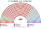
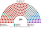
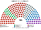

# 估計結果

> 中國沒有自由競爭的全國選舉與政黨民調，本檔以意識形態帶的**假設分布**估計席次、組閣與朝野互動：§1 近期大選（無）、§2 假設分布、§3 長期推估、§4 朝野互動。席次圖見 [`席次圖.md`](席次圖.md)。中國目前沒有其他功能完善的政黨，所以用意識形態帶而非政黨表示。

選制摘要：全院 **450＝單一 260（top-3 孔多賽）＋複數 190（彈性名單、聖拉古、無門檻、M∈[8,14]）**。詳 [`01`](01-全國議會與選制.md)。對應表允許席次以**意識形態**而非政黨表示。

## 計算方式

| 層 | 做法 |
|---|---|
| 民意層 | 沒有自由競爭的全國選舉與政黨民調；以六個意識形態帶的**假設分布**代替（社會保障、環境與民生、發展優先、技術官僚中間、市場改革、地方分權） |
| 參選方層 | 以意識形態帶為參選單位，不假設現有政黨 |
| 單一 260 | 依假設分布與區域差異估計，前 3 名孔多賽（示意，沒有程式） |
| 複數 190 | 彈性名單、聖拉古、無門檻、每區 8–14 席 |
| 首長、組閣 | 全院 450 記名排名，孔多賽；組閣由首長往外依意識形態距離加帶到過半 |

程式：[`15-預期政治生態.md`](15-預期政治生態.md)；細節見 共同算法 [`選舉結果計算方式`](../../../notes/算法/選舉結果計算方式.md)。

## 1 近期大選

**跳過／無。** 本夾所設民選制下，沒有可套用的近期自由全國大選得票；亦不另造重算檔。

## 2 民調

**無本機民調檔**（無 `polls.csv`／全國投票意向表）。對應表允許以意識形態分布表示；下列為**意識形態分布假設**（量級與 [`15-預期政治生態.md`](15-預期政治生態.md) 第 4 屆示意一致），非正式民調套用。

| 光譜帶 | 假設支持度（示意） | 單一 260 | 複數 190 | **全院 450** |
|---|--:|--:|--:|--:|
| 社會保障 | 16% | 40 | 34 | **74** |
| 環境與民生 | 6% | 6 | 21 | **27** |
| 發展優先 | 37% | 118 | 50 | **168** |
| 技術官僚中間 | 18% | 48 | 34 | **82** |
| 市場改革 | 14% | 30 | 31 | **61** |
| 地方分權 | 9% | 18 | 20 | **38** |
| **計** | **100%** | **260** | **190** | **450** |

**組閣聯盟／多數派政府**：首長／供給由全院選出——發展優先 168＜226；發展優先＋技術官僚中間＝**250** 過。

發展優先全院 168，不過首長／供給／建設性更新門檻 **226**；加技術官僚中間 82＝250 過。單一過半 **131**、複數過半 **96** 僅作組成參考，不決定政府。

## 3 長期運行假設下

示意 **第 4 屆**（假設見 [`15-預期政治生態.md`](15-預期政治生態.md)）。

| 光譜帶 | 單一 260 | 複數 190 | 全院 450 |
|---|--:|--:|--:|
| 社會保障 | 40 | 34 | **74** |
| 環境與民生 | 6 | 21 | **27** |
| 發展優先 | 118 | 50 | **168** |
| 技術官僚中間 | 48 | 34 | **82** |
| 市場改革 | 30 | 31 | **61** |
| 地方分權 | 18 | 20 | **38** |
| **計** | **260** | **190** | **450** |

**組閣聯盟／多數派政府**：執政／供給多數發展優先＋技術官僚中間＝**250**（門檻 226）；基本法／修憲提案要全院 ≥270——最大帶單獨不成。

發展優先＋技術官僚中間＝250（過 226）；不含發展優先的四帶組合亦可湊 255。基本法／修憲提案要全院 ≥270，最大帶單獨不成。

朝野互動與候選人行為見 [`15-預期政治生態.md`](15-預期政治生態.md)。

## 4 朝野互動

| 情境 | 政府 | 在野 | 互動 |
|---|---|---|---|
| 假設分布（第 4 屆） | 發展優先＋技術官僚中間 250 | 社會保障 74、市場改革 61、地方分權 38、環境與民生 27 | 最大帶 168 單獨不過 226，必須和居中的技術官僚帶組閣；在野四帶也可湊 255，所以執政聯盟要照顧居中帶的政策，否則建設性更新就成立。基本法與修憲要 270，最大帶加任一帶都還要第三帶 |

誘因、候選人行為與檢視見 [`15-預期政治生態.md`](15-預期政治生態.md)。
