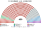
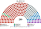
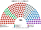

# 席次圖

`0-基本/總體.md` 要求：給仿維基百科的議會席次圖（如：單一席次、複數席次圖；有政黨、派系或意識形態議員的圓點顏色為所屬的代表色）。對應表允許以**意識形態**表示議會分布；本夾用六個意識形態帶。兩個組成，所以三張：全院、單一、複數。

數字來自 [`15`](15-預期政治生態.md) 第 3 屆，由 [`生態模型.py`](生態模型.py) 算出。產生器：席次圖產生器。

## 全院 450（加總）

社會保障 38、環境與民生 19、**發展優先 269**、技術官僚中間 74、市場改革 30、地方分權 20。過半 **226**、3/5 **270**、2/3 **300**。

發展優先單獨過全院過半，離 3/5 只差 1 席——所以基本法與修憲另要複數席次那一張過門檻。

## 單一席次 260

單一席次是向心誘因的來源；政府由全院產生（[`02`](02-政府組成與建設性更新.md)）。

社會保障 1、環境與民生 1、**發展優先 211**、技術官僚中間 46、市場改革 1。

33% 的第一偏好變成 81% 的單一席次：它在多數區對每一個對手都贏（[`15`](15-預期政治生態.md) §2.4）。

## 複數席次 190

社會保障 37、環境與民生 18、發展優先 58、技術官僚中間 28、市場改革 29、地方分權 20。3/5 **114**、2/3 **127**。

六帶都在。基本法與修憲要在這一張也過 3/5（[`05`](05-法律與法規位階.md) §2.3）：發展優先 58 要再加兩帶。

## 顏色

各帶代表色。座位由左至右依 [`15`](15-預期政治生態.md) §2.1 的光譜排列。
