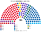
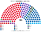
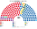
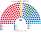
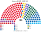
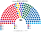
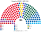

# 估計結果

> 圖庫 [`席次圖.md`](席次圖.md)；算法 [`14`](14-近期大選重算.md)、[`生態模型.py`](生態模型.py)。

選制：**180＝單一 106＋複數 70＋北大西洋 4**。並立；**不是**比例拆單一、**不是** 135＋40 補償。

## 1 近期大選

單位：**投票所**（DST afstemningsområde，2026 年 1,314 個、2022 年 1,347 個、2019 年 1,384 個），依所屬提名區排序後連續切成 106 個單一區。

| | 實際（本土 175＋北大西洋） | **本夾全院 180** | 首長 |
|---|---|---|---|
| 2026-03 | S 38、SF 20、V 18、DF 16、LA 16、M 14… | **S 64**、V 48、SF 11、M 20、C 8… | **S**（S＋M＋SF＝95） |
| 2022-11 | S 50、V 23、M 16…；S＋V＋M 執政 | **S 76**、V 39、M 25、DD 8、EL 5、LA 7… | **S**（S＋M＝101） |
| 2019-06 | S 48、V 43、DF 16… | **S 78**、V 61、EL 6、RV 7… | **S**（S＋SF＋EL＝95） |

### 2026 單一／複數

| 政黨 | 單一 106 | 複數 70 | 北大西洋映射 | **全院 180** |
|---|--:|--:|--:|--:|
| S | 46 | 17 | 1 | **64** |
| V | 40 | 7 | 1 | **48** |
| SF | 4 | 7 | 0 | **11** |
| M | 14 | 5 | 1 | **20** |
| C | 2 | 6 | 0 | **8** |
| DF | 0 | 7 | 0 | **7** |
| LA | 0 | 7 | 0 | **7** |
| DD | 0 | 5 | 0 | **5** |
| EL | 0 | 4 | 1 | **5** |
| RV | 0 | 4 | 0 | **4** |
| ALT | 0 | 1 | 0 | **1** |

**組閣聯盟／多數派政府**：首長 **S**；**S＋M＋SF＝95**（S＋M 84 不過半）。

### 2022 單一／複數

| 政黨 | 單一 106 | 複數 70 | 北大西洋映射 | **全院 180** |
|---|--:|--:|--:|--:|
| S | 54 | 20 | 2 | **76** |
| V | 29 | 9 | 1 | **39** |
| M | 19 | 6 | 0 | **25** |
| DD | 0 | 8 | 0 | **8** |
| EL | 0 | 4 | 1 | **5** |
| LA | 0 | 7 | 0 | **7** |
| SF | 2 | 6 | 0 | **8** |
| C | 1 | 4 | 0 | **5** |
| NB | 0 | 3 | 0 | **3** |
| ALT | 1 | 1 | 0 | **2** |
| RV | 0 | 2 | 0 | **2** |

**組閣聯盟／多數派政府**：首長 **S**；**S＋M＝101**。

### 2019 單一／複數

| 政黨 | 單一 106 | 複數 70 | 北大西洋映射 | **全院 180** |
|---|--:|--:|--:|--:|
| S | 57 | 19 | 2 | **78** |
| V | 42 | 18 | 1 | **61** |
| EL | 0 | 5 | 1 | **6** |
| RV | 1 | 6 | 0 | **7** |
| C | 1 | 5 | 0 | **6** |
| DF | 0 | 6 | 0 | **6** |
| SF | 5 | 6 | 0 | **11** |
| ALT | 0 | 2 | 0 | **2** |
| KD | 0 | 1 | 0 | **1** |
| LA | 0 | 1 | 0 | **1** |
| NB | 0 | 1 | 0 | **1** |

**組閣聯盟／多數派政府**：首長 **S**；**S＋SF＋EL＝95**。

**與舊版（92 提名區）比較**：提名區平均 3.8 萬票，切 106 區時要把整區對半拆；改用投票所後切線落在真實的票倉邊界。首長三屆都仍是 S；S 少 3–6 席、V 多 2–5 席，2022 年 EL 在哥本哈根拿到 2 個單一席。

## 2 民調

**方法**：[`民調推估.py`](民調推估.py)。來源 [`資料/polls.csv`](資料/polls.csv)（各家民調的**現行制度席次**推估；丹麥現行為全國補償比例，席次比≈得票比）。本土 175 席換算成全國份額，再以 **2026-03 投票所地理**縮放（每黨在每個投票所的票 × 目標份額／2026 份額），跑本夾的單一 106 top-3 孔多賽與複數 70 聖拉古；北大西洋 4 席照列。

| | 現行制度席次 | **本夾全院 180** | 單一 106 | 首長 | 組閣 |
|---|---|---|---|---|---|
| Voxmeter（2026-10-05..11） | S 36、DF 23、SF 20、C 17、LA 17、DD 14、V 13 … | S 68、V 39、C 21、SF 11、DF 9、M 9、LA 7、DD 6、EL 5、RV 4、ALT 1 | S 53、V 32、C 14、M 4、SF 3 | **S** | S＋M＋SF＋EL＝93 |
| Epinion（2026-09-29..10-06） | S 38、DF 23、SF 19、C 18、LA 17 … | S 77、V 27、C 26、SF 11、DF 9、LA 8、EL 6、M 6、DD 5、RV 4、ALT 1 | S 61、V 21、C 19、SF 4、M 1 | **S** | S＋M＋SF＝94 |
| Verian（2026-09-23..29） | S 38、DF 24、SF 18、C 17、LA 17 … | S 59、V 46、C 26、DF 9、M 9、SF 9、LA 7、EL 6、DD 5、RV 4 | S 42、V 39、C 19、M 4、SF 2 | **M** | M＋S＋V＝114 |
| Megafon（2026-09-07..10） | S 34、DF 24、C 19、LA 18、SF 17 … | S 66、C 34、V 27、SF 11、DF 10、LA 8、DD 6、EL 6、M 6、RV 5、ALT 1 | S 52、C 27、V 21、SF 4、M 1、RV 1 | **S** | S＋M＋SF＋EL＋RV＝94 |

**讀法**：

- **S 是三份民調下的單一席次最大黨（42–61 席）**：社民黨在左右兩塊之間，左派與右派選民常把它排在對方陣營前；但新制誘因下相鄰政黨（V 與 C、M 等）的共同提名讓右派在部分選區擠進前三，S 的單一席次比不整合時少。現行制度下 S 只有 34–38 席。
- **右派的成長（DF 23–24、C 17–19）多半落在名單層**：DF 單一只有 0–3。
- **首長**：Voxmeter、Epinion、Megafon 是 S（組閣 93–94，要拉 M、SF 等）；**Verian 是 M**（中間的 M 對 S 92:88、對 V 87:93 之外全勝，組閣 M＋S＋V＝114）。
- Borgernes Parti 在各民調中 0 席，本夾也是 0。

## 3 長期運行假設下

第 3 屆：2022 投票所地理＋翼側略軟、中位略升（誘因假設，見 [`12`](12-預期政治生態.md)）。

| 政黨 | 全院 |
|---|--:|
| S | **79** |
| M | **37** |
| V | 30 |
| LA | 7 |
| SF | 7 |
| C／DD | 各 5 |
| EL | 3 |
| ALT／RV | 各 3 |
| NB | 1 |

首長 **S**；組閣聯盟／多數派政府 **S＋M＝116**。
