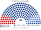

# 席次圖

`0-基本/總體.md` 要求：給仿維基百科的議會席次圖（如：單一席次、複數席次圖；有政黨／派系議員的圓點顏色為所屬政黨／派系的代表色）。本夾兩個組成都有，所以三張：全院、單一、複數。

數字來自 [`16`](16-預期政治生態.md) 第 3 屆，由 [`生態模型.py`](生態模型.py) 算出。產生器：席次圖產生器。

## 全院 300（加總）

統一俄羅斯 205（領土經營派 139、名單協調派 66）、俄羅斯聯邦共產黨 55、俄羅斯自由民主黨 20、公正俄羅斯 10、新人 10。過半 **151**、3/5 **180**、2/3 **200**。

統一俄羅斯單獨過全院 2/3——這張圖看不出它改不了規則，要看複數那一張。

## 單一席次 180

單一席次是向心誘因的來源。任內調整的杜馬那一把與未覆蓋部分由全院 ≥151 表決（[`03`](03-行政權預算.md) §2.5）。

統一俄羅斯 141（領土經營派 120、名單協調派 21）、俄羅斯聯邦共產黨 29、俄羅斯自由民主黨 10。

48% 的區域第一偏好變成 78% 的單一席次：勝者全拿的放大。

## 複數席次 120

統一俄羅斯 64（名單協調派 45、領土經營派 19）、俄羅斯聯邦共產黨 26、俄羅斯自由民主黨 10、公正俄羅斯 10、新人 10。3/5 **72**、2/3 **80**。

基本法與修憲要在這一張也過門檻（[`05`](05-法律基本法與修憲.md) §2.3）：統一俄羅斯要基本法得再拉一個黨，要急迫修憲得再拉兩個。

## 顏色

統一俄羅斯按派系分色（母黨色的變體）。座位由左至右依政治光譜排列。
