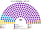
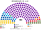

# 近期大選重算

> **這檔是什麼**：近期大選得票**怎麼**套進本夾選制（方法、假設、對照）。席次一覽與圖見 [`估計結果.md`](估計結果.md) §1、[`席次圖.md`](席次圖.md)。

**問題**：如果上兩次大選的選民照原本的偏好投票，在本夾的制度下會選出什麼樣的議會和政府？

**方法**：[`生態模型.py`](生態模型.py)。以各黨實際全國得票為第一偏好；偏好排序、區域偏移、族群集中選區都是假設（[`12`](12-預期政治生態.md) §2）。**不模擬政黨在新制下的重組與策略調整**，所以這是「同樣的民意、不同的規則」，不是預測。

## 計算方式

民意層＝各黨全國得票＋模型區域偏移（不用現行當選結果）；參選方層＝`finals_for`；單一 top-3、複數 7 區聖拉古。總說明見 [`選舉結果計算方式`](../../../notes/算法/選舉結果計算方式.md)。

## 1 一覽

| | **2026-04 大選** | **2024-10 大選** |
|---|---|---|
| 實際結果（240 席，4% 門檻） | 進步保加利亞 131、GERB 39、PP–DB 37、DPS 21、復興 12 | GERB 66、PP–DB 36、復興 33、DPS–新開始 29、社會黨 19、APS 19、ITN 17、MECh 11、Velichie 10（初步；後經憲法法院改判） |
| 實際組閣 | 進步保加利亞單獨過半，由該黨組閣 | 約 3 個月後由 GERB 的 Zhelyazkov 組成 GERB、社會黨、ITN 的聯合政府；2025-12 因預算抗議下台 → 看守內閣 → 2026-04 重選 |
| **新制全院 180** | 進步保加利亞 140、GERB 12、PP–DB 10、DPS 8、復興 3、Velichie 2、MECh 2、社會黨 2、APS 1 | GERB 55、ITN 51、社會黨 24、DPS 12、PP–DB 11、復興 10、APS 8、Velichie 3、MECh 6 |
| 新制首長 | **進步保加利亞**（最弱一場對社會黨 157:23） | **ITN**（孔多賽贏家，最弱一場對 GERB 113:67） |
| 新制組閣時間 | 第一輪排名投票即選出 | **≤30 日**（ITN 不過半，但對每個對手都過 91） |
| 勝者單獨改得了規則嗎 | **全院過 2/3（140），但複數只有 41／80 < 48，改不了** | 否（全院 87、複數 21） |

## 2 2024-10：居中小黨拿單一席次

這一節是 **2024-10** 的全國得票套模型，不是 2026。2026 的席次表在 [`估計結果.md`](估計結果.md)。

| 政黨系 | 得票% | 實際 240 | 實際占比 | 單一 100 | 複數 80 | **新制 180** | 新制占比 |
|---|--:|--:|--:|--:|--:|--:|--:|
| GERB | 25.5 | 66 | 27.5% | 34 | 21 | **55** | 30.6% |
| ITN | 6.6 | 17 | 7.1% | 44 | 7 | **51** | 28.3% |
| 社會黨 | 7.3 | 19 | 7.9% | 17 | 7 | **24** | 13.3% |
| DPS–新開始 | 11.1 | 29 | 12.1% | 2 | 10 | 12 | 6.7% |
| PP–DB | 13.8 | 36 | 15.0% | 0 | 11 | 11 | 6.1% |
| 復興 | 12.9 | 33 | 13.8% | 0 | 10 | 10 | 5.6% |
| APS | 7.2 | 19 | 7.9% | 1 | 7 | 8 | 4.4% |
| MECh | 4.5 | 11 | 4.6% | 2 | 4 | 6 | 3.3% |
| Velichie | 3.9 | 10 | 4.2% | 0 | 3 | 3 | 1.7% |

- **贏家是居中的小黨與中間偏右的建制黨**。ITN 和社會黨在多數選區是「大家都能接受的第二偏好」；新制誘因下相鄰政黨在 ITN 或社會黨排不進前三的選區共同提名（[參選方層](../../../notes/算法/選舉結果計算方式.md)），ITN 單一 44 超過 GERB 34。GERB 在地緣軸上居中（介於 PP–DB 與復興之間），在它擠進前三、對手分散的選區勝出。
- **輸家是兩端**：PP–DB（親西方＋反寡頭）、復興（親俄）在單一選區 0 席；**DPS–新開始只在卡爾賈利贏**——DPS–新開端的黨魁是全國最不受歡迎的政治人物，其他選民一律把他排最後。
- **APS 贏拉兹格勒**：在族群選區裡，DPS 的原派系（APS）比 DPS–新開端更能拿到保加利亞族選民的第二偏好。

**組閣**：沒有一黨過半。記名排名投票中 **ITN 是孔多賽贏家**（對 GERB 113:67，對其他每一黨都過 140），第一輪就有 ≥91 人把它排在「維持空缺」之上。可能的多數：ITN＋GERB（106）或 ITN＋社會黨＋DPS＋……；**首長來自 ITN、GERB 是最大夥伴**，和實際「GERB 首長、ITN 與社會黨入閣」的組合相同，但主從顛倒，時間從約 3 個月縮到 30 日以內。

**2025-12 的預算危機在新制下**：預算送出 20 個開會日內，反對者要以 91 票推出一個繼任首長，否則預算生效。以這個議會的組成，ITN＋GERB 以外的各黨（社會黨、PP–DB、復興、DPS、APS、MECh、Velichie 合計 74）湊不到 91。**政府不會因為預算而倒，也不會有第 8 次大選。**

## 4 兩次合起來看

| 問題 | 2026-04 | 2024-10 |
|---|---|---|
| 新制會不會讓政府更快出現 | 一樣快 | **會**：約 3 個月 → ≤30 日 |
| 會不會減少選舉 | — | **會**：無解散、無預算倒閣，2026-04 那次重選不會發生 |
| 會不會放大第一大黨 | **會（54.6% → 77.8%）** | 會（27.5% → 48.3%），但仍要夥伴 |
| 誰被擠掉 | 除進步保加利亞外所有黨的單一席次 | PP–DB、復興、DPS–新開始的單一席次 |
| 規則是否需要跨黨 | 是 | 是 |

★ **兩次重算支持本夾的核心主張**（組得出政府、預算過得了、規則要跨黨），**也暴露它最大的代價**（單一席次的贏者全拿）。後者在 [`12`](12-預期政治生態.md) §5 與 [`13`](13-完善與自洽.md) 處理。

## 5 2024-10 的敏感度：若選民或政黨調整（不是主線）

§2 是機械重算（同樣的偏好位置）。新制下各黨與選民會調整，下表是幾個可能的方向（模型以改位置重跑）：

| 情境 | 單一 100 | 全院 180 | 首長 |
|---|---|---|---|
| A 機械重算＋參選方層（主線） | ITN 44、GERB 34、社會黨 17 | GERB 55、ITN 51、社會黨 24 | **ITN** |
| B 選民把 GERB 看成寡頭網絡一員（與 DPS–新開端綁在一起） | GERB 53、社會黨 20、ITN 17、PP–DB 3 | GERB 74、社會黨 27、ITN 24、PP–DB 14 | **ITN** |
| C＝B＋PP–DB 淡化親西方 | GERB 42、社會黨 20、ITN 17、PP–DB 10 | GERB 63、社會黨 27、ITN 24、PP–DB 21 | **ITN** |
| D＝C＋復興淡化親俄 | GERB 29、復興 26、社會黨 20、ITN 17 | GERB 50、復興 36、社會黨 27、ITN 24 | **ITN** |
| E＝B＋ITN 崩到 3% | GERB 58、社會黨 19、Velichie 7、MECh 5 | GERB 79、社會黨 26 | GERB |

**§6 的走向以 A（當時實際民意）為準**。B–E 是 2026-11-10 前、未加參選方層的舊算（手動改位置，沒有可重跑的程式），只當方向參考；它們說明：若選民把 GERB 和 DPS–新開端綁在一起看（B–D），2024 年的孔多賽贏家會變成 ITN，GERB 只能當最大夥伴。

## 6 若從 2024-10 起就用新制：政治走向（民意照當時實際）

前提：新憲法在 2024-10 大選前已生效。**每個時點的民意都用當時的實際情況**：2024-10 用該次得票（§2 機械重算，不套 §5 的策略情境）；2025 年底的抗議照實際發生；2026 年用 2026-04 大選所顯示的民意（進步保加利亞約 44%，投票率約 51%）。

| 時間 | 實際 | **新制下** | 機制 |
|---|---|---|---|
| 2024-10 大選 | GERB 66／240 | GERB 55、**ITN 51**、社會黨 24、DPS 12、PP–DB 11、復興 10、APS 8、MECh 6、Velichie 3（／180） | §3 |
| 組閣 | 約 3 個月 | **30 日內，ITN 首長**（孔多賽贏家，最弱一場對 GERB 113:67）；ITN＋GERB 106 席，可再加社會黨（130）。DPS 的 12 席不是必要拼圖 | 30 日＋預設值 |
| 2025 年 | 延長法、入歐元區準備 | 供給自動生效、不需延長法；入歐元區照常 | [`03`](03-預算與供給.md) |
| 2025-12 抗議、首長辭職 | 看守內閣 → 解散 → 2026-04 重選 | **議會 30 日內選出新首長**：同一批議員，孔多賽贏家仍是 ITN → 換一個 ITN 系首長；有爭議的加稅需要 91 票，撤回 | [`02`](02-政府組成與建設性更新.md) §2.5 |
| 2026-01 | 時任總統辭職、組成進步保加利亞 | 同（照實際）；副總統 Iotova 繼任 | — |
| 2026 年春夏 | 2026-04 大選，進步保加利亞 131／240 | **沒有大選；進步保加利亞改走「議員更新」**：逐區連署（單一選區 10%、複數選區 8%），對現任議員發動替代現狀投票 | [`09`](09-人選更新.md) |
| 更新結果（模型） | — | 更新投票率 **≥40%**：單一選區 **96／100 換成進步保加利亞**（2026-11-10 前、未加參選方層的舊算；參選方層下現任改為 ITN 44、GERB 34、社會黨 17，此節未重算，方向不變）；投票率 **30%**：只換 1 席（25% 地板擋住） | 見下表 |
| 2026 年中後 | 進步保加利亞 2026-05 組閣 | 若更新成功：進步保加利亞單一約 96＋複數（7 區重選後）約 41 ＝ **約 137**，以**建設性更新**讓進步保加利亞的人選就任首長。**終點和實際相同，路徑不同**：逐區投票、約晚 2–4 個月、沒有看守期 | 建設性更新 ≥91 |
| 規則 | — | 複數 41／80 < 48，**改不了選制、司法** | 兩種多數 |
| 2026-10 總統選舉 | 照常 | 照常（top-3 孔多賽）；勝者權力只剩四項 | [`04`](04-總統.md) |
| 2028-10 | — | 固定大選 | — |

### 6.1 更新投票的模型結果（2024 年的議員 vs 2026 年的民意）

| 更新投票率 | 被換掉的單一席次 | 換成誰 |
|:--:|:--:|---|
| 30% | 1 | 進步保加利亞 1 |
| 40% | 96 | 進步保加利亞 96（舊算：原 GERB 64、社會黨 16、ITN 11、其他 5） |
| 50% | 100 | 進步保加利亞 100 |

**地板是關鍵**：挑戰者與「維持現狀」對決時的支持票要達選舉人 25%。進步保加利亞的挑戰者在幾乎每一區都能拿到投票者的七、八成（除了 GERB 與 DPS 的選民，大家都偏好它勝過 GERB 現任），所以**投票率約 32–35% 以上就過地板**。2026-04 的實際投票率是 51%，浪潮期的動員足夠。

### 6.2 這說明了什麼

- **固定任期擋不住真正的浪潮**：更新機制讓浪潮以「逐區換人」的方式進入議會，效果接近提前大選，但要先過連署與 25% 地板——**擋得住小規模的不滿，擋不住 44% 的浪潮**。
- **差別在路徑**：沒有看守內閣、沒有總統挑選的過渡政府；國家任何時刻都有議會選出的首長與生效的預算。
- **差別在規則**：浪潮拿得到政府，拿不到選制與司法（比例層 41 < 48）。

★ 這也是本夾的一個未明寫處：**更新投票的日期**。若每區各自擇日，2026 年會變成上百場零散的投票；合理的補法是**每季一個共同更新日**（[`09`](09-人選更新.md) 待補）。

## 6.3 反事實：新制本身會不會改變 2026 年的民意

§6 假設 2026 年民意與實際相同（進步保加利亞 44%、投票率 51%）。但實際的浪潮有一部分是**舊制度造成的**，新制下會變小：

| 2026 浪潮的實際成因 | 新制下 | 對進步保加利亞 |
|---|---|---|
| 選舉疲勞（8 次大選） | 2024 後無提前大選 | ↓ |
| 「DPS–新開端的國家」：DPS 29 席撐政府 | DPS 12 席，不是組閣必要拼圖 | ↓ 抗議少了最大燃料 |
| 看守內閣成為總統的舞台 | 無看守、總統無組閣角色 | ↓ |
| 2025-12 預算加稅抗議 | 稅制要 91，在抗議下撤回 | ↓ 小幅 |
| 伊朗戰爭、油價、入歐元區的物價疑慮 | 制度管不到 | **↑ 照樣打擊執政黨** |
| 進步保加利亞黨魁的個人聲望 | 不變 | 底盤還在 |

**判斷**：2026 年民意約為進步保加利亞 24–30%、GERB 20–23%（不像實際跌到 13%）、PP–DB 約 15%、復興約 8%。

**模型：此民意下的逐區更新**（2024 年選出的現任 vs 2026 年民意）

| 2026 民意 | 更新投票率 35% | 40% | 45% |
|---|---|---|---|
| 進步保加利亞 30% | 換 14 席 | 換 81 席 | 換 95 席 |
| 進步保加利亞 24% | 換 4 席 | 換 60 席 | 換 88 席 |

怒氣較小時，更新投票率估約 35%，只換 10–20 席；執政聯盟仍過半，反對陣營湊不到 91。

**走向**：ITN 為首、GERB 為最大夥伴、與 DPS–新開端保持距離的聯合政府做到 **2028-10 固定大選**；進步保加利亞那時以約 25–30% 第一偏好拿下單一約 98／100、全院約 120，單獨組閣，複數約 22–26／80，改不了規則。

**評價**：
- **有幫助**：多 2 年穩定政府與正常預算；DPS–新開端失去槓桿；進步保加利亞晚兩年、以較低得票在固定大選上台，不是乘危機浪潮。
- **沒改變**：終點仍是進步保加利亞執政；貪腐與生活成本的根本問題不變。
- **設計警訊**：居中政黨＋更新機制威力很大——投票率 40% 時，24% 民意就能逐區換掉 60 席，煞車只有 25% 地板。**更新地板是否該提高，是待決的設計點。**

## 7 限制

- **沒有逐區票檔。** 第一偏好是寫在 [`生態模型.py`](生態模型.py) `SCENARIOS` 的全國得票％，區域差異是 `OFFSET`／族群倍數，不是中央選舉委員會的選區或投票所結果。`資料/` 裡只有 `polls.csv`。
- 偏好空間、選民類型、區域偏移、族群集中倍數都是假設，模型可重跑。
- **不模擬策略反應**：在新制下，PP–DB 與 GERB 可能協調只派一人進前 3，復興可能淡化親俄立場以進入第二偏好；這些都會改變單一席次。
- 2024-10 的實際席次是憲法法院改判前的初步結果。
- 「其他」與「都不支持」的選票未分配到具體政黨。
