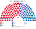

# 估計結果

> 圖庫 [`席次圖.md`](席次圖.md)；算法 [`14`](14-近期大選重算.md)、[`生態模型.py`](生態模型.py)。

選制：**180＝單一 106＋複數 70＋北約 4**。並立；**不是**比例拆單一、**不是** 135＋40 補償。

## 1 近期大選

| | 實際（本土 175＋北約） | **本夾全院 180** | 首長 |
|---|---|---|---|
| 2022-11 | S 50、V 23、M 16…；S＋V＋M 執政 | **S 85**、V 35、M 20、DD 8、SF 8、LA 7… | **S**（S＋M＝105） |
| 2019-06 | S 48、V 43、DF 16… | **S 86**、V 56、RV 8、SF 7… | **S**（S＋SF＝93） |

### 2022 單一／複數

| 政黨 | 單一 | 複數 | 北約映射 | 全院 |
|---|--:|--:|--:|--:|
| S | 63 | 20 | 2 | **85** |
| V | 25 | 9 | 1 | **35** |
| M | 14 | 6 | 0 | **20** |
| DD | 0 | 8 | 0 | **8** |
| SF | 2 | 6 | 0 | **8** |
| LA | 0 | 7 | 0 | **7** |
| C | 2 | 4 | 0 | **6** |
| EL | 0 | 4 | 1 | **5** |
| NB | 0 | 3 | 0 | **3** |
| RV | 0 | 2 | 0 | **2** |
| ALT | 0 | 1 | 0 | **1** |

**組閣聯盟／多數派政府**：首長 **S**；**S＋M＝105**。

### 2019 單一／複數

| 政黨 | 單一 | 複數 | 北約映射 | 全院 |
|---|--:|--:|--:|--:|
| S | 65 | 19 | 2 | **86** |
| V | 37 | 18 | 1 | **56** |
| RV | 2 | 6 | 0 | **8** |
| SF | 1 | 6 | 0 | **7** |
| C | 1 | 5 | 0 | **6** |
| DF | 0 | 6 | 0 | **6** |
| EL | 0 | 5 | 1 | **6** |
| ALT | 0 | 2 | 0 | **2** |
| KD／LA／NB | 0 | 各 1 | 0 | **各 1** |

**組閣聯盟／多數派政府**：首長 **S**；**S＋SF＝93**。

## 2 民調

（開夾時未嵌特定民調；有 Voxmeter／Epinion 全國份額時：以 2022 opstilling 地理縮放後真套兩層——方法句同 §1。）

## 3 長期運行假設下

第 3 屆：2022 opstilling 地理＋翼側略軟、中位略升（誘因假設，見 [`12`](12-預期政治生態.md)）。

| 政黨 | 全院 |
|---|--:|
| S | **85** |
| M | **34** |
| V | 27 |
| LA／SF | 各 7 |
| C | 6 |
| DD | 5 |
| EL | 4 |
| RV | 3 |
| ALT／NB | 各 1 |

首長 **S**；組閣聯盟／多數派政府 **S＋M＝119**。
