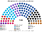

# 預期政治生態

> **席次估計**見 [`估計結果.md`](估計結果.md)（主閱讀頁）。本檔專注誘因、朝野互動與候選人行為；不重複貼完整席次表。算法見 [`14`](14-近期大選重算.md)；圖庫見 [`席次圖.md`](席次圖.md)。

`0-基本/總體.md`：給長期運行下的預期政治生態（朝野互動、候選人行為、各政黨／派系席次、仿維基席次圖），要有論據，可大膽假設。
`0-基本/要求.md` **硬性**：不得把提示詞要求直接當預期生態；不合期望就回頭改設計。

路徑：**誘因 → 得票 → 選制 → 席次 → 朝野互動 → 檢視**。席次由 [`生態模型.py`](生態模型.py) 算出（`python 生態模型.py --projection`）。

## 1 誘因

| 層 | 誘因 | 預期行為 |
|---|---|---|
| 單一席次（top-3 孔多賽） | 第三名支持者的第二偏好決定勝負 | 候選人爭取對手陣營的第二偏好；「我們永遠不和 X 坐在一起」變貴 |
| 複數席次（彈性名單） | 個人票達 Droop 25% 才躍升 | 初選的「拉黨員」報酬下降；名單的前段仍由黨決定 |
| 組閣（30 日＋預設值） | 拖延＝交給票面算術 | 不再有「拖到重選」的選項 |
| 建設性更新 | 倒閣＝**投票支持一個具名的對手** | 小黨的威脅從「拆政府」變成「扶對手上台」，可信度大降 |
| 供給自動生效 | 拒絕預算＝換政府 | 聯盟資金不能拿預算當人質 |
| 無解散 | 選舉日不是武器 | — |

## 2 假設

### 2.1 偏好空間

四條軸：**安全**（鴿 −1 … 鷹 +1）、**宗教**（世俗 −1 … 宗教 +1）、**人物**（反 Netanyahu −1 … 挺 +1）、**阿拉伯政黨**（1／0）。位置是假設，改了就重跑。

| 政黨 | 安全 | 宗教 | 人物 | 阿拉伯 |
|---|:--:|:--:|:--:|:--:|
| 利庫德 | 0.6 | 0.2 | 1.0 | 0 |
| 宗教錫安 | 1.0 | 0.7 | 0.8 | 0 |
| 沙斯 | 0.5 | 0.8 | 0.9 | 0 |
| 聖經猶太 | 0.4 | 1.0 | 0.9 | 0 |
| 我們的家 | 0.6 | −0.8 | −0.7 | 0 |
| 國家團結 | 0.2 | −0.2 | −0.8 | 0 |
| 未來黨 | −0.1 | −0.7 | −1.0 | 0 |
| 民主黨（工黨＋梅雷茲） | −0.6 | −0.7 | −1.0 | 0 |
| 拉姆 | −0.5 | 0.6 | −0.3 | 1 |
| 哈達什–塔阿勒 | −0.9 | −0.4 | −1.0 | 1 |
| 巴拉德 | −1.0 | −0.2 | −1.0 | 1 |

選民三型：重安全 35%、重宗教 30%、重人物 35%；阿拉伯軸權重 2.0（猶太選民普遍把阿拉伯政黨排後，反之亦然）。

### 2.2 地理

得票來自中央選舉委員會的**逐票匭**結果（約 1.25 萬個票匭），彙整成約 1,380 個單位：小鎮一個單位，大城市依票匭序切成約 2 萬選舉人一塊。單一選區在各區內**沿城鎮座標的希爾伯特曲線**連續切出（座標＝教育部學校座標的中位數），所以選區大致連續，阿拉伯城鎮、極端正統派城市、屯墾區各自成塊。

### 2.3 屆次

**推估第 3 屆**＝2022 年的地理與得票，加上已發生的工黨＋梅雷茲合併（民主黨）。不另外假設政黨崛起或崩盤；以色列的政黨版圖每屆都變，**本檔看的是規則的效果，不是猜下一個新黨**。2026-10-27 逐票匭套本夾見 [`估計結果.md`](估計結果.md) §1／[`14`](14-近期大選重算.md) §2。

## 3 席次（推估第 3 屆）

| 政黨 | 單一 70 | 複數 50 | **全院 120** | 現行 2022 |
|---|--:|--:|--:|--:|
| 利庫德 | 23 | 11 | **34** | 32 |
| 未來黨 | 13 | 9 | **22** | 24 |
| 沙斯 | 12 | 5 | **17** | 11 |
| 國家團結 | 10 | 5 | **15** | 12 |
| 宗教錫安 | 1 | 6 | **7** | 14 |
| 哈達什–塔阿勒 | 5 | 2 | **7** | 5 |
| 聖經猶太 | 3 | 3 | **6** | 7 |
| 民主黨 | 1 | 5 | **6** | 4（工黨；梅雷茲 0） |
| 巴拉德 | 2 | 1 | **3** | 0 |
| 拉姆 | 0 | 2 | **2** | 5 |
| 我們的家 | 0 | 1 | **1** | 6 |

門檻：過半 61、3/5 72、2/3 80；複數 3/5 30、2/3 34。

| 區（單一席次數） | 單一席次 |
|---|---|
| 北部（11） | 哈達什–塔阿勒 5、未來黨 2、利庫德 2、民主黨 1、沙斯 1 |
| 海法－夏隆（13） | 國家團結 5、利庫德 4、未來黨 2、巴拉德 2 |
| 中部（14） | 利庫德 7、國家團結 4、未來黨 2、沙斯 1 |
| 特拉維夫（13） | 未來黨 7、利庫德 3、沙斯 2、國家團結 1 |
| 耶路撒冷－南部（19） | 沙斯 8、利庫德 7、聖經猶太 3、宗教錫安 1 |

- **最常見的決選三人**：利庫德／未來黨／國家團結（11 區）。在這組裡**國家團結常是孔多賽贏家**：利庫德選民寧可要國家團結也不要未來黨，未來黨選民寧可要國家團結也不要利庫德。
- **沒有一區的當選者第一偏好過半**；當選者第一偏好的中位數約 25%。這是 top-3 孔多賽在多黨國家的常態：**贏的人是「大家都還能接受」的那個**。
- **宗教錫安單一只有 1 席**（現行 14 席多半來自全國名單）：它在三人對決裡很少是別人的第二偏好。
- **行政首長**：利庫德（對每個對手至少 64:56）。

## 4 朝野互動與候選人行為

| 面向 | 預期 |
|---|---|
| 組閣 | 選首長不需要聯盟協議：利庫德是孔多賽贏家，第一輪排名投票就過 61 |
| 立法 | 普通法律要 61：利庫德 34＋沙斯 17＋宗教錫安 7＋聖經猶太 6＝64。**宗教錫安、沙斯各自仍能擋下個別法律** |
| 換首長 | 在野 56 要拉 5 票，而且拉來的人要**投給一個具名的在野首長**。宗教錫安、聖經猶太、沙斯都把利庫德排在任何在野人選之前，威脅不可信 |
| 預算 | 自動生效；聯盟資金逐項公開，不能拿預算當人質 |
| 規則 | Netanyahu 陣營全院 64（不到 72）、複數 25（不到 30）：**改法官遴選、改選制、改修憲都要拉在野黨** |
| 候選人 | 單一席次的利庫德候選人要拿到國家團結、我們的家選民的第二偏好，**激怒世俗中間派的言論會被懲罰**；未來黨候選人要拿到右派選民的第二偏好，同理 |
| 阿拉伯選民 | 北部與三角地帶有 7 個阿拉伯政黨的單一席次；在混合選區，阿拉伯選民的第二偏好成為猶太候選人爭取的票 |

## 5 檢視：哪裡不合

本夾對自己的期望：**不再反覆重選、預算不倒閣、小黨勒索降低、改規則要跨陣營。**

### 5.1 不合一：沙斯的席次增加

| | 現行 2022 | 新制重算 2022 | 推估 |
|---|--:|--:|--:|
| 沙斯 | 11 | **17** | **17** |
| 聖經猶太 | 7 | 6 | 6 |

沙斯在耶路撒冷－南部贏 8 區：在「利庫德／沙斯／宗教錫安」或「聖經猶太／沙斯／利庫德」這類決選裡，**沙斯是右派與宗教選民都能接受的第二偏好**。這和計劃的預期（「小黨勒索力下降」）不合。

**檢視後的判斷**：沙斯的席次增加，但它的**勒索工具**少了兩件：

| 現行的工具 | 本夾 |
|---|---|
| 退出聯盟 → 政府失去多數 → 解散重選 | 無解散；要換首長得**投票支持一位在野首長**，沙斯把利庫德排在任何在野人選之前 |
| 預算過不了 → 國會自動解散 | 供給自動生效 |
| 兵役豁免寫進聯盟協議 | 仍可以（普通法律），但可以被公投推翻（[`06`](06-人民修改法規範.md)） |

**因此改過的設計**（看到這張表之後加的）：

| 原本 | 改成 | 檔 |
|---|---|---|
| 聯盟資金不處理 | **逐項列出協議出處、審計院公告** | [`03`](03-預算與供給.md) §2.3 |
| 部長人數不限 | **上限 24** | [`02`](02-政府組成與建設性更新.md) §2.8 |
| 宗教政策只能由國會改 | **宗教政策可公投** | [`06`](06-人民修改法規範.md) §3 |

### 5.2 不合二：2019-04 型的 60:60 仍然是 60:60

新制下 2019-04 的國會，利庫德與新右翼在全院對決是 **60:60**（[`14`](14-近期大選重算.md) §2）。新制沒有讓分裂消失；它讓分裂在 30 日後**以平手規則結束**（排第一者多：利庫德 45 人對新右翼 4 人），而不是以重選結束。**這個結果很脆**：切點平移半區、或選民全部偏重人物軸時，首長變成 4 席的新右翼——2021 年 Bennett 以 7 席政黨出任總理，正是現實中的同一種形狀。

### 5.3 不合三：全國分散的小黨仍然浪費選票

我們的家（2022 年 4.5%）在新制下只剩 1–3 席：它的選民分散，單一席次沒有一區是前 3 名，複數席次只在大區過有效門檻。**無法定門檻不等於沒有門檻。**

### 5.4 對得上的

- **組得出政府**：五次選舉的新制國會都在 30 日內產生首長（[`14`](14-近期大選重算.md)）。
- **改規則要跨陣營**：五次選舉裡，沒有任何陣營同時過全院 72 與複數 30。
- **極端派的單一席次少**：宗教錫安單一 1、巴拉德 2；它們的代表在比例層。

## 6 敏感度

| 情境 | 單一 70 | 首長 |
|---|---|---|
| 推估（基準） | 利庫德 23、未來黨 13、沙斯 12、國家團結 10、哈達什–塔阿勒 5 … | 利庫德 |
| 利庫德 −6 點 | 未來黨 18、沙斯 15、利庫德 13、國家團結 12 … | **國家團結** |
| 利庫德 −3 點 | 利庫德 20、未來黨 14、沙斯 12、國家團結 11 … | 利庫德 |
| 利庫德 +3 點 | 利庫德 31、沙斯 12、未來黨 9、國家團結 9 … | 利庫德 |
| 利庫德 +6 點 | 利庫德 34、沙斯 12、未來黨 9 … | 利庫德 |

★ 利庫德掉 6 點時，首長不是第一大黨未來黨（28 席），而是**國家團結**（17 席）：它是全院的孔多賽贏家。這是本夾的設計意圖——**首長是國會中位能接受的人**，不必是最大黨。

選民類型的敏感度（全部重人物時沙斯單一席次更多、全部重宗教時利庫德更多）見 `python 生態模型.py --sweep`。

## 7 席次圖

[`席次圖.md`](席次圖.md)。
