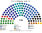
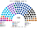
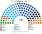
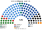
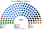
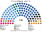
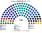
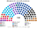
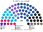
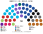

# 估計結果

> **這檔是什麼**：本夾席次的**主閱讀頁**（數字權威）——§1 近期大選、§2 民調、§3 長期。每屆：**一句結論 → 全院圖 → 完整席次表 → 首長／組閣**。算法見 [`14-近期大選重算.md`](14-近期大選重算.md)；圖庫掃圖見 [`席次圖.md`](席次圖.md)；朝野見 [`12-預期政治生態.md`](12-預期政治生態.md)。

選制摘要：全院 **120＝單一 70（top-3 孔多賽）＋複數 50（彈性名單、5 區聖拉古、無法定門檻）**。詳 [`01`](01-國會與選制.md)。

## 1 近期大選

用當時實際得票套本夾（逐票匭）。各屆由新到舊。下面總表只當目錄。

| | 實際結果 | **本夾首長** | **本夾組閣聯盟／多數派政府** |
|---|---|---|---|
| 2026-10 | Netanyahu 陣營 53＜61 | **Together** | Netanyahu 陣營 53＜61，須另組 |
| 2022-11 | Netanyahu 6 黨 | **利庫德** | 利庫德＋沙斯＋宗教錫安＝**61**（＋聖經猶太 67） |
| 2021-03 | Bennett–Lapid 8 黨 | **藍白**（平手規則） | 藍白＋利庫德＋亞米納＋工黨＝**61** |
| 2020-03 | 輪替政府 → 倒閣 | **藍白** | 藍白＋利庫德＝**80** |
| 2019-09 | 組不成 → 重選 | **藍白** | 藍白＋利庫德＝**77** |
| 2019-04 | 組不成 → 解散 | **利庫德**（平手規則） | 利庫德＋新右翼＋沙斯＋…＝**61** |

★ 新制無解散、固定 4 年：2019-04 之後下次選舉會是 2023-10，五次變一次。

### 2026-10

首長 **Together**；Netanyahu 陣營仍 **53**＜61（與現實同不過半）。

| 政黨 | 得票% | 實際 | 單一 70 | 複數 50 | **全院** |
|---|--:|--:|--:|--:|--:|
| 利庫德 | 20.52 | 27 | 21 | 12 | **33** |
| Yashar | 16.05 | 21 | 18 | 8 | **26** |
| Together | 9.32 | 12 | 11 | 4 | **15** |
| 聯合名單 | 8.82 | 11 | 8 | 5 | **13** |
| 沙斯 | 5.27 | 6 | 9 | 2 | **11** |
| 我們的家 | 5.93 | 7 | 1 | 5 | **6** |
| 民主黨 | 6.44 | 8 | 0 | 5 | **5** |
| 聖經猶太 | 5.51 | 7 | 1 | 3 | **4** |
| 宗教錫安 | 5.08 | 6 | 1 | 2 | **3** |
| 拉姆 | 5.93 | 8 | 0 | 2 | **2** |
| 猶太力量 | 5.73 | 7 | 0 | 2 | **2** |

**組閣聯盟／多數派政府**：首長 **Together**（對利庫德 67:53）。

### 2022-11

首長 **利庫德**（與現實同）；陣營過半，改不了規則。

| 政黨 | 實際 | 單一 70 | 複數 50 | **全院** |
|---|--:|--:|--:|--:|
| 利庫德 | 32 | 24 | 13 | **37** |
| 未來黨 | 24 | 12 | 9 | **21** |
| 沙斯 | 11 | 12 | 5 | **17** |
| 國家團結 | 12 | 11 | 5 | **16** |
| 宗教錫安 | 14 | 1 | 6 | **7** |
| 哈達什–塔阿勒 | 5 | 5 | 2 | **7** |
| 聖經猶太 | 7 | 3 | 3 | **6** |
| 巴拉德 | 0 | 2 | 1 | **3** |
| 我們的家 | 6 | 0 | 3 | **3** |
| 拉姆 | 5 | 0 | 2 | **2** |
| 工黨 | 4 | 0 | 1 | **1** |
| 梅雷茲 | 0 | 0 | 0 | **0** |

**組閣聯盟／多數派政府**：利庫德＋沙斯＋宗教錫安＝**61**（＋聖經猶太 67）。Netanyahu 陣營全院 67、複數 27——過半，改規則（全院 72／複數 30）要拉在野。

### 2021-03

首長 **藍白**（平手規則）；現實是亞米納的 Bennett。

| 政黨 | 實際 | 單一 70 | 複數 50 | **全院** |
|---|--:|--:|--:|--:|
| 利庫德 | 30 | 19 | 12 | **31** |
| 未來黨 | 17 | 12 | 8 | **20** |
| 藍白 | 8 | 12 | 4 | **16** |
| 沙斯 | 9 | 10 | 3 | **13** |
| 聯合名單 | 6 | 5 | 3 | **8** |
| 亞米納 | 7 | 5 | 3 | **8** |
| 我們的家 | 7 | 3 | 3 | **6** |
| 工黨 | 7 | 1 | 5 | **6** |
| 聖經猶太 | 7 | 1 | 3 | **4** |
| 拉姆 | 4 | 1 | 2 | **3** |
| 宗教錫安 | 6 | 1 | 1 | **2** |
| 新希望 | 6 | 0 | 2 | **2** |
| 梅雷茲 | 6 | 0 | 1 | **1** |

**組閣聯盟／多數派政府**：藍白＋利庫德＋亞米納＋工黨＝**61**。

### 2020-03

首長 **藍白**；自然走向藍白＋利庫德大聯合（現實後來也走到輪替，只是先又選了一次）。

| 政黨 | 實際 | 單一 70 | 複數 50 | **全院** |
|---|--:|--:|--:|--:|
| 利庫德 | 36 | 25 | 13 | **38** |
| 藍白 | 33 | 28 | 14 | **42** |
| 聯合名單 | 15 | 6 | 6 | **12** |
| 沙斯 | 9 | 7 | 4 | **11** |
| 聖經猶太 | 7 | 4 | 3 | **7** |
| 工黨–梅雷茲 | 7 | 0 | 4 | **4** |
| 我們的家 | 7 | 0 | 4 | **4** |
| 亞米納 | 6 | 0 | 2 | **2** |

**組閣聯盟／多數派政府**：藍白＋利庫德＝**80**。

### 2019-09

首長 **藍白**；現實組不成才重選——本夾最自然多數仍是藍白＋利庫德。

| 政黨 | 實際 | 單一 70 | 複數 50 | **全院** |
|---|--:|--:|--:|--:|
| 藍白 | 33 | 34 | 13 | **47** |
| 利庫德 | 32 | 17 | 13 | **30** |
| 聯合名單 | 13 | 6 | 6 | **12** |
| 沙斯 | 9 | 8 | 5 | **13** |
| 我們的家 | 8 | 0 | 4 | **4** |
| 聖經猶太 | 7 | 4 | 3 | **7** |
| 亞米納 | 7 | 1 | 2 | **3** |
| 工黨 | 6 | 0 | 3 | **3** |
| 民主聯盟 | 5 | 0 | 1 | **1** |

**組閣聯盟／多數派政府**：藍白＋利庫德＝**77**。

### 2019-04

首長 **利庫德**（對新右翼 60:60，平手規則）；**不論首長是誰，都沒有後面三次重選。**

| 政黨 | 實際 | 單一 70 | 複數 50 | **全院** |
|---|--:|--:|--:|--:|
| 利庫德 | 35 | 29 | 16 | **45** |
| 藍白 | 35 | 18 | 15 | **33** |
| 沙斯 | 8 | 5 | 3 | **8** |
| 聖經猶太 | 8 | 4 | 3 | **7** |
| 哈達什–塔阿勒 | 6 | 4 | 3 | **7** |
| 我們的家 | 5 | 4 | 3 | **7** |
| 新右翼 | 0 | 3 | 1 | **4** |
| 工黨 | 6 | 0 | 3 | **3** |
| 拉姆–巴拉德 | 4 | 1 | 1 | **2** |
| 右翼聯盟 | 5 | 1 | 1 | **2** |
| 庫拉努 | 4 | 1 | 0 | **1** |
| 澤胡特 | 0 | 0 | 1 | **1** |
| 梅雷茲 | 4 | 0 | 0 | **0** |

**組閣聯盟／多數派政府**：利庫德＋新右翼＋沙斯＋右翼聯盟＋庫拉努＋澤胡特＝**61**。

## 2 民調

> 2026-11-04：本節數字改由 [`民調重算.py`](民調重算.py) 重算（輸入 [`資料/polls.csv`](資料/polls.csv)）。原數字沒有留下可重跑的程式；新黨沿用母黨的政策位置與地理（見程式開頭）。

**民調＝現行比例代表制**席次推估（多直接報席次），不是本夾並立。摘自維基等。

方法：以 **2026-10 逐票匭** 為地理基底，按 Midgam 席次當全國得票權重縮放各單位得票，再跑本夾——**單一 70** top-3 孔多賽、**複數 50** 聖拉古（與 §1 同一套生態模型，不是比例拆單一）。

### Midgam R&C／Channel 12（2026-10-22..23，n＝1018）

會前示意；正式開票見 §1 2026-10。Yashar＝Eisenkot 系；Together＝Bennett 系。首長 **Together**。

| 政黨 | 現行比例制席次 | 單一 70 | 複數 50 | 本夾全院 |
|---|--:|--:|--:|--:|
| Yashar | 23 | 22 | 9 | **31** |
| Together | 15 | 19 | 7 | **26** |
| 利庫德 | 21 | 12 | 9 | **21** |
| 沙斯 | 8 | 10 | 3 | **13** |
| 聯合名單 | 9 | 5 | 3 | **8** |
| 我們的家 | 8 | 1 | 5 | **6** |
| 民主黨 | 10 | 0 | 5 | **5** |
| 猶太力量 | 8 | 0 | 3 | **3** |
| 聖經猶太 | 7 | 0 | 3 | **3** |
| 宗教錫安 | 6 | 1 | 1 | **2** |
| 拉姆 | 5 | 0 | 2 | **2** |

## 3 長期運行假設下

生態模型示意 **推估第 3 屆**（2022 地理與得票，工黨＋梅雷茲＝民主黨；假設見 [`12`](12-預期政治生態.md)）。

首長 **利庫德**；陣營過半，改規則要拉在野。

| 政黨 | 單一 70 | 複數 50 | 全院 120 |
|---|--:|--:|--:|
| 利庫德 | 23 | 11 | **34** |
| 未來黨 | 13 | 9 | **22** |
| 沙斯 | 12 | 5 | **17** |
| 國家團結 | 10 | 5 | **15** |
| 宗教錫安 | 1 | 6 | **7** |
| 哈達什–塔阿勒 | 5 | 2 | **7** |
| 聖經猶太 | 3 | 3 | **6** |
| 民主黨 | 1 | 5 | **6** |
| 巴拉德 | 2 | 1 | **3** |
| 拉姆 | 0 | 2 | **2** |
| 我們的家 | 0 | 1 | **1** |
| **計** | **70** | **50** | **120** |

**組閣聯盟／多數派政府**：Netanyahu 陣營（利庫德＋沙斯＋宗教錫安＋聖經猶太）全院 64、複數 25——過半，改規則（複數 ≥30）要拉在野。朝野互動見 [`12`](12-預期政治生態.md)。
