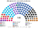
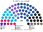
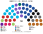
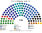
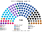
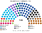
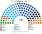
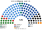
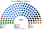
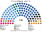

# 席次圖

> **這檔是什麼**：仿維基席次**圖庫**（掃圖用）。**完整席次表、首長、組閣以 [`估計結果.md`](估計結果.md) 為準**；算法見 [`14-近期大選重算.md`](14-近期大選重算.md)。

產生器：席次圖產生器。座位依**安全軸**左（鴿）→ 右（鷹）；阿拉伯政黨在最左。

## 長期（推估第 3 屆）

全院／單一／複數；數字見估計結果 §3。

首長利庫德；過半 61、3/5 72、2/3 80；複數 3/5＝30。

## 大選重算（新→舊）

### 2026-10

Together 首長；Netanyahu 陣營 53。→ [估計結果](估計結果.md#2026-10)

### 2022-11 本夾

利庫德首長；陣營 67。→ [估計結果](估計結果.md#2022-11)

### 2022-11 現行

全國一區、3.25% 門檻實際結果。

### 2021-03

藍白首長（平手規則）。→ [估計結果](估計結果.md#2021-03)

### 2020-03

藍白首長。→ [估計結果](估計結果.md#2020-03)

### 2019-09

藍白首長。→ [估計結果](估計結果.md#2019-09)

### 2019-04

利庫德首長（平手規則）。→ [估計結果](估計結果.md#2019-04)

## 民調

民調圖嵌在估計結果 §2（[`席次圖-民調-Midgam.svg`](席次圖-民調-Midgam.svg)），此處不重複。

## 顏色

| 政黨 | 色 |
|---|---|
| 利庫德 | 深藍 |
| 未來黨、Yashar | 青、靛藍 |
| Together、藍白、國家團結 | 松青、藍、靛 |
| 沙斯、聖經猶太 | 黑、灰 |
| 宗教錫安、右翼聯盟 | 棕 |
| 亞米納、新右翼、猶太力量 | 橙、金 |
| 我們的家 | 深綠松 |
| 工黨、民主黨 | 紅 |
| 梅雷茲 | 綠 |
| 哈達什–塔阿勒、拉姆、巴拉德、聯合名單 | 洋紅、淺綠、紫、深綠 |
