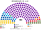

# 預期政治生態

> **席次估計**（近期大選重算、民調套本夾、長期運行假設下的席次表）見 [`估計結果.md`](估計結果.md)。本檔專注誘因、朝野互動與候選人行為；席次數字以估計結果與席次圖為準。

`0-基本/總體.md`：給長期運行下的預期政治生態（朝野互動、候選人行為、各政黨／派系席次、仿維基席次圖），要有論據（誘因、機械效應），可大膽假設。
`0-基本/要求.md` **硬性**：不得把提示詞要求直接當預期生態；不合期望就回頭改設計。

路徑：**誘因 → 得票 → 選制 → 席次 → 朝野互動與候選人行為 → 檢視**。席次由 [`生態模型.py`](生態模型.py) 算出。

## 1 誘因

| 層 | 誘因 | 預期行為 |
|---|---|---|
| 單一席次（top-3 孔多賽） | 第二輪三人，**第三名支持者的第二偏好決定勝負** | 候選人爭取對手陣營的第二偏好；攻擊第三名等於自殺。**「我們永遠不和 X 合作」的宣言變得昂貴**：X 的選民會把你排最後 |
| 複數席次（彈性名單） | 個人票跨不過 Droop 25% 就白做 | 地方網絡的控制票失去邊際報酬；**買票從「買候選人的個人票」退回「買政黨票」**，而政黨票要買到能改變席次的量，成本高出一個數量級 |
| 組閣（30 日＋預設值） | 拖延＝把選擇交給票面算術 | 不再有「拖到重選」的選項；談判集中在前 30 日 |
| 供給（20 日自動生效） | 拒絕預算＝換政府 | 預算抗議會轉成**換首長**，不轉成重選 |
| 無解散、固定選舉日 | 選舉日不是政治武器 | 總統與首長都不能挑選舉時機 |

## 2 假設

### 2.1 偏好的空間

兩條軸＋族群軸（位置是假設；改了就重跑）：

| 政黨系 | 地緣（親西方 −1 … 親俄 +1） | 體制（反寡頭 −1 … 寡頭網絡 +1） | 族群 |
|---|:--:|:--:|:--:|
| PP–DB | −0.9 | −0.8 | 0 |
| GERB | −0.5 | +0.7 | 0 |
| DPS（Peevski） | −0.3 | +1.0 | 1 |
| ITN | 0.0 | +0.1 | 0 |
| APS（Dogan） | 0.0 | +0.5 | 1 |
| **進步保加利亞** | **+0.3** | **−0.4** | 0 |
| MECh | +0.4 | −0.7 | 0 |
| 社會黨 | +0.5 | +0.2 | 0 |
| Velichie | +0.6 | −0.3 | 0 |
| 復興 | +0.9 | −0.5 | 0 |

每黨選民分三型：重地緣（35%）、重體制（35%）、均衡（30%）；族群軸權重 1.5，所以保加利亞族選民普遍把族群政黨排後，族群政黨的選民則先排另一個族群政黨。

★ **進步保加利亞在兩條軸上都靠中間**：地緣上在親西方三黨與親俄三黨之間；體制上和 PP–DB 同在反寡頭一側。這一個位置決定了 §3 的大半結果。

### 2.2 區域

7 區各有偏移（索非亞市 PP–DB +12；西北社會黨 +4、進步保加利亞 +5 等）；族群政黨的得票集中在 9 個單一選區（卡爾賈利兩區約全國的 6 倍，上限 80%）。數字見模型。

### 2.3 屆次

| 情境 | 得票 |
|---|---|
| 2024-10、2026-04 | 實際得票（[`14`](14-近期大選重算.md)） |
| **推估 第 3 屆**（新制運行約 8 年後） | 進步保加利亞 26、GERB 18、PP–DB 17、復興 10、DPS 6、社會黨 5、MECh 3、Velichie 3、APS 2、其他 10 |

第 3 屆的理由：**進步保加利亞的 44% 是一次浪潮**（前總統、反 Peevski、反預算抗議三件事疊在一起）。執政兩屆後回落到 20–30%，GERB 回到它的長期底盤，復興回到 10% 上下。

## 3 席次（推估第 3 屆）

| 政黨系 | 單一 100 | 複數 80 | **全院 180** |
|---|--:|--:|--:|
| 進步保加利亞 | 99 | 24 | **123** |
| GERB | 1 | 16 | 17 |
| PP–DB | 0 | 14 | 14 |
| 復興 | 0 | 9 | 9 |
| DPS | 0 | 7 | 7 |
| 社會黨 | 0 | 7 | 7 |
| MECh | 0 | 2 | 2 |
| APS | 0 | 1 | 1 |

門檻：過半 91、3/5 108、2/3 120；複數 3/5 48、2/3 54。

- **進步保加利亞以 26% 第一偏好拿到單一 99／100**：它在幾乎每一區都是孔多賽贏家。親西方選民在它和復興之間選它，親俄選民在它和 GERB、PP–DB 之間選它，反寡頭選民在它和 GERB 之間選它。
- **行政首長**：進步保加利亞，在最弱的一場對決（對社會黨）也有 148 票。
- **規則**：它在複數席次只有 24／80，**組織法與修憲要另找 24 席**——GERB＋PP–DB（30）或 GERB＋復興（25）。

## 4 朝野互動與候選人行為

| 面向 | 預期 |
|---|---|
| 政府 | **單黨政府，穩定**；建設性更新幾乎不會發動 |
| 立法 | 普通法律由執政黨單獨通過（123 ≥ 91） |
| 規則 | **選制、司法、財政規則**的修改是朝野談判：執政黨要拉 GERB 或 PP–DB |
| 反對黨 | 主戰場在**比例層、憲法法院乙組、司法與檢察委員會的政治席**；單一選區對他們幾乎關閉 |
| 候選人 | 單一席次候選人淡化地緣立場，比「誰更能管好地方」；**親俄與親西方的極端言論在單一選區被懲罰** |
| 族群 | DPS 只在卡爾賈利這類當地過半的選區贏；其餘選區的族群選民成為兩大候選人爭取的第二偏好——**土耳其裔選民從「被防疫的對象」變成「被拉攏的票」** |
| 買票 | 單一席次要在第二輪贏三人對決，買票得買到過半的兩兩對決，成本高；名單層躍升門檻讓買個人票無用 |

## 5 檢視：哪裡不合

本夾對自己的期望：**組得出政府、預算過得了、不讓一黨收編國家、選舉可信。**前兩項與第四項對得上；第三項不完全對得上。

### 5.1 不合一：居中政黨以少數第一偏好拿下多數政府

| 進步保加利亞第一偏好 | 單一 100 | 全院 180 | 首長 |
|:--:|--:|--:|---|
| 12% | 46 | 57 | 進步保加利亞（仍是孔多賽贏家） |
| 16% | 87 | **102** | 進步保加利亞（單獨過半） |
| 20% | 97 | 116 | 同上 |
| 26% | 99 | 123 | 同上 |
| 32% | 99 | 129 | 同上 |

**16% 第一偏好就能單獨過半。**孔多賽贏家當首長是本夾要的；但在保加利亞，**這個多數同時掌握政府、供給與普通立法**，正是收編的入口。

**因此改過的設計**（模型跑出這張表之後才改的）：

| 原本的做法 | 改成 | 檔 |
|---|---|---|
| 首長與供給由**單一席次**選出、表決（**不採用**） | **全院 180**（2024-10 型的分裂局面下，最大黨要找夥伴） | [`02`](02-政府組成與建設性更新.md) §2.1 |
| 憲法法院甲組由單一席次選 | 改由**總統候選人加權**選 | [`07`](07-司法權與檢察.md) §2.1 |
| 只有組織法、修憲要兩種多數 | 加上**緊急狀態第 91 日起**、**彈劾總統** | [`08`](08-緊急狀態、地方與政黨.md) §2、[`04`](04-總統.md) §6 |
| 司法與檢察委員會的政治席由全院選 | 改由**複數席次 STV** 選 | [`07`](07-司法權與檢察.md) §3 |

**改完仍然剩下的**：一個 20% 上下的居中政黨可以單獨組閣、單獨立法。本夾的判斷是：**這是孔多賽贏家應得的**；收編的防線放在「規則、法院、檢察、財政規則」這幾個它單獨改不動的地方，而不是放在「它能不能執政」。這個取捨寫進 [`13`](13-完善與自洽.md)。

### 5.2 不合二：城市改革派在單一選區幾乎消失

PP–DB 在三個情境都是單一 0 席（索非亞市也是）：它在地緣與體制兩條軸上都在一端，**第二輪三人對決時，它很少是第二偏好**。它的代表全在比例層。

### 5.3 不合三：親俄選民只剩比例層

復興在單一選區 0 席。對親俄選民來說，「單一選區永遠輸」可能讀成制度排斥，而不是選票算術。**本夾不處理**——這是任何向心型選制的代價。

### 5.4 對得上的

- **組得出政府**：三個情境的首長都在第一輪排名投票就出現，無循環；2024-10 型的分裂局面下，GERB 87 席需要找夥伴，但它是孔多賽贏家（對每個對手都過 91），**30 日內必定就任**。
- **改規則要跨黨**：三個情境裡沒有任何一黨單獨過複數 3/5。

## 6 敏感度

| 選民類型 | 2024-10 單一席次 | 2026-04 單一席次 |
|---|---|---|
| 基準 | GERB 66、ITN 16、社會黨 14、DPS 2、APS 1、Velichie 1 | 進步保加利亞 99、DPS 1 |
| 全部重地緣 | GERB 81、ITN 9、社會黨 7、DPS 3 | 進步保加利亞 99、DPS 1 |
| 全部重體制 | GERB 49、社會黨 20、ITN 15、復興 11、APS 3、Velichie 2 | 進步保加利亞 99、DPS 1 |

★ 2026 的結果對選民類型完全不敏感：44% 加上居中位置，任何權重下都贏。2024 的結果則對選民類型敏感：選民越在乎體制軸，GERB 越弱。

## 7 席次圖

[`席次圖.md`](席次圖.md)。
