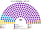
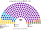
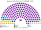
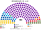

# 估計結果

> **這檔是什麼**：民意套本夾選制的席次**表**（如組閣聯盟／多數派政府）——§1 近期大選、§2 民調（若有）、§3 長期。圖庫見 [`席次圖.md`](席次圖.md)；大選算法細節見本夾重算檔。朝野互動見「預期政治生態」。

選制摘要：全院 **180＝單一 100（top-3 孔多賽）＋複數 80（彈性名單、7 區、M∈[8,16]、無法定門檻）**。詳 [`01`](01-國民議會與選制.md)。

## 1 近期大選

用當時實際得票套本夾。細節與方法見 [`14-近期大選重算.md`](14-近期大選重算.md)（[`生態模型.py`](生態模型.py)）。

| | 現實結果 | **本夾首長** | **本夾組閣聯盟／多數派政府** |
|---|---|---|---|
| 2026-04 | 進步保加利亞單獨過半 | **進步保加利亞** | 單獨 140；改規則要拉夥伴（複數 41＜48） |
| 2024-10 | GERB 聯合政府 | **GERB** | GERB＋ITN 或 GERB＋社會黨（差 4 過半） |

完整席次見下方各小節。

### 2026-04

| 政黨系 | 單一 100 | 複數 80 | **全院** |
|---|--:|--:|--:|
| 進步保加利亞 | 99 | 41 | **140** |
| GERB | 0 | 12 | **12** |
| PP–DB | 0 | 10 | **10** |
| DPS | 1 | 7 | **8** |
| 復興 | 0 | 3 | **3** |
| Velichie | 0 | 2 | **2** |
| MECh | 0 | 2 | **2** |
| 社會黨 | 0 | 2 | **2** |
| APS | 0 | 1 | **1** |

**組閣聯盟／多數派政府**：首長 **進步保加利亞**；全院 140 單獨過半／2/3；複數 41＜48，改組織法／修憲要拉夥伴。

### 2024-10

| 政黨系 | 單一 100 | 複數 80 | **全院** |
|---|--:|--:|--:|
| GERB | 66 | 21 | **87** |
| ITN | 16 | 7 | **23** |
| 社會黨 | 14 | 7 | **21** |
| DPS–新開始 | 2 | 10 | **12** |
| PP–DB | 0 | 11 | **11** |
| 復興 | 0 | 10 | **10** |
| APS | 1 | 7 | **8** |
| Velichie | 1 | 3 | **4** |
| MECh | 0 | 4 | **4** |

**組閣聯盟／多數派政府**：首長 **GERB**；GERB 87 差 4 過半（≥91），須拉 ITN 等；複數 3/5＝48（GERB 複數 21）。

## 2 民調

> 2026-11-04：本節數字改由 [`民調重算.py`](民調重算.py) 重算（輸入 [`資料/polls.csv`](資料/polls.csv)）。原數字沒有留下可重跑的程式；新黨沿用母黨的政策位置與地理（見程式開頭）。

公開全國投票意向（PolitPro 等彙整之 Gallup／Market LINKS）。

方法：把民調得票率當全國第一偏好，套本夾生態模型——**單一 100** top-3 孔多賽、**複數 80** 聖拉古（區域偏移見模型；不是全國比例拆單一）。

### Gallup（2026-10-14..22，n＝1001）

首長 **進步保加利亞**。表列 PP＋DB 合併為 PP–DB（模型政黨系）。

| 政黨 | 得票推估% | 單一 100 | 複數 80 | 本夾全院 |
|---|--:|--:|--:|--:|
| 進步保加利亞 | 36.3% | 98 | 32 | **130** |
| GERB | 15% | 2 | 13 | **15** |
| PP–DB | 19.3% | 0 | 15 | **15** |
| DPS | 7.1% | 0 | 7 | **7** |
| 復興 | 6.4% | 0 | 7 | **7** |
| MECh | 3.3% | 0 | 3 | **3** |
| 社會黨 | 3.2% | 0 | 3 | **3** |
| Velichie | 2.7% | 0 | 0 | **0** |
| 其他 | 6.7% | 0 | 0 | **0** |

### Market LINKS／bTV（2026-10-13..19，n＝1006）

首長 **進步保加利亞**。PP＋DB 合併為 PP–DB。

| 政黨 | 得票推估% | 單一 100 | 複數 80 | 本夾全院 |
|---|--:|--:|--:|--:|
| 進步保加利亞 | 41.9% | 100 | 37 | **137** |
| PP–DB | 19.4% | 0 | 15 | **15** |
| GERB | 9.9% | 0 | 8 | **8** |
| DPS | 6.6% | 0 | 7 | **7** |
| 其他 | 17% | 0 | 7 | **7** |
| 復興 | 5.2% | 0 | 6 | **6** |

## 3 長期運行假設下

生態模型示意 **推估第 3 屆**（假設見 [`12-預期政治生態.md`](12-預期政治生態.md)；數字由 [`生態模型.py`](生態模型.py) 算出）。

| 政黨系 | 單一 100 | 複數 80 | 全院 180 |
|---|--:|--:|--:|
| 進步保加利亞 | 99 | 24 | **123** |
| GERB | 1 | 16 | **17** |
| PP–DB | 0 | 14 | **14** |
| 復興 | 0 | 9 | **9** |
| DPS | 0 | 7 | **7** |
| 社會黨 | 0 | 7 | **7** |
| MECh | 0 | 2 | **2** |
| APS | 0 | 1 | **1** |
| **計** | **100** | **80** | **180** |

進步保加利亞全院 123（過半 91）；複數 24／80，組織法與修憲要另找夥伴（複數 3/5＝48）。
朝野互動與候選人行為見 [`12-預期政治生態.md`](12-預期政治生態.md)。
