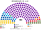
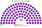
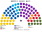
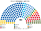
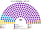

# 席次圖

> **這檔是什麼**：仿維基席次**圖庫**（長期示意；有則附大選重算／現行圖）。席次**數字表**與民調見 [`估計結果.md`](估計結果.md)；大選算法細節見本夾 `*大選重算*`／`*近期大選*` 檔。朝野互動見「預期政治生態」。

數字來自 [`生態模型.py`](生態模型.py)；產生器：席次圖產生器。座位依**地緣軸**由左（親西方）到右（親俄）排列。

## 推估第 3 屆

### 全院 180

### 單一席次 100

### 複數席次 80

| 政黨 | 單一 100 | 複數 80 | **全院** |
|---|--:|--:|--:|
| 進步保加利亞 | 99 | 24 | **123** |
| GERB | 1 | 16 | **17** |
| PP–DB | 0 | 14 | **14** |
| 復興 | 0 | 9 | **9** |
| DPS | 0 | 7 | **7** |
| 社會黨 | 0 | 7 | **7** |
| MECh | 0 | 2 | **2** |
| APS | 0 | 1 | **1** |

過半 **91**、3/5 **108**、2/3 **120**。居中政黨在幾乎每一區都是孔多賽贏家（[`12`](12-預期政治生態.md) §3）。複數 3/5 **48**——執政黨改規則還要另找約 24 席。

## 2024-10 得票套新制

| 政黨 | **全院** |
|---|--:|
| GERB | **87** |
| ITN | **23** |
| 社會黨 | **21** |
| DPS | **12** |
| PP–DB | **11** |
| 復興 | **10** |
| APS | **8** |
| MECh | **4** |
| Velichie | **4** |

細節見 [`14`](14-近期大選重算.md)。

## 2026-04 得票套新制

| 政黨 | **全院** |
|---|--:|
| 進步保加利亞 | **140** |
| GERB | **12** |
| PP–DB | **10** |
| DPS | **8** |
| 復興 | **3** |
| MECh | **2** |
| Velichie | **2** |
| 社會黨 | **2** |
| APS | **1** |

## 顏色

| 政黨系 | 色 |
|---|---|
| PP–DB | 黃 |
| GERB | 藍 |
| DPS | 淺藍 |
| ITN | 灰藍 |
| APS | 綠 |
| 進步保加利亞 | 紫（示意色） |
| MECh | 橙 |
| 社會黨 | 紅 |
| Velichie | 棕 |
| 復興 | 橄欖綠 |
