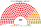
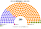

# 近期大選套新制

> 席次一覽與圖見 [`估計結果.md`](估計結果.md) §1、[`席次圖.md`](席次圖.md)。本檔講**怎麼**套。

## 1 方法

| 項目 | 來源與做法 |
|---|---|
| 第一偏好 | NVI（國家選舉辦公室）vtr.valasztas.hu **逐投票所名單票**（`SzavkorJkv-縣-市鎮.json`；[`_fetch_nvi.py`](_fetch_nvi.py)、[`_build_ogy.py`](_build_ogy.py)）：2026 年 10,022 個、2022 年 10,243 個投票所＋海外郵寄票一列（[`資料/ogy-2026.csv`](資料/ogy-2026.csv)、[`資料/ogy-2022.csv`](資料/ogy-2022.csv)） |
| 驗證 | 全國加總與官方完全一致：2026 有效票 6,366,733，TISZA 53.18%、Fidesz–KDNP 38.61%、Mi Hazánk 5.63%；2022 有效票 5,654,860，Fidesz–KDNP 54.13%、聯合反對派 34.44%、Mi Hazánk 5.88% |
| 座標 | NVI 投票所中心點（`Szavkor-Topo` 的 centrum）；2022 年沿用 2026 年的座標，投票所編號對不上的 266 個用同市鎮平均 |
| 海外郵寄票 | 只有全國數字（2026 年約 33.5 萬，84% Fidesz），單獨一列，只進海外複數區（M＝4） |
| 單一 120 | 8 個 NUTS-2 區內依座標的 Hilbert 曲線排序，按有效票連續切；top-3 孔多賽 |
| 複數 80 | 各區聖拉古、無門檻 |
| 首長 | 全院 200 記名排名，須 ≥101 |

## 2 2026-04-12

實際（199）：Tisza 141（單一 96＋名單 45）、Fidesz–KDNP 52、Mi Hazánk 6；**Tisza 單獨超過 2/3**。

| 政黨 | 名單得票% | 實際 199 | 單一 120 | 複數 80 | **新制 200** |
|---|--:|--:|--:|--:|--:|
| **TISZA** | 53.2 | 141 | 109 | 43 | **152** |
| Fidesz–KDNP | 38.6 | 52 | 11 | 30 | **41** |
| Mi Hazánk | 5.6 | 6 | 0 | 7 | **7** |

| 區（單一） | 結果 | 區 | 結果 |
|---|---|---|---|
| 布達佩斯（20） | TISZA 20 | 南多瑙河外（11） | TISZA 9、FIDESZ 2 |
| 佩斯（17） | TISZA 17 | 北匈牙利（13） | TISZA 11、FIDESZ 2 |
| 中多瑙河外（14） | TISZA 14 | 北大平原（17） | TISZA 12、FIDESZ 5 |
| 西多瑙河外（13） | TISZA 11、FIDESZ 2 | 南大平原（15） | TISZA 15 |

- **單一席次幾乎全歸 Tisza**：94／120 區 Tisza 的第一偏好就過半，選制不起作用。
- **組織法**：全院 152 過 120，但**複數 43 不到 48**，Tisza 單獨改不了選舉、法院、媒體規則（[`05`](05-法規位階與修憲.md)）。
- 海外 4 席：Fidesz 3、Tisza 1。

## 3 2022-04-03

實際（199）：Fidesz–KDNP 135、聯合反對派 57、Mi Hazánk 6、德意志族 1；**Fidesz 單獨 2/3**。

| 政黨 | 名單得票% | 實際 199 | 單一 120 | 複數 80 | **新制 200** |
|---|--:|--:|--:|--:|--:|
| **Fidesz–KDNP** | 54.1 | 135 | 96 | 45 | **141** |
| 聯合反對派（DK、Jobbik、Momentum、MSZP、LMP、Párbeszéd） | 34.4 | 57 | 24 | 27 | **51** |
| Mi Hazánk | 5.9 | 6 | 0 | 7 | **7** |
| MKKP | 3.3 | 0 | 0 | 1 | **1** |

- 單一：布達佩斯 19 區給聯合反對派，其餘幾乎全歸 Fidesz。
- **Fidesz 有過半、沒有兩種多數**：全院 141 過 120，但複數 45 不到 48。**2022–26 年以基本法律、修憲推動的事項，在本夾 Fidesz 單獨做不到**，要拉 Mi Hazánk（全院 148、複數 52）。
- 德意志族名單（0.4%）在無門檻、無優惠額數下，任何一區都拿不到 1 席。

## 4 敏感度（`--sweep`）

| 檢查 | 2026 單一 | 首長 | 2022 單一 | 首長 |
|---|---|---|---|---|
| 基準 | TISZA 109、FIDESZ 11 | TISZA | FIDESZ 96、EGYSÉG 24 | FIDESZ |
| 全部重地緣 | TISZA 102、FIDESZ 18 | TISZA | FIDESZ 100、EGYSÉG 20 | FIDESZ |
| 全部重體制 | TISZA 102、MI 17、FIDESZ 1 | TISZA | FIDESZ 82、EGYSÉG 22、MI 16 | FIDESZ |
| 切線位移半區 | TISZA 109、FIDESZ 11 | — | FIDESZ 97、EGYSÉG 23 | — |
| Fidesz ＋4／TISZA −4 點 | TISZA 85、FIDESZ 35 | TISZA | — | — |
| Fidesz ＋8／TISZA −8 點 | FIDESZ 61、TISZA 59 | **Mi Hazánk** | — | — |

「全部重體制」時 Mi Hazánk 在鄉村區拿到 16–17 個單一席次：它在體制軸上位於 Fidesz 與 Tisza 之間。兩強接近時（Fidesz ＋8 點），議員之間的孔多賽贏家變成 Mi Hazánk。

## 5 走向（推測）

| 時點 | 現實 | **新制** |
|---|---|---|
| 2022-04 | Fidesz 2/3，修憲、基本法律、危險狀態延長 | Fidesz 141 過半，但組織法、修憲要拉 Mi Hazánk 或公投；危險狀態每 30 日要全院 3/5 |
| 2022–26 | 監督機關由 2/3 選出、任期跨屆 | STV 或三組選出、7 年錯開，Fidesz 只能選到約自己得票比例的人 |
| 2026-04 | Tisza 2/3，可以單獨重寫憲法 | Tisza 152 過半，改規則要拉另一黨或民意升到約六成（[`估計結果.md`](估計結果.md) §2） |

## 6 出處

| 數字 | 出處 |
|---|---|
| 2026、2022 逐投票所、海外郵寄、投票所座標 | NVI vtr.valasztas.hu/ogy2026、/ogy2022 的 JSON（`SzavkorJkv`、`ListasJkv`、`Szavkor-Topo`） |
| 實際席次 | 維基 2026、2022 Hungarian parliamentary election |
| 民調 | 維基 Opinion polling for the 2030 Hungarian parliamentary election |
