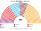

# 預期政治生態

> **席次估計**（近期大選重算、民調套本夾、長期運行假設下的席次表）見 [`估計結果.md`](估計結果.md)。本檔專注誘因、朝野互動與候選人行為；席次數字以估計結果與席次圖為準。

`0-基本/總體.md`：長期預期生態，要有論據，可大膽假設。`0-基本/要求.md` **硬性**：不得把提示詞當預期生態。席次由 [`生態模型.py`](生態模型.py) 算出。

## 1 誘因

| 層 | 誘因 | 預期行為 |
|---|---|---|
| top-3 孔多賽 | 第三名支持者的第二偏好決定勝負 | AKP 對 CHP 的對決裡，**İYİ、MHP 這類「兩邊選民都不討厭到底」的黨進得了前三名就是孔多賽贏家** |
| 無法定門檻、聯盟不再有門檻優待 | 小黨不必躲進大聯盟 | 兩大聯盟鬆動；選前聯盟變成選後聯合 |
| 全院選首長、建設性更新 | 首長要每天有議會多數 | 執政要聯合；換首長要先湊出替代者 |
| 無解散、固定選舉日 | 不能挑時機 | 不再有「提前改選」作為談判籌碼 |

## 2 假設

**第一偏好**：議會選舉的政黨票（逐縣）；聯盟票歸聯盟最大黨。2023 年在 CHP 名單上參選的 DEVA、未來黨、幸福黨、民主黨併入 CHP（它們沒有自己的票）。

**偏好空間**：四軸。

| 政黨 | 宗教保守 | 民族 | 經濟 | 陣營 |
|---|:--:|:--:|:--:|:--:|
| AKP 正義與發展黨 | 0.7 | 0.5 | 0.3 | 1.0 |
| MHP 民族行動黨 | 0.4 | 1.0 | 0.1 | 0.8 |
| BBP 大團結黨 | 0.7 | 1.0 | 0.1 | 0.7 |
| YRP 新福利黨 | 1.0 | 0.4 | −0.2 | 0.3（2023 年 0.6、2024 年 −0.2） |
| SP 幸福黨 | 0.9 | 0.2 | −0.3 | −0.5 |
| CHP 共和人民黨 | −0.7 | 0.2 | −0.4 | −1.0 |
| İYİ 好黨 | −0.2 | 0.8 | 0.3 | −0.7（2024 年 −0.4） |
| Zafer 勝利黨 | −0.5 | 1.0 | 0.2 | −0.4 |
| DEM 人民平等與民主黨（2023 綠左黨、2018 HDP） | −0.3 | −1.0 | −0.7 | −1.0 |
| TİP 土耳其工人黨 | −0.9 | −0.4 | −1.0 | −0.9 |

**陣營軸**：2016 年以後土耳其最強的分界是「支持或反對執政聯盟」，不是左右。沒有這一軸時，İYİ 選民會因為宗教與民族的距離把 AKP 排在 CHP 前面，這和 2023 年 İYİ 在國家聯盟內的事實不合。

**CHP 選民把 MHP 排在 AKP 前面**：宗教軸讓世俗派的 CHP 選民離 MHP 比離 AKP 近。這不是憑空：2014 年總統選舉 CHP 與 MHP 共推候選人。但它是本模型最關鍵、也最不確定的假設（§6）。

## 3 席次（2023 得票，推估第 3 屆）

| 政黨 | 單一 270 | 複數 180 | **全院 450** | 現行 2023（600） |
|---|--:|--:|--:|--:|
| AKP | 103 | 69 | **172** | 268 |
| CHP | 52 | 51 | **103** | 169 |
| İYİ | 58 | 18 | **76** | 43 |
| MHP | 38 | 20 | **58** | 50 |
| DEM | 19 | 19 | **38** | 61 |
| YRP | 0 | 2 | **2** | 5 |
| TİP | 0 | 1 | **1** | 4 |

門檻：過半 226、3/5 270、2/3 300；複數 3/5 108。

- **İYİ 單一 58**：決選三人「AKP／CHP／İYİ」的 109 區裡，它是兩邊選民共同的第二偏好。伊斯坦堡、西馬爾馬拉、愛琴海內陸是它的票倉。
- **MHP 單一 38**：中安納托利亞 14／21、西黑海 6、東地中海 6。「AKP／CHP／MHP」的 83 區裡 CHP 選民把它排在 AKP 前。
- **AKP 單一 103**：東南西 13／14、東馬爾馬拉 12、黑海、安卡拉；它過半或對手太分散的地方。
- **CHP 單一 52**：伊茲密爾 10、西地中海 10、伊斯坦堡一 9。
- **DEM 單一 19**：東南東 12／12、中東部 5、東黑海與東北 2。
- **首長：MHP**（對 AKP 238:212、對 CHP 232:218）。**組閣陣營：MHP＋AKP 230**——現行人民聯盟。

## 4 朝野互動

| 面向 | 預期 |
|---|---|
| 政府 | 人民聯盟兩黨聯合；**誰當總理是兩黨之間的談判**，不再由一人直選決定 |
| 規則 | MHP＋AKP 全院 230、複數 89：**立法可以，改選制、修憲不行**（要 270 且複數 108） |
| 反對 | CHP＋İYİ＋DEM 217：差 9 席就能以建設性更新換掉政府——**İYİ 是樞紐** |
| 東南部 | DEM 在單一與複數各 19；首長投票時它的 38 席把 CHP 排在 AKP 前 |

## 5 檢視：哪裡不合

### 5.1 不合一：一個 10% 的黨當總理

MHP 2023 年得票 9.9%，全院 58 席、當首長；2024 年代理資料下首長落在新福利黨（7%）或 İYİ（4.6%）。這是和日本國民民主、荷蘭 CDA、巴西中間大團同型的結果：**top-3 孔多賽與全院排名投票都把中位黨放大**。

**判斷**：放大保留。理由：(1) 這個首長在議員的成對比較中勝過每一個對手（2023 年無循環）；(2) 它必須和大黨聯合才有 226（MHP 58 要 AKP 172）；(3) 改規則要複數 3/5，中位小黨在名單層只有自己的比例。

**但要寫清楚**：模型讓每位議員依距離誠實排名；現實中大黨會用組閣條件換首長職位。**組閣陣營比首長人選可靠**。

### 5.2 不合二：2024 年出現循環

2024 年代理資料下，CHP＞新福利＞AKP＞CHP。依 [`02`](02-政府組成與建設性更新.md) §2，30 日後 Ranked Pairs 第一名（新福利黨）就任，但它對 CHP 只有 215:235，**沒有過 226**。本夾的設計允許這種結果（30 日預設值），代價是首長缺乏過半支持；建設性更新讓多數隨時可以換掉它，**前提是那個多數能對替代者達成一致**。

**判斷**：不改。拿掉預設值就回到「組不出政府」的 2015 年與 1990 年代；預設值的目的是讓循環不變成停擺。

### 5.3 不合三：每省一席

見 [`01`](01-國會與選制.md) §2。原設計「不跨省界、每省至少一席」在 270 席下讓 39 省只有一席、偏差 ±45%，**違反本夾自己的 ±10%**。已改為可跨省界。

## 6 敏感度

| 情境 | 2023 單一 | 2023 首長 | 2018 首長 | 2024 首長 |
|---|---|---|---|---|
| 基準 | AKP 103、İYİ 58、CHP 52、MHP 38、DEM 19 | **MHP** | AKP | 新福利（循環） |
| 陣營軸權重 0 | AKP 130、İYİ 55、CHP 34、MHP 32 | **AKP** | AKP | MHP |
| 陣營軸權重 0.5 | AKP 119、İYİ 61、CHP 41、MHP 30 | **AKP** | AKP | İYİ |
| 陣營軸權重 2 | AKP 74、MHP 66、İYİ 58、CHP 52 | MHP | **MHP** | İYİ |
| 選民全部重民族 | AKP 141、İYİ 58、CHP 57 | **AKP** | AKP | 新福利 |
| 選民全部重宗教 | AKP 75、MHP 66、İYİ 58、CHP 41 | MHP | AKP | 新福利 |
| AKP −3 點 | AKP 70、CHP 66、MHP 58、İYİ 56 | **İYİ** | — | — |
| AKP +3 點 | AKP 131、İYİ 56、CHP 39 | **AKP** | — | — |
| 兩輪多數決（前 2 名對決） | **AKP 126、CHP 108**、DEM 21、MHP 15 | AKP | AKP | CHP |

★ **2023 年的組閣陣營在每個情境都是 AKP＋MHP**（人民聯盟）；變的只是總理是哪一黨。2024 年的首長在 MHP、İYİ、新福利之間跳動，但 **CHP 在每個情境都是全院最大黨**（168–176）。

★ 兩輪多數決那一行說明 top-3 的作用：二選一決選下 AKP 與 CHP 拿走 234 個單一席次，**兩大陣營結構原封不動**；三人決選讓 İYİ、MHP 進得去。
