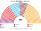
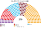
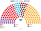
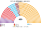
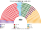
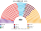
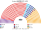

# 估計結果

> **這檔是什麼**：民意套本夾選制的席次**表**（如組閣聯盟／多數派政府）——§1 近期大選、§2 民調（若有）、§3 長期。圖庫見 [`席次圖.md`](席次圖.md)；大選算法細節見本夾重算檔。朝野互動見「預期政治生態」。

選制摘要：全院 **450＝單一 270（top-3 孔多賽）＋複數 180（彈性名單、16 區聖拉古、無法定門檻）**。詳 [`01`](01-國會與選制.md)。

## 1 近期大選

用當時實際得票套本夾（另以 2024 地方選舉代理）。細節與方法見 [`14-近期大選重算.md`](14-近期大選重算.md)（[`生態模型.py`](生態模型.py)）。

| | 實際（600） | **本夾全院 450** | 首長 |
|---|---|---|---|
| 2023-05 | AKP 268、CHP 169、綠左 61、MHP 50、İYİ 43 … | AKP **172**、CHP 103、İYİ 76、MHP 58、DEM 38 | **MHP**（組閣 MHP＋AKP 230） |
| 2018-06 | AKP 295、CHP 146、HDP 67、MHP 49、İYİ 43 | AKP **237**、CHP 93、İYİ 52、DEM 42、MHP 26 | **AKP**（單獨過半） |
| 2015-11 | AKP 317、CHP 134、HDP 59、MHP 40 | AKP **255**、CHP 88、MHP 66、DEM 41 | **AKP**（單獨過半） |
| 2015-06 | AKP 258、CHP 132、MHP 80、HDP 80 | AKP **192**、MHP 112、CHP 97、DEM 49 | **MHP**（組閣 MHP＋AKP 304） |
| 2024-03（地方代理） | — | CHP **170**、AKP 105、新福利 70、MHP 36、İYİ 31、DEM 29 … | 新福利（循環；對 CHP 未過 226） |

### 2023-05 單一／複數

| 政黨 | 單一 270 | 複數 180 | **全院** |
|---|--:|--:|--:|
| AKP | 103 | 69 | **172** |
| CHP | 52 | 51 | **103** |
| İYİ | 58 | 18 | **76** |
| MHP | 38 | 20 | **58** |
| DEM | 19 | 19 | **38** |
| YRP | 0 | 2 | **2** |
| TİP | 0 | 1 | **1** |

**組閣聯盟／多數派政府**：首長 **MHP**；執政多數 MHP＋AKP＝**230**（過半 226）；改選制／修憲要全院 270 且複數 108——現達不到。

### 2018-06 單一／複數

| 政黨 | 單一 270 | 複數 180 | **全院** |
|---|--:|--:|--:|
| AKP | 160 | 77 | **237** |
| CHP | 50 | 43 | **93** |
| İYİ | 35 | 17 | **52** |
| DEM | 19 | 23 | **42** |
| MHP | 6 | 20 | **26** |

**組閣聯盟／多數派政府**：首長 **AKP**；AKP **237** 單獨過半；複數 77＜108，改規則要拉人。

### 2024-03 地方代理 單一／複數

| 政黨 | 單一 270 | 複數 180 | **全院** |
|---|--:|--:|--:|
| CHP | 102 | 68 | **170** |
| AKP | 39 | 66 | **105** |
| YRP | 57 | 13 | **70** |
| MHP | 25 | 11 | **36** |
| İYİ | 23 | 8 | **31** |
| DEM | 17 | 12 | **29** |
| Zafer | 4 | 1 | **5** |
| BBP | 2 | 1 | **3** |
| SP | 1 | 0 | **1** |

**組閣聯盟／多數派政府**：首長示意 **新福利**（循環；對 CHP 未過 226）。

2023 年 MHP＋AKP 全院 230、複數 89——立法過半，改選制／修憲（全院 270 且複數 108）不行。2018 年 AKP 237 單獨過半，複數 77 仍改不了規則。

## 2 民調

> 2026-11-04：本節數字改由 [`民調重算.py`](民調重算.py) 重算（輸入 [`資料/polls.csv`](資料/polls.csv)）。原數字沒有留下可重跑的程式；新黨沿用母黨的政策位置與地理（見程式開頭）。

公開全國投票意向（PolitPro 等彙整）。方法：以 **2023-05 逐縣** 為地理基底，按民調得票率縮放後跑本夾——**單一 270** top-3 孔多賽、**複數 180** 聖拉古（不是全國比例拆單一）。Yeni＝Yeni Parti（Özel；地理以 CHP 為種）；Anahtar 以 İYİ 為種。

### ASAL（2026-10-04..10，n＝2020）

首長 **Anahtar**（模型對決敏感）。

| 政黨 | 得票推估% | 單一 270 | 複數 180 | 全院 450 |
|---|--:|--:|--:|--:|
| AKP | 31.6% | 91 | 62 | **153** |
| Yeni | 25.2% | 68 | 50 | **118** |
| İYİ | 7.1% | 52 | 13 | **65** |
| MHP | 8% | 39 | 15 | **54** |
| DEM | 8.8% | 20 | 19 | **39** |
| CHP | 5.1% | 0 | 11 | **11** |
| Anahtar | 3.2% | 0 | 4 | **4** |
| Zafer | 3.4% | 0 | 4 | **4** |
| YRP | 2.9% | 0 | 2 | **2** |
| 其他 | 4.7% | 0 | 0 | **0** |

### Kontak（2026-09-29..10-04，n＝1773）

首長 **Zafer**。

| 政黨 | 得票推估% | 單一 270 | 複數 180 | 全院 450 |
|---|--:|--:|--:|--:|
| AKP | 28.5% | 91 | 55 | **146** |
| Yeni | 23.8% | 61 | 44 | **105** |
| Zafer | 7.7% | 62 | 16 | **78** |
| İYİ | 6.8% | 31 | 14 | **45** |
| DEM | 8.5% | 21 | 19 | **40** |
| CHP | 12.2% | 0 | 23 | **23** |
| MHP | 3.8% | 4 | 7 | **11** |
| YRP | 3.1% | 0 | 2 | **2** |
| BBP | — | 0 | 0 | **0** |
| TİP | 1.6% | 0 | 0 | **0** |
| 其他 | 4% | 0 | 0 | **0** |

## 3 長期運行假設下

生態模型示意 **推估第 3 屆**（＝2023 得票套本夾；假設見 [`12-預期政治生態.md`](12-預期政治生態.md)；數字由 [`生態模型.py`](生態模型.py) 算出）。

| 政黨 | 單一 270 | 複數 180 | 全院 450 |
|---|--:|--:|--:|
| AKP | 103 | 69 | **172** |
| CHP | 52 | 51 | **103** |
| İYİ | 58 | 18 | **76** |
| MHP | 38 | 20 | **58** |
| DEM | 19 | 19 | **38** |
| YRP | 0 | 2 | **2** |
| TİP | 0 | 1 | **1** |
| **計** | **270** | **180** | **450** |

首長：MHP；組閣陣營 MHP＋AKP 230。İYİ 單一 58——AKP／CHP／İYİ 決選區裡兩邊選民共同的第二偏好。
朝野互動與候選人行為見 [`12-預期政治生態.md`](12-預期政治生態.md)。
