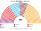
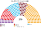
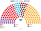
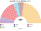
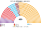
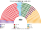

# 席次圖

> **這檔是什麼**：仿維基席次**圖庫**（長期示意；有則附大選重算／現行圖）。席次**數字表**與民調見 [`估計結果.md`](估計結果.md)；大選算法細節見本夾 `*大選重算*`／`*近期大選*` 檔。朝野互動見「預期政治生態」。

數字來自 [`生態模型.py`](生態模型.py)；產生器：席次圖產生器。座位依**陣營軸**由左（反對）到右（執政聯盟）排列。

## 2023-05 得票套新制（＝推估第 3 屆）

### 全院 450

### 單一席次 270

### 複數席次 180

| 政黨 | 單一 270 | 複數 180 | **全院** |
|---|--:|--:|--:|
| AKP | 103 | 69 | **172** |
| CHP | 52 | 51 | **103** |
| İYİ | 58 | 18 | **76** |
| MHP | 38 | 20 | **58** |
| DEM | 19 | 19 | **38** |
| YRP | 0 | 2 | **2** |
| TİP | 0 | 1 | **1** |

首長 MHP；組閣 MHP＋AKP 230。

3/5 **108**。

## 現行制度 2023-05 實際結果

| 政黨 | 單一 270 | 複數 180 | **全院** |
|---|--:|--:|--:|
| AKP | 103 | 69 | **172** |
| CHP | 52 | 51 | **103** |
| İYİ | 58 | 18 | **76** |
| MHP | 38 | 20 | **58** |
| DEM | 19 | 19 | **38** |
| YRP | 0 | 2 | **2** |
| TİP | 0 | 1 | **1** |

## 2018-06 得票套新制

| 政黨 | 單一 270 | 複數 180 | **全院** |
|---|--:|--:|--:|
| AKP | 160 | 77 | **237** |
| CHP | 50 | 43 | **93** |
| İYİ | 35 | 17 | **52** |
| DEM | 19 | 23 | **42** |
| MHP | 6 | 20 | **26** |

3/5 **108**。

## 2024-03 地方選舉代理

| 政黨 | 單一 270 | 複數 180 | **全院** |
|---|--:|--:|--:|
| CHP | 102 | 68 | **170** |
| AKP | 39 | 66 | **105** |
| YRP | 57 | 13 | **70** |
| MHP | 25 | 11 | **36** |
| İYİ | 23 | 8 | **31** |
| DEM | 17 | 12 | **29** |
| Zafer | 4 | 1 | **5** |
| BBP | 2 | 1 | **3** |
| SP | 1 | 0 | **1** |
