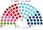
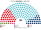
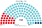
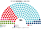
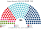

# 席次圖

數字來自 [`生態模型.py`](生態模型.py)；產生器：席次圖產生器。座位依**文化軸**由左（開放）到右（保守、限移民）。

## 推估第 3 屆（[`估計結果`](估計結果.md) §3）

### 全院 180

### 單一席次 108

### 複數席次 72

| 政黨 | 單一 108 | 複數 72 | **全院** |
|---|--:|--:|--:|
| ÖVP | 74 | 23 | **97** |
| SPÖ | 29 | 17 | **46** |
| FPÖ | 5 | 17 | **22** |
| NEOS | 0 | 8 | **8** |
| GRÜNE | 0 | 6 | **6** |
| KPÖ | 0 | 1 | **1** |

首長 ÖVP；ÖVP 單獨過半。假設見 [`12`](12-預期政治生態.md) §2.3。

## 2024-09 得票重算（§1）

## 2019-09 得票重算（§1）

## 現行制度 2024-09

## 民調 Unique Research 2026-10-01

## 顏色

Grüne 綠、NEOS 粉、SPÖ 紅、KPÖ 深紅、ÖVP 青、FPÖ 深藍。
