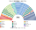
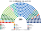
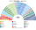
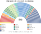

# 估計結果

> **這檔是什麼**：民意套本夾選制的席次**表**（如組閣聯盟／多數派政府）——§1 近期大選、§2 民調（若有）、§3 長期。圖庫見 [`席次圖.md`](席次圖.md)；大選算法細節見本夾重算檔。朝野互動見「預期政治生態」。

選制摘要：全院 **513＝單一 300（top-3 孔多賽）＋複數 213（聖拉古、無法定門檻）**。詳 [`01`](01-國會與選制.md)。

## 1 近期大選

用 TSE 逐市鎮得票套本夾。細節見 [`14-近期大選重算.md`](14-近期大選重算.md)。

| | 實際（開放名單） | **本夾全院 513** | 首長 |
|---|---|---|---|
| 2026-10 | PL 121、PT 聯盟 88、União–PP 87 … | União–PP **137**、PL 89、PSD 63、MDB 48、PT 43 … | PODE |
| 2022-10 | PL 99、PT 聯盟 80、União 59 … | União **88**、PSD 70、PL 58、MDB 54 … | União |

### 2026-10 單一／複數

| 政黨 | 單一 300 | 複數 213 | **全院** |
|---|--:|--:|--:|
| União–PP | 107 | 30 | **137** |
| PL | 37 | 52 | **89** |
| PSD | 45 | 18 | **63** |
| MDB | 32 | 16 | **48** |
| PT | 8 | 35 | **43** |
| REP | 26 | 17 | **43** |
| PODE | 24 | 12 | **36** |
| PSB | 5 | 10 | **15** |
| PSOL | 0 | 10 | **10** |
| NOVO | 4 | 4 | **8** |
| PSDB | 5 | 3 | **8** |
| PRD | 3 | 4 | **7** |
| AVANTE | 4 | 1 | **5** |
| MISSÃO | 0 | 1 | **1** |

**組閣聯盟／多數派政府**：首長 **PODE**；中間大團為樞紐；改憲法要複數 ≥128（中間大團約 80，須拉 PL 或 PT）。

### 2022-10 單一／複數

| 政黨 | 單一 300 | 複數 213 | **全院** |
|---|--:|--:|--:|
| União | 66 | 22 | **88** |
| PSD | 53 | 17 | **70** |
| PL | 20 | 38 | **58** |
| MDB | 35 | 19 | **54** |
| PP | 26 | 20 | **46** |
| PT | 9 | 31 | **40** |
| REP | 19 | 16 | **35** |
| PRD | 23 | 10 | **33** |
| PSDB | 22 | 9 | **31** |
| PODE | 13 | 7 | **20** |
| AVANTE | 6 | 3 | **9** |
| PSOL | 0 | 9 | **9** |
| PSB | 3 | 6 | **9** |
| PDT | 5 | 4 | **9** |
| NOVO | 0 | 2 | **2** |

**組閣聯盟／多數派政府**：首長 **União**；中間大團＋盟友組閣；細節見重算檔。

## 2 民調

民調與得票摘自 parliament_condorcet 研究抽取／維基等彙整之 CSV（`parliament_condorcet/<country>/data/`），非本倉內建資料。`brazil/data/polls.csv` 主要是**現行各州開放名單比例代表**下的實際當選，不是本夾選制。獨立的會前政黨支持度民調列在該抽取中不足；下列以 **2026 眾議院逐市鎮得票** 直接套本夾（與 §1 同一套生態模型）——**單一 300** top-3 孔多賽、**複數 213** 聖拉古。

**現行選制實際當選**（2026-10-04，`polls.csv`）：PL 121、FE（PT 系）88、UPB（União–PP）87、PSD 43、Republicanos 41、MDB 36、PODE 27 …（合計 513）。

**本夾**（2026 地理 Condorcet＋聖拉古；首長 **PODE**）：

| 政黨 | 得票占比（2026） | 單一 300 | 複數 213 | 全院 513 |
|---|--:|--:|--:|--:|
| PL | 22.7% | 37 | 52 | **89** |
| PT | 15.4% | 8 | 35 | **43** |
| União–PP | 13.6% | 107 | 30 | **137** |
| PSD | 8.3% | 45 | 18 | **63** |
| REP | 7% | 26 | 17 | **43** |
| MDB | 7% | 32 | 16 | **48** |
| PODE | 5.1% | 24 | 12 | **36** |
| PSOL | 4.9% | 0 | 10 | **10** |
| PSB | 4.4% | 5 | 10 | **15** |
| PSDB | 2.8% | 5 | 3 | **8** |
| NOVO | 2.6% | 4 | 4 | **8** |
| PRD | 1.9% | 3 | 4 | **7** |
| PDT | 1.7% | 0 | 0 | **0** |
| AVANTE | 1.6% | 4 | 1 | **5** |
| MISSÃO | 1.1% | 0 | 1 | **1** |

## 3 長期運行假設下

生態模型 **推估第 3 屆**（修正案廢除後誘因下的得票假設；[`12-預期政治生態.md`](12-預期政治生態.md) §3）。

| 政黨 | 單一 300 | 複數 213 | **全院 513** |
|---|--:|--:|--:|
| PL | 63 | 62 | **125** |
| União–PP | 91 | 25 | **116** |
| PT | 16 | 44 | **60** |
| PSD | 34 | 16 | **50** |
| MDB | 32 | 13 | **45** |
| REP | 18 | 15 | **33** |
| PODE | 15 | 9 | **24** |
| PSB | 12 | 9 | **21** |
| PSDB | 10 | 4 | **14** |
| PSOL | 0 | 10 | **10** |
| NOVO | 5 | 4 | **9** |
| AVANTE | 3 | 1 | **4** |
| PRD | 1 | 1 | **2** |

朝野互動與候選人行為見 [`12-預期政治生態.md`](12-預期政治生態.md)。
