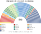
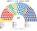
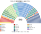
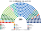
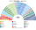

# 席次圖

> **這檔是什麼**：仿維基席次**圖庫**（長期示意；有則附大選重算／現行圖）。席次**數字表**與民調見 [`估計結果.md`](估計結果.md)；大選算法細節見本夾 `*大選重算*`／`*近期大選*` 檔。朝野互動見「預期政治生態」。

數字來自 [`生態模型.py`](生態模型.py)；產生器：席次圖產生器。座位依**陣營軸**由左（Lula 系）到右（Bolsonaro 系）排列，中間大團居中。

## 推估第 3 屆（2026 地理；PT、PL 各從中間大團拿回 4 點）

### 全院 513

### 單一席次 300

### 複數席次 213

| 政黨 | 單一 300 | 複數 213 | **全院** |
|---|--:|--:|--:|
| União–PP | 107 | 30 | **137** |
| PL | 37 | 52 | **89** |
| PSD | 45 | 18 | **63** |
| MDB | 32 | 16 | **48** |
| PT | 8 | 35 | **43** |
| REP | 26 | 17 | **43** |
| PODE | 24 | 12 | **36** |
| PSB | 5 | 10 | **15** |
| PSOL | 0 | 10 | **10** |
| NOVO | 4 | 4 | **8** |
| PSDB | 5 | 3 | **8** |
| PRD | 3 | 4 | **7** |
| AVANTE | 4 | 1 | **5** |
| MISSÃO | 0 | 1 | **1** |

過半 **257**、3/5 **308**、2/3 **342**。首長：PODE。複數 3/5 **128**——中間大團 80，改憲法要拉 PL 或 PT。

## 2026-10 得票套新制

細表見 [`估計結果.md`](估計結果.md) §1 與 [`14`](14-近期大選重算.md)。

### 全院 513

### 單一席次 300

| 政黨 | 單一 300 | 複數 213 | **全院** |
|---|--:|--:|--:|
| União–PP | 107 | 30 | **137** |
| PL | 37 | 52 | **89** |
| PSD | 45 | 18 | **63** |
| MDB | 32 | 16 | **48** |
| PT | 8 | 35 | **43** |
| REP | 26 | 17 | **43** |
| PODE | 24 | 12 | **36** |
| PSB | 5 | 10 | **15** |
| PSOL | 0 | 10 | **10** |
| NOVO | 4 | 4 | **8** |
| PSDB | 5 | 3 | **8** |
| PRD | 3 | 4 | **7** |
| AVANTE | 4 | 1 | **5** |
| MISSÃO | 0 | 1 | **1** |

## 2022-10 得票套新制

| 政黨 | **全院** |
|---|--:|
| União | **88** |
| PSD | **70** |
| PL | **58** |
| MDB | **54** |
| PP | **46** |
| PT | **40** |
| REP | **35** |
| PRD | **33** |
| PSDB | **31** |
| PODE | **20** |
| AVANTE | **9** |
| PDT | **9** |
| PSB | **9** |
| PSOL | **9** |
| NOVO | **2** |

## 顏色

| 政黨 | 色 | 政黨 | 色 |
|---|---|---|---|
| PSOL | 黃 | PODE | 青綠 |
| PT | 紅 | União、União–PP | 藍 |
| PDT | 淺紅 | PP | 淺藍 |
| PSB | 橙 | REP | 深青 |
| PSDB | 天藍 | PRD | 棕 |
| MDB | 綠 | MISSÃO | 紫 |
| PSD | 黃綠 | NOVO | 橘紅 |
| AVANTE | 粉 | PL | 深藍 |
