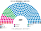
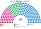

# 近期大選套新制

> 席次一覽與圖見 [`估計結果.md`](估計結果.md) §1、[`席次圖.md`](席次圖.md)。本檔講**怎麼**套。

## 1 方法與資料限制

| 項目 | 來源與做法 |
|---|---|
| 第一偏好 | **59 個現行選區**的名單得票率（維基 June／May 2023 Greek parliamentary election 的 By constituency 表；[`_parse_wiki.py`](_parse_wiki.py) → [`資料/gr-2023-06.csv`](資料/gr-2023-06.csv)、[`資料/gr-2023-05.csv`](資料/gr-2023-05.csv)） |
| 權重 | 各選區 2021 普查法定居民（維基 List of parliamentary constituencies of Greece）。加權後全國份額和官方幾乎一致：2023-06 ND 40.5（官方 40.56）、SYRIZA 18.0（17.83）、PASOK 11.9（11.84）；2023-05 ND 40.7（40.79）、SYRIZA 20.1（20.07） |
| **為什麼這麼粗** | 內政部 ekloges.ypes.gr 對自動存取一律回 403（CDN 阻擋），依規定不繞過；使用者暫不手動下載。GitHub 上的鏡像也只到選區層級 |
| 區 | 12 國內區（[`01`](01-國會與選制.md) §2）；2023 年沒有海外郵寄投票，海外區不計 |
| 單一 132 | 區內依選區順序（大致相鄰）按居民切成等大的新區，**跨界的選區按比例拆分**：同一選區拆出來的新區得票率相同。這會低估地方差異，單一席次比逐投票所版更「一面倒」 |
| 複數 88 | 各區聖拉古、無門檻；「其他」拆成 5 張小名單 |
| 首長 | 全院 220 記名排名，須 ≥111；組閣由近到遠 |

## 2 2023-06-25（紅利制下的實際選舉）

實際（300）：ND 158（含紅利 50）、SYRIZA 47、PASOK 32、KKE 21、Spartans 12、EL 12、Victory 10、PE 8。

| 政黨 | 得票% | 實際 300 | 單一 132 | 複數 88 | **新制 220** |
|---|--:|--:|--:|--:|--:|
| **ND** | 40.5 | 158 | 103 | 45 | **148** |
| PASOK | 11.9 | 32 | 20 | 13 | **33** |
| SYRIZA | 18.0 | 47 | 9 | 18 | **27** |
| KKE | 7.7 | 21 | 0 | 7 | **7** |
| EL | 4.4 | 12 | 0 | 2 | **2** |
| Victory | 3.7 | 10 | 0 | 2 | **2** |
| Spartans | 4.7 | 12 | 0 | 1 | **1** |
| PE、MeRA25 | 3.2、2.5 | 8、0 | 0 | 0 | **0** |

| 區（單一） | 結果 | 區 | 結果 |
|---|---|---|---|
| 雅典中北（14） | ND 14 | 馬其頓西中（9） | ND 9 |
| 雅典西南（14） | ND 8、SYRIZA 6 | 色薩利（10） | ND 10 |
| 比雷埃夫斯－西阿提卡（8） | ND 5、SYRIZA 3 | 伊庇魯斯－西希臘－愛奧尼亞（17） | **PASOK 12**、ND 5 |
| 東阿提卡－群島（12） | ND 12 | 中希臘（7） | ND 7 |
| 塞薩洛尼基（14） | ND 14 | 伯羅奔尼撒（8） | ND 8 |
| 北希臘（11） | ND 9、PASOK 2 | 克里特（8） | **PASOK 6**、ND 2 |

- **ND 單獨過半（148≥111）**：不靠紅利。右派小黨（Spartans、EL、Victory，合計 12.8%）的選民把 ND 排在左派前，ND 在大部分新區對 PASOK、SYRIZA 都贏。
- **PASOK 在西希臘、克里特拿單一席次**：它在這些地方是 SYRIZA 與 ND 之間的居中選擇。
- **改選舉法要拉 PASOK**：ND 複數 45 不到 53（[`05`](05-法規位階與修憲.md) §2）。

## 3 2023-05-21（純比例下的實際選舉）

實際（300，純比例）：ND 146、SYRIZA 71、PASOK 41、KKE 26、EL 16。**沒有政黨組閣，看守政府辦 6 月重選。**

| 政黨 | 得票% | 實際 300 | 單一 132 | 複數 88 | **新制 220** |
|---|--:|--:|--:|--:|--:|
| **ND** | 40.7 | 146 | 64 | 45 | **109** |
| SYRIZA | 20.1 | 71 | 32 | 21 | **53** |
| PASOK | 11.5 | 41 | 36 | 13 | **49** |
| KKE | 7.2 | 26 | 0 | 7 | **7** |
| EL | 4.5 | 16 | 0 | 2 | **2** |

- **得票幾乎一樣，單一席次卻差很多**（ND 103 → 64）：5 月沒有 Spartans，右派小黨合計只有約 7%（EL、Victory），「其他」7.6% 的第二偏好假設成左右各半。ND 對 PASOK 的對決在很多區變成 52：48 上下，區域差異決定勝負。
- **組得出政府**：ND 109 不夠 111，與 PASOK 合 158。即使談不攏，30 日後孔多賽第一名（ND，對 PASOK、SYRIZA 都是 111：109）逕行就任。**不會有 6 月重選**。
- 雅典西南 14 區全歸 SYRIZA、西希臘 17 區全歸 PASOK、克里特 8 區全歸 PASOK。

## 4 敏感度（`--sweep`）

| 檢查 | 2023-06 單一 | 首長 | 2023-05 單一 | 首長 |
|---|---|---|---|---|
| 基準 | ND 103、PASOK 20、SYRIZA 9 | ND | ND 64、PASOK 36、SYRIZA 32 | ND |
| 全部重左右 | ND 106、PASOK 20、SYRIZA 6 | ND | ND 61、PASOK 38、SYRIZA 33 | **PASOK** |
| 全部重體制 | ND 91、SYRIZA 31、PASOK 10 | ND | ND 66、SYRIZA 43、PASOK 23 | ND |
| 切線位移半區 | ND 102、PASOK 21、SYRIZA 9 | — | ND 63、PASOK 37、SYRIZA 32 | — |
| ND −4／SYRIZA ＋4 點 | ND 60、PASOK 38、SYRIZA 34 | **PASOK** | — | — |
| ND ＋4／SYRIZA −4 點 | ND 120、PASOK 7、SYRIZA 5 | ND | — | — |

2023-06 的結論穩；2023-05 的首長在 ND 與 PASOK 之間，看假設。

## 5 走向（推測）

| 時點 | 現實 | **新制** |
|---|---|---|
| 2023-05 | 純比例、組不出政府、看守、重選 | ND＋PASOK 組閣或 ND 逕行就任；一次選舉就結束 |
| 2023-06 | 紅利 50 席、ND 158 單獨 | ND 148 單獨過半，不需紅利 |
| 2023–26 | Tempi 部長責任卡在國會；監聽案 | 檢察官直接偵辦；情報局由國會監督 |
| 2026 民調 | ND 約 30%、Tsipras 新黨 ELAS 約 16%、右派分裂 | 首長 PASOK（[`估計結果.md`](估計結果.md) §2） |

## 6 出處

| 數字 | 出處 |
|---|---|
| 2023 逐選區得票率 | 維基 June／May 2023 Greek parliamentary election（引內政部） |
| 選區居民、現行席次 | 維基 List of parliamentary constituencies of Greece（引內政部、2021 普查） |
| 實際席次 | 同上兩頁 |
| 民調 | 維基 Opinion polling for the next Greek parliamentary election |
