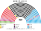

# 預期政治生態

> **席次估計**見 [`估計結果.md`](估計結果.md)。本檔專注誘因、朝野互動與候選人行為。

`0-基本/要求.md` **硬性**：不得把提示詞要求直接當預期生態；不合期望就回頭改設計。  
`0-基本/總體.md`：長期預期政治生態要有論據，可大膽假設。

路徑：**誘因 → 得票 → 選制 → 席次 → 朝野互動 → 檢視**。席次由 [`生態模型.py`](生態模型.py) 算出。

## 1 誘因

| 層 | 誘因 | 預期行為 |
|---|---|---|
| 單一席次（top-3 孔多賽） | 第三名支持者的第二偏好決定勝負 | CDU／SPD／Grüne／FDP 互搶第二偏好；**AfD 若幾乎不是任何人的第二偏好，單一席次會遠少於第一偏好份額** |
| 複數席次（十六邦） | 無全國門檻 | BSW／FDP 等靠邦名單進國會；小邦 M＝2 有效門檻高 |
| 組閣 30 日 | 不需聯盟協議就能就任 | 協議變短；解散重來消失 |
| 建設性更新、無解散 | 退出聯盟不會倒閣／逼提前選 | 「拆政府逼選舉」這張牌消失 |
| 總統形式化 | 不再握解散／點菜 | Bellevue 退出組閣主路徑 |

## 2 假設

### 2.1 偏好空間（基準＝2025 重算）

二維：**經濟**（左 −1 … 右 +1）、**文化**（開放 −1 … 保守、限移民 +1）。

| 政黨 | 經濟 | 文化 |
|---|:--:|:--:|
| LINKE | −0.85 | −0.55 |
| BSW | −0.55 | 0.45 |
| SPD | −0.35 | −0.15 |
| GRÜNE | −0.25 | −0.85 |
| SSW | −0.15 | −0.4 |
| FDP | 0.55 | −0.35 |
| CDU | 0.35 | 0.25 |
| CSU | 0.45 | 0.45 |
| FW | 0.25 | 0.35 |
| AfD | 0.15 | 1.0 |

選民三型：重經濟 30%、重文化 40%、均衡 30%。

### 2.2 地理

Bundeswahlleiterin 2025 **Wahlbezirksstatistik**（逐投票區 Zweitstimme，約 13,400 個單位）；邦內依選區號、單位序連續切成單一選區。

### 2.3 推估第 3 屆（**不是** 2025 得票）

兩屆孔多賽之後的大膽假設（改假設就重跑 `--projection`）：

| 機制 | 內容 |
|---|---|
| 票移轉 | 部分抗議第一偏好從 AfD → CDU／SPD：選民學到「藍營領先仍常在三人決選輸掉」 |
| AfD 策略 | 文化軸 **1.0 → 0.6**（`POS_TERM3`）：為搶第二偏好收斂 |
| 小黨 | BSW 穩定約 5%；FDP 約 4% |
| 目標全國% | CDU 26、AfD 18、SPD 17、Grüne 12、Linke 9、CSU 6.5、BSW 5、FDP 4 |

地理形狀仍用 2025；**得票權重與 AfD 座標與 §1 不同**。

## 3 席次（推估第 3 屆）

| 政黨 | 單一 252 | 複數 168 | **全院 420** | 2025 重算（對照） |
|---|--:|--:|--:|--:|
| CDU | 140 | 47 | **187** | 197 |
| SPD | 48 | 31 | **79** | 78 |
| CSU | 37 | 11 | **48** | 48 |
| AfD | 20 | 28 | **48** | 40 |
| LINKE | 7 | 17 | **24** | 21 |
| GRÜNE | 0 | 20 | **20** | 19 |
| BSW | 0 | 8 | **8** | 10 |
| FDP | 0 | 5 | **5** | 6 |
| FW | 0 | 1 | **1** | 1 |

門檻：過半 211、3/5 252、2/3 280；複數 3/5 101、2/3 112。

- **相對 2025 重算**：CDU 仍最大但略降；AfD 軟化後單一 5→20，全院仍低於第一偏好份額。
- **首長：CDU**，最弱對決 ≥211。
- **組閣聯盟／多數派政府**：CDU＋FW＋CSU＝**236**（模型由近到遠；**不編碼** Brandmauer）。

## 4 朝野互動與候選人行為（第 3 屆）

| 面向 | 預期 |
|---|---|
| 組閣 | 30 日內；黑黃（CDU／CSU）可過半，不必黑紅 |
| 立法 | 中間偏右；SPD／Grüne 在都會單一議價 |
| 規則 | CDU 複數 47（要 101）：**改規則要拉他黨** |
| AfD | 軟化換到部分東德單一；若再極端化，單一回 2025 的近乎歸零 |
| 候選人 | 單一選區比「誰能當第二偏好」；極端限移言論仍被懲罰 |

## 5 檢視：哪裡不合

本夾期望：**並立真地理、無 5% 殘殺、無 Bundesrat 否決、無解散重來、組閣有截止。** 對得上。代價：

### 5.1 不合一：AfD 席次仍低於第一偏好

第 3 屆得票約 18%，全院 50 席（12%）。軟化有幫助，**孔多賽仍懲罰「多數人的最後名」**。

**判斷**：不改選制；矯正型公投＋複數 3/5 改規則保留。

### 5.2 不合二：不保證最大黨執政、不編碼 Brandmauer

本推估下 CDU 同時是席次第一與首長。若未來 AfD 第一偏好再升、軟化不夠，可能再出現「席次前列 ≠ 首長」——**老實寫，不把隔離帶寫進憲法**。
