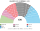
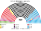
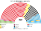
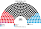

# 近期大選重算

> **這檔是什麼**：近期大選得票**怎麼**套進本夾選制（方法、假設、對照）。席次一覽與圖見 [`估計結果.md`](估計結果.md) §1、[`席次圖.md`](席次圖.md)。

2025、2021 套新制

**問題**：2025-02 與 2021-09 的選民照原本的偏好投票，在本夾的制度下會選出什麼樣的國會和政府？

**方法**：[`生態模型.py`](生態模型.py)。第一偏好是 Bundeswahlleiterin 終局 **Wahlkreis Zweitstimme**（[`資料/bt-2025.csv`](資料/bt-2025.csv)、[`資料/bt-2021.csv`](資料/bt-2021.csv)）；偏好排序是假設（[`12`](12-預期政治生態.md) §2）。單一選區在邦內依 wk_nr 序切，席次配額見 [`01`](01-國會與選制.md)。**不是**全國比例拆單一；**不是** Zweitstimme 定總席；**不模擬**政黨在新制下的重組（第 3 屆誘因假設見 [`估計結果`](估計結果.md) §3）。

## 1 一覽

| | 實際（630，聯立／Zweit 定總） | 實際組閣 | **新制全院 420** | **新制首長** | **組閣聯盟／多數派政府** |
|---|---|---|---|---|---|
| 2025-02 | CDU 164、AfD 152、SPD 120 … | 黑紅；Brandmauer | CDU **195**、SPD 80、CSU 47、AfD 41、LINKE 21、GRÜNE 19、BSW 10、FDP 6、FW 1 | **CDU**（最弱 267） | **CDU＋FW＋CSU＝243** |
| 2021-09 | SPD 206、CDU 152、Grüne 118 … | Ampel | SPD **225**、CDU 76、CSU 37、GRÜNE 25、FDP 22、AfD 18、LINKE 9、FW 8 | **SPD**（最弱 259） | **SPD＝225** |

## 2 2025-02

| 政黨 | 得票% | 實際 | 單一 252 | 複數 168 | **新制** |
|---|--:|--:|--:|--:|--:|
| CDU | 22.6 | 164 | 154 | 41 | **195** |
| AfD | 20.8 | 152 | 6 | 35 | **41** |
| SPD | 16.4 | 120 | 51 | 29 | **80** |
| GRÜNE | 11.6 | 85 | 0 | 19 | **19** |
| LINKE | 8.8 | 64 | 5 | 16 | **21** |
| CSU | 6.0 | 44 | 36 | 11 | **47** |
| BSW | 4.981 | 0 | 0 | 10 | **10** |
| FDP | 4.3 | 0 | 0 | 6 | **6** |
| FW | 1.5 | 0 | 0 | 1 | **1** |

| 邦（單一） | 結果 |
|---|---|
| NW（54） | CDU 39、SPD 15 |
| BY（40） | CSU 36、SPD 4 |
| BW（34） | CDU 30、SPD 4 |
| NI（24） | CDU 19、SPD 5 |
| HE（19） | CDU 14、SPD 5 |
| RP（13） | CDU 12、SPD 1 |
| SN（12） | CDU 7、AfD 4、LINKE 1 |
| BE（11） | SPD 5、LINKE 4、CDU 2 |
| SH（9） | CDU 6、SPD 3 |
| BB（8） | CDU 7、SPD 1 |
| ST（6） | CDU 5、AfD 1 |
| TH（6） | CDU 6 |
| HH（6） | SPD 6 |
| MV（5） | CDU 4、AfD 1 |
| SL（3） | CDU 3 |
| HB（2） | SPD 2 |

- **AfD 152 → 41**：全國第二偏好，單一只 6。決選三人常見含 AfD，但 AfD 幾乎不是第二偏好。
- **BSW 0 → 10**：無全國門檻治 4.981% 歸零。
- **76 區**「非第一偏好第一名當選」。
- **首長 CDU**；組閣聯盟／多數派政府 **CDU＋FW＋CSU＝243**（過半 211）。模型**不編碼** Brandmauer；若行為仍排除 AfD，路徑本來就不必找 AfD。

## 3 2021-09

| 政黨 | 得票% | 實際 | 單一 252 | 複數 168 | **新制** |
|---|--:|--:|--:|--:|--:|
| SPD | 25.7 | 206 | 177 | 48 | **225** |
| CDU | 18.9 | 152 | 41 | 35 | **76** |
| GRÜNE | 14.8 | 118 | 0 | 25 | **25** |
| FDP | 11.5 | 91 | 0 | 22 | **22** |
| AfD | 10.3 | 83 | 0 | 18 | **18** |
| CSU | 5.2 | 45 | 28 | 9 | **37** |
| LINKE | 4.9 | 39 | 0 | 9 | **9** |
| FW | 2.4 | 0 | 6 | 2 | **8** |

- **SPD 單獨 225 過半**：現實是 Ampel 三黨；新制下聯盟協議不是就任條件。
- **AfD 83 → 18**：單一只 0。
- 首長 SPD（最弱 ≥211）。

## 4 敏感度與穩健性（2025）

| 檢查 | 結果 |
|---|---|
| 選民全部重經濟 | 單一 CDU 仍最大；首長 **CDU** |
| 選民全部重文化 | 單一 CDU；首長 CDU |
| 全部均衡 | 單一 CDU；首長 CDU |
| AfD −6 點 | 全院 CDU 180、SPD 108、AfD 24；首長 CDU |
| AfD ＋6 點 | 全院 CDU 197、AfD 68、SPD 54；首長 **仍 CDU** |

★ 在本夾偏好假設下，2025 基準的首長結果對 AfD ±6 點不敏感；若改文化軸權重或 AfD 第二偏好結構，才可能動搖——改 [`12`](12-預期政治生態.md) §2.1 就重跑。

## 5 限制

- 偏好排序是假設的二維空間，不是真實排序票。
- 單一選區依 wk_nr 序切／合併，不是官方 252 區劃界。
- 用 Zweitstimme 當第一偏好強度；Erststimme 地圖未單獨跑（並立層不聯立）。
- 不模擬新制下的政黨重組（那是 §3 長期，不是本檔）。

## 來源

- Die Bundeswahlleiterin，《Bundestagswahl 2025／2021》終局 kerg2（[`資料/btw25_kerg2.csv`](資料/btw25_kerg2.csv)、[`資料/btw2021_kerg2.csv`](資料/btw2021_kerg2.csv)）。
- 實際席次與組閣：Bundeswahlausschuss 終局；2025 黑紅為公開組閣結果。
