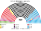
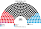
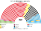
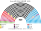
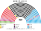
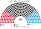

# 估計結果

> 席次**表**——§1 近期大選、§2 民調、§3 長期。圖庫見 [`席次圖.md`](席次圖.md)；算法見 [`14`](14-近期大選重算.md)、[`生態模型.py`](生態模型.py)。

選制摘要：全院 **420＝單一 252（top-3 孔多賽）＋複數 168（聖拉古、無全國門檻、十六邦）**。詳 [`01`](01-國會與選制.md)。

## 1 近期大選

BWL Wahlkreis Zweitstimme 套本夾（**不是**比例拆單一；**不是** Zweit 定總）。細節見 [`14`](14-近期大選重算.md)。**不是第 3 屆。**

| | 實際（630） | **本夾全院 420** | 首長 |
|---|---|---|---|
| 2025-02 | CDU 164、AfD 152、SPD 120 …；黑紅 | CDU **195**、SPD 80、CSU 47、AfD 41、LINKE 21、GRÜNE 19、BSW 10、FDP 6、FW 1 | **CDU** |
| 2021-09 | SPD 206、CDU 152、Grüne 118 …；Ampel | SPD **225**、CDU 76、CSU 37、GRÜNE 25、FDP 22、AfD 18、LINKE 9、FW 8 | **SPD** |

### 2025-02 單一／複數

| 政黨 | 單一 252 | 複數 168 | **全院** |
|---|--:|--:|--:|
| CDU | 154 | 41 | **195** |
| SPD | 51 | 29 | **80** |
| CSU | 36 | 11 | **47** |
| AfD | 6 | 35 | **41** |
| LINKE | 5 | 16 | **21** |
| GRÜNE | 0 | 19 | **19** |
| BSW | 0 | 10 | **10** |
| FDP | 0 | 6 | **6** |
| FW | 0 | 1 | **1** |

**組閣聯盟／多數派政府**：首長 **CDU**；CDU＋FW＋CSU＝**243**（過半 211）。改規則要複數 ≥101（CDU 僅 41）。

### 2021-09

| 政黨 | 單一 252 | 複數 168 | **全院** |
|---|--:|--:|--:|
| SPD | 177 | 48 | **225** |
| CDU | 41 | 35 | **76** |
| CSU | 28 | 9 | **37** |
| GRÜNE | 0 | 25 | **25** |
| FDP | 0 | 22 | **22** |
| AfD | 0 | 18 | **18** |
| LINKE | 0 | 9 | **9** |
| FW | 6 | 2 | **8** |

**組閣聯盟／多數派政府**：首長 **SPD**；SPD 單獨 **225**（現實為 Ampel）。

## 2 民調

方法：以 **2025 Wahlkreis 地理** 為基底，按民調全國得票%縮放後跑本夾——**單一** top-3 孔多賽、**複數** 聖拉古（**不是**比例拆單一）。

### Forsa 示意（約 2026-10；模型內 `POLL_FORSA`）

全國意向（含 CSU 分列）：AfD 26、CDU 24、SPD 14、Grüne 11、Linke 10、CSU 6、BSW 4、FDP 3。

| 政黨 | 單一 252 | 複數 168 | **全院** |
|---|--:|--:|--:|
| CDU | 164 | 44 | **208** |
| AfD | 14 | 43 | **57** |
| SPD | 24 | 24 | **48** |
| CSU | 36 | 10 | **46** |
| LINKE | 11 | 20 | **31** |
| GRÜNE | 3 | 18 | **21** |
| BSW | 0 | 5 | **5** |
| FDP | 0 | 3 | **3** |
| FW | 0 | 1 | **1** |

**首長：CDU**。  
**組閣聯盟／多數派政府**（模型：偏好距離由近到遠）：CDU＋FW＋CSU＝**255**。  
★ 模型**不編碼** Brandmauer；若政治行為仍排除 AfD，機械過半路徑本來就不含 AfD。

## 3 長期運行（推估第 3 屆）

生態模型示意 **推估第 3 屆**（假設見 [`12`](12-預期政治生態.md) §2.3；`python 生態模型.py --projection`）。

**與 §1 不同**：不是 2025 得票重跑。假設兩屆孔多賽後——（1）部分第一偏好從 AfD 移回中間黨；（2）AfD 為搶第二偏好，文化軸從 1.0 軟化到 0.6；（3）BSW／FDP 維持低門檻進場。地理形狀仍用 2025。

目標全國得票%：CDU 26、AfD 18、SPD 17、Grüne 12、Linke 9、CSU 6.5、BSW 5、FDP 4。

| 政黨 | 單一 252 | 複數 168 | **全院 420** |
|---|--:|--:|--:|
| CDU | 137 | 47 | **184** |
| SPD | 52 | 31 | **83** |
| AfD | 22 | 28 | **50** |
| CSU | 36 | 11 | **47** |
| LINKE | 5 | 17 | **22** |
| GRÜNE | 0 | 20 | **20** |
| BSW | 0 | 8 | **8** |
| FDP | 0 | 5 | **5** |
| FW | 0 | 1 | **1** |

**組閣聯盟／多數派政府**：首長 **CDU**；CDU＋FW＋CSU＝**232**（過半 211）。相對 §1：AfD 單一回升（軟化），全院仍低於第一偏好份額。朝野見 [`12`](12-預期政治生態.md)。
