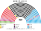
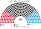
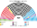
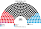
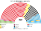
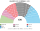
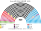

# 席次圖

數字來自 [`生態模型.py`](生態模型.py)；產生器：席次圖產生器。座位依**文化軸**由左（開放）到右（保守、限移民）。

## 推估第 3 屆（[`估計結果`](估計結果.md) §3）

### 全院 420

### 單一席次 252

### 複數席次 168

| 政黨 | 單一 252 | 複數 168 | **全院** |
|---|--:|--:|--:|
| CDU | 137 | 47 | **184** |
| SPD | 52 | 31 | **83** |
| AfD | 22 | 28 | **50** |
| CSU | 36 | 11 | **47** |
| LINKE | 5 | 17 | **22** |
| GRÜNE | 0 | 20 | **20** |
| BSW | 0 | 8 | **8** |
| FDP | 0 | 5 | **5** |
| FW | 0 | 1 | **1** |

首長 CDU；CDU＋FW＋CSU＝232。假設見 [`12`](12-預期政治生態.md) §2.3。

## 2025-02 得票重算（§1）

## 2021-09 得票重算（§1）

## 現行制度 2025-02

## 民調 Forsa 示意 2026-10

## 顏色

Grüne 綠、Linke 洋紅、SPD 紅、SSW 深藍、FDP 黃、CDU 黑、CSU 藍、FW 橙、BSW 紫、AfD 淺藍。
