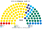
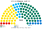

# 估計結果

> 席次**表**——§1 近期大選、§2 民調、§3 長期。圖庫見 [`席次圖.md`](席次圖.md)；算法見 [`14`](14-近期大選重算.md)、[`生態模型.py`](生態模型.py)、[`民調重算.py`](民調重算.py)。

選制：全院 **101＝單一 61（top-3 孔多賽）＋複數 40（聖拉古、無門檻）**；首長、供給 ≥51；組織法全院 ≥61 且複數 ≥24。詳 [`01`](01-國會與選制.md)。

## 1 近期大選

國家選舉委員會：2023 opendata.valimised.ee `/api/RK_2023/`；2019 rk2019.valimised.ee 網頁表格。

| | 實際（101） | **本夾全院 101** | 首長 | 組閣 |
|---|---|---|---|---|
| 2023-03 | RE 37、EKRE 17、KESK 16、E200 14、SDE 9、IE 8；RE＋E200＋SDE 60（Kallas）；2024-07 起 Michal；2025-03 起 RE＋E200 | **RE 58、KESK 21、E200 6、EKRE 6、IE 6、SDE 4** | **RE** | RE＝58 |
| 2019-03 | RE 34、KESK 26、EKRE 19、IE 12、SDE 10；KESK＋EKRE＋IE 57（Ratas）；2021-01 起 RE＋KESK 60（Kallas） | **KESK 45、RE 33、IE 12、EKRE 7、SDE 4** | **KESK** | KESK＋IE＝57 |

| 政黨 | 單一 61 | 複數 40 | **全院** |
|---|--:|--:|--:|
| RE | 46 | 12 | **58** |
| KESK | 13 | 8 | **21** |
| E200 | 0 | 6 | **6** |
| EKRE | 0 | 6 | **6** |
| IE | 2 | 4 | **6** |
| SDE | 0 | 4 | **4** |

**組閣聯盟／多數派政府**：首長 **RE**；**RE＝58**。組織法：RE 複數 12，改不了。

| 政黨 | 單一 61 | 複數 40 | **全院** |
|---|--:|--:|--:|
| KESK | 36 | 9 | **45** |
| RE | 19 | 14 | **33** |
| IE | 6 | 6 | **12** |
| EKRE | 0 | 7 | **7** |
| SDE | 0 | 4 | **4** |

**組閣聯盟／多數派政府**：首長 **KESK**；**KESK＋IE＝57**。組織法：KESK＋IE 複數 15，改不了。

## 2 民調

**方法**：[`民調重算.py`](民調重算.py)；來源 [`資料/polls.csv`](資料/polls.csv)（維基 Opinion polling for the next Estonian parliamentary election，每家最新一筆；ERK（2024 自 EKRE 分出）用 EKRE 的地理按比例拆出；以 2023 逐投票所地理縮放）。

| 民調 | 投票意向（前五） | **本夾全院 101** | 單一 61 | 首長 | 組閣（機械） |
|---|---|---|---|---|---|
| Norstat（2026-10-19..25） | KESK 23.8、IE 22.9、SDE 16.6、EKRE 13.5、RE 11.4 | KESK 40、IE 35、RE 10、SDE 8、EKRE 6、PP 2 | KESK 30、IE 25、RE 4、PP 1、SDE 1 | **KESK** | KESK＋PP＋IE＝77 |
| Emor（2026-10-12..21） | KESK 20.6、SDE 20.4、IE 19.4、RE 14.2、EKRE 13.8 | KESK 33、IE 27、RE 23、SDE 11、EKRE 6、PP 1 | KESK 24、IE 18、RE 17、SDE 2 | **KESK** | KESK＋PP＋IE＝61 |
| Turu-uuringute（2026-10-01..08） | KESK 21.6、IE 19.6、EKRE 18.6、SDE 14.4、RE 10.3 | KESK 44、IE 30、EKRE 8、SDE 8、RE 7、PP 4 | KESK 35、IE 21、PP 2、RE 2、SDE 1 | **KESK** | KESK＋PP＋IE＝78 |

**讀法**：「組閣」是由首長往外依偏好距離加黨到 ≥51 的機械結果，不是預測。

## 3 長期運行（推估第 3 屆）

兩翼（社民黨、EKRE、聯合左翼）各讓出 1/8 第一偏好給改革黨與中間黨（`python 生態模型.py --projection`）。

| 政黨 | 單一 61 | 複數 40 | **全院** |
|---|--:|--:|--:|
| RE | 47 | 13 | **60** |
| KESK | 13 | 9 | **22** |
| E200 | 0 | 6 | **6** |
| EKRE | 0 | 6 | **6** |
| IE | 1 | 4 | **5** |
| SDE | 0 | 2 | **2** |

首長 **RE**，RE＝60；複數 13，改不了組織法。
