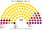
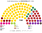
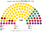
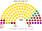

# 估計結果

> 席次**表**——§1 近期大選、§2 民調、§3 長期。圖庫見 [`席次圖.md`](席次圖.md)；算法見 [`14`](14-近期大選重算.md)、[`生態模型.py`](生態模型.py)、[`民調重算.py`](民調重算.py)。

選制：全院 **100＝單一 60（top-3 孔多賽）＋複數 40（聖拉古、無門檻）**；首長、供給 ≥51；組織法全院 ≥60 且複數 ≥24。詳 [`01`](01-國會與選制.md)。

## 1 近期大選

中央選舉委員會（CVK）：2022 data.gov.lv「14. Saeimas vēlēšanas sv2022」逐投票所（`departmentresults.json`）；2026 cvk.lv/data/rezultati/latest.json（5 選區最終結果，2026-10-16）。

| | 實際（100） | **本夾全院 100** | 首長 | 組閣 |
|---|---|---|---|---|
| 2026-10 | AS 41、LPV 17、SV 15、NA 10、PRO 10、JV 7；選後協商中 | **AS 70、LPV 13、NA 5、SV 5、PRO 3、JV 2、MMN 1、ZZS 1** | **AS** | AS＝70 |
| 2022-10 | JV 26、ZZS 16、AS 15、NA 13、S! 11、PRO 10、LPV 9；JV＋AS＋NA 54（Kariņš）；2023-09 起 JV＋ZZS＋PRO 52（Siliņa） | **AS 30、ZZS 24、JV 16、LPV 10、NA 5、SDPS 5、S! 3、LKS 2、PRO 2 …** | **AS** | AS＋ZZS＝54 |

| 政黨 | 單一 60 | 複數 40 | **全院** |
|---|--:|--:|--:|
| AS | 54 | 16 | **70** |
| LPV | 6 | 7 | **13** |
| NA | 0 | 5 | **5** |
| SV | 0 | 5 | **5** |
| PRO | 0 | 3 | **3** |
| JV | 0 | 2 | **2** |
| MMN | 0 | 1 | **1** |
| ZZS | 0 | 1 | **1** |

**組閣聯盟／多數派政府**：首長 **AS**；**AS＝70**。組織法：AS 複數 16，改不了。

| 政黨 | 單一 60 | 複數 40 | **全院** |
|---|--:|--:|--:|
| AS | 24 | 6 | **30** |
| ZZS | 17 | 7 | **24** |
| JV | 6 | 10 | **16** |
| LPV | 8 | 2 | **10** |
| NA | 1 | 4 | **5** |
| SDPS | 3 | 2 | **5** |
| S! | 1 | 2 | **3** |
| LKS | 0 | 2 | **2** |
| PRO | 0 | 2 | **2** |
| AP | 0 | 1 | **1** |
| KuK | 0 | 1 | **1** |
| SV | 0 | 1 | **1** |

**組閣聯盟／多數派政府**：首長 **AS**；**AS＋ZZS＝54**。組織法：AS＋ZZS 複數 13，改不了。

## 2 民調

**方法**：[`民調重算.py`](民調重算.py)；來源 [`資料/polls.csv`](資料/polls.csv)（維基 2026 Latvian parliamentary election 的 Opinion polls；**選後還沒有民調**，用選前最後一個月各家最新一筆。以 2026 逐投票所（推估）地理縮放）。

| 民調 | 投票意向（前五） | **本夾全院 100** | 單一 60 | 首長 | 組閣（機械） |
|---|---|---|---|---|---|
| SKDS（2026-09-04..16） | AS 22.8、SV 14.1、LPV 13.3、PRO 10.2、NA 8.7 | AS 58、LPV 18、SV 6、ZZS 5、NA 4、PRO 4、JV 2 … | AS 47、LPV 12、ZZS 1 | **AS** | AS＝58 |
| Latvijas Fakti（2026-09） | AS 23.9、LPV 12.9、PRO 12.4、ZZS 10.6、NA 8.9 | AS 60、ZZS 11、LPV 10、PRO 6、NA 4、SV 4、JV 2 … | AS 49、ZZS 6、LPV 5 | **AS** | AS＝60 |

**讀法**：「組閣」是由首長往外依偏好距離加黨到 ≥51 的機械結果，不是預測。

## 3 長期運行（推估第 3 屆）

兩翼（進步黨、民族聯盟、主權力量、拉脫維亞優先）各讓出 1/8 第一偏好給團結名單與綠農（`python 生態模型.py --projection`）。

| 政黨 | 單一 60 | 複數 40 | **全院** |
|---|--:|--:|--:|
| AS | 52 | 18 | **70** |
| LPV | 5 | 6 | **11** |
| ZZS | 3 | 4 | **7** |
| NA | 0 | 4 | **4** |
| SV | 0 | 4 | **4** |
| JV | 0 | 2 | **2** |
| PRO | 0 | 2 | **2** |

首長 **AS**，AS＝70；複數 18，改不了組織法。
