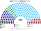

# 預期政治生態

> **席次估計**（近期大選重算、民調套本夾、長期運行假設下的席次表）見 [`估計結果.md`](估計結果.md)。本檔專注誘因、朝野互動與候選人行為；席次數字以估計結果與席次圖為準。

`0-基本/總體.md`：給長期運行下的預期政治生態，要有論據，可大膽假設。
`0-基本/要求.md` **硬性**：不得把提示詞要求直接當預期生態；不合期望就回頭改設計。

席次由 [`生態模型.py`](生態模型.py) 算出。

## 1 誘因

| 層 | 誘因 | 預期行為 |
|---|---|---|
| 眾議院單一席次 | 第三名支持者的第二偏好決定勝負 | ANO 的候選人要拿 SPOLU、STAN 選民的第二偏好，**和 SPD 的距離變成負債**；SPOLU、STAN 的候選人要拿 ANO 選民的第二偏好，**「反 Babiš」本身不再夠用** |
| 複數席次（彈性名單、無門檻） | 不必擔心 5% 門檻 | 選民不必為了「不浪費票」而投大黨；小黨不必為了過門檻而組聯盟 |
| 組閣 | 總統不能卡、不能挑 | 組閣談判只在眾議院裡進行 |
| 倒閣 | 要具名繼任者 | 反對黨的不信任案從「表態」變成「提出另一個總理」 |
| 改規則 | 要兩種多數，修憲還要參議院 | 公共媒體、檢察、選制的改動變成朝野協商 |

## 2 假設

### 2.1 偏好的空間

| 政黨 | 地緣（西方整合 −1 … 主權派 +1） | 社經（自由市場、改革 −1 … 民粹、國家主義 +1） |
|---|:--:|:--:|
| SPOLU（ODS、KDU-ČSL、TOP 09） | −0.7 | −0.6 |
| STAN | −0.6 | −0.2 |
| Piráti | −0.8 | +0.1 |
| **ANO** | **+0.1** | **+0.7** |
| AUTO（Motorists） | +0.6 | −0.6 |
| SPD | +0.9 | +0.5 |
| Stačilo! | +0.9 | +0.9 |

選民分三型：重地緣（50%）、重社經（20%）、均衡（30%），和羅馬尼亞夾相同。

★ **ANO 在地緣軸上居中**：它不反歐盟、不反北約，但和主權派共享民粹的社經立場。親西方選民在 ANO 和 SPD 之間選 ANO；主權派選民在 ANO 和 SPOLU 之間選 ANO。這一個位置決定了 §3 的大半結果。

### 2.2 校準

用 2023 年總統選舉校準：模型算出 Pavel 對 Babiš 58.9%（實際決選 58.3%），Nerudová 對 Babiš 59.3%（民調 57–64%），Pavel 對 Nerudová 53.0%（民調 50–56%）。

### 2.3 地區

14 州的**實際**得票（不像羅馬尼亞夾要借總統選舉）。州內單一選區加城鄉梯度（SPOLU、Piráti 在城市強，ANO、SPD 在鄉村強）和隨機擾動。

## 3 席次（以 2025-10 實際得票）

| 政黨 | 單一 110 | 複數 90 | **眾議院 200** |
|---|--:|--:|--:|
| **ANO** | 73 | 30 | **103** |
| STAN | 23 | 12 | 35 |
| SPOLU | 7 | 21 | 28 |
| Piráti | 7 | 9 | 16 |
| SPD | 0 | 8 | 8 |
| AUTO | 0 | 8 | 8 |
| Stačilo! | 0 | 2 | 2 |

門檻：過半 101、3/5 120、2/3 134；複數 3/5 54、2/3 60。

- **首長**：ANO 的人選，最弱的一場對決是 121 比 79。**ANO 單獨過半，不需要 SPD 和 Motorists**。
- **STAN 是第二大黨**：它在 SPOLU、Piráti 選民和 ANO 選民之間都是可接受的第二選擇，拿下 23 個單一選區。
- **主權派三黨**（SPD、AUTO、Stačilo!，合計 18.9%）在單一選區 0 席，只剩比例層的 18 席（9%）。
- **規則**：ANO 在複數席次只有 30／90，改組織法要拉 SPOLU 和 STAN（[`05`](05-法規位階與修憲.md) §3）。

### 3.1 參議院

| 情境 | 結果 |
|---|---|
| 假設 81 席全部以 2025 年民意、同日改選 | ANO 54、STAN 15、SPOLU 7、Piráti 5 |
| 現實 2026-10 改選 27 席（兩輪多數決、決選單獨舉行） | **ANO 0 席** |

## 4 朝野互動與候選人行為

| 面向 | 預期 |
|---|---|
| 政府 | ANO 在 30% 以上時**單黨執政**；掉到約 25% 時換成 **STAN 當樞紐**（§6） |
| 執政聯盟的形狀 | **主權派不再是組閣的必要夥伴**。現實的 ANO＋SPD＋AUTO 聯盟，在新制下 ANO 不需要它 |
| 反對黨 | 從「反 Babiš 大聯盟」變成「爭取 ANO 選民的第二偏好」。SPOLU 在單一選區只剩 7 席，比例層是它的主戰場 |
| 總統與政府 | 總統沒有任命裁量，Pavel 與 Babiš 那種對峙失去舞台 |
| 候選人 | 單一席次候選人淡化反歐盟或反 Babiš 的口號，比地方治理 |
| 公共媒體、檢察 | 執政黨單獨改不動 |

## 5 檢視：哪裡不合

本夾對自己的期望：**保留捷克運作良好的部分、組得出政府、規則不被單一政黨改寫、選舉日人人去投票。**

### 5.1 不合一：三分之一的第一偏好拿到單獨過半

| ANO 第一偏好（2025 形狀，其餘按比例） | 單一 110 | 眾議院 200 | 首長 |
|:--:|--:|--:|---|
| 20% | 34 | 52 | **STAN** |
| 25% | 49 | 72 | **STAN** |
| 30% | 66 | 92 | ANO（要找夥伴） |
| 34.5%（約等於 2025；按比例縮放，和 §3 差 1–2 席） | 74 | 105 | ANO（單獨過半） |
| 40% | 88 | 122 | ANO（過 3/5，但複數不到 54） |

ANO 以約 33% 就能單獨過半。這和保加利亞夾的發現相同：**居中政黨被單一席次放大**。

**因此改過或確認的設計**：

| 原本的想法 | 改成 | 檔 |
|---|---|---|
| 首長、供給由單一席次選 | **眾議院全院**（ANO 30% 時要找夥伴，只限單一席次則仍單獨執政） | [`02`](02-政府組成與建設性更新.md) §2.1 |
| 憲法法院乙組由參議院選（計劃 D14） | 改由**眾議院複數席次**選（參議院也會被放大，§5.3） | [`07`](07-司法權與檢察.md) §2.1 |
| 公共媒體財源「寫進組織法」 | 確認：ANO 單獨的複數 30 席改不了 | [`03`](03-預算與供給.md) §3 |
| 緊急狀態只有追認 | 加上第 91 日起要過比例層 | [`08`](08-緊急狀態與地方.md) §2 |

**改完仍然剩下的**：一個 33% 的政黨單獨組閣、單獨立法。本夾的判斷和保加利亞夾相同：**這是孔多賽贏家應得的；防線放在規則。**

### 5.2 不合二：2021 年的結果會反過來

以 2021 年實際得票重算，ANO 也拿 103 席（[`14`](14-近期大選重算.md) §2）。現實中 SPOLU 加 Pirates＋STAN 以約 43% 的得票拿到 108 席、Fiala 組閣；新制下會是 **Babiš 續任**。

這不是模型的錯：2021 年約兩成選票因 5% 門檻落空（ČSSD、KSČM、Přísaha 等），而這些選民在 ANO 和 SPOLU 之間多半選 ANO。現行制度讓 43% 拿到過半，新制讓**孔多賽贏家**拿到過半。**哪一個比較「對」，取決於你接不接受孔多賽**；本夾接受，但要把這個後果寫出來。

### 5.3 不合三：參議院可能失去「反對黨的院」的性格

現實中參議院長期是反對黨的據點：低投票率的決選，動員的是反執政黨的選民（2026 年 ANO 0／27）。本夾把決選搬到所有人都投票的 B 日，**模型顯示同樣的民意下，參議院會和眾議院一樣被 ANO 主導**。

**處置**：
- 參議院仍然每 2 年改選 1/3，**期中選舉的民意擺盪**仍會讓它和眾議院錯開。
- 憲法法院乙組改由比例層選（§5.1 表）。
- 參議院只在修憲時是第三道鎖；組織法的鎖是比例層。

**改完仍然剩下的**：參議院的制衡力會變弱。這是提高投票率的代價；本夾選擇正當性高、但比較不「反對」的參議院。

### 5.4 對得上的

- **組得出政府**：所有情境的首長都直接出現，無循環。
- **主權派不再是組閣的樞紐**：2025 年現實中 SPD 和 Motorists 是 ANO 組閣的必要夥伴；新制下不是。
- **改規則要跨陣營**：沒有任何組合能在不包含 ANO 和至少兩個反對黨的情況下過組織法。

## 6 敏感度

| 選民類型 | 2025 單一 110 | 2021 單一 110 |
|---|---|---|
| 基準 | ANO 73、STAN 23、SPOLU 7、Piráti 7 | ANO 76、PirSTAN 34 |
| 全部重地緣 | ANO 81、STAN 16、SPOLU 13 | ANO 79、PirSTAN 31 |
| 全部重社經 | ANO 55、STAN 31、Piráti 17、SPD 6、SPOLU 1 | ANO 52、PirSTAN 52、SPD 4、Přísaha 2 |

| 縣內擾動 | 2025 單一 110 |
|---|---|
| 無 | ANO 77、STAN 16、SPOLU 14、Piráti 3 |
| 基準（sd 2.5） | ANO 73–75、STAN 23、SPOLU 7、Piráti 5–7 |
| 加倍（sd 5） | ANO 72–76、STAN 21–27、SPOLU 5–8、Piráti 5–6 |

★ ANO 在所有權重下都是單一席次的最大黨；只有在「全部重社經」時，2021 年的 PirSTAN 能和它打平。

## 7 席次圖

[`席次圖.md`](席次圖.md)。
