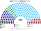
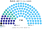
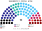
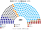
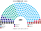
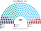
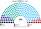
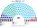
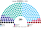

# 估計結果

> **這檔是什麼**：民意套本夾選制的席次**表**（如組閣聯盟／多數派政府）——§1 近期大選、§2 民調（若有）、§3 長期。圖庫見 [`席次圖.md`](席次圖.md)；大選算法細節見本夾重算檔。朝野互動見「預期政治生態」。

選制摘要：眾議院 **200＝單一 110（top-3 孔多賽）＋複數 90（聖拉古、無法定門檻）**。詳 [`01`](01-國會與選制.md)。

## 1 近期大選

用州級得票套本夾。細節見 [`14-近期大選重算.md`](14-近期大選重算.md)。

| | 現實 200 | **本夾眾議院 200** |
|---|---|---|
| 2025-10 | ANO 80、SPOLU 52、STAN 22、Piráti 18 … | **ANO 103**、STAN 35、SPOLU 28、Piráti 16、SPD 8、AUTO 8、Stačilo! 2 |
| 2021-10 | SPOLU＋PirSTAN 執政 | **ANO 103**、PirSTAN 48、SPOLU 27 …（Babiš 續任） |

### 2025-10 眾議院單一／複數

| 政黨 | 單一 110 | 複數 90 | **眾議院** |
|---|--:|--:|--:|
| ANO | 73 | 30 | **103** |
| STAN | 23 | 12 | **35** |
| SPOLU | 7 | 21 | **28** |
| Piráti | 7 | 9 | **16** |
| SPD | 0 | 8 | **8** |
| AUTO | 0 | 8 | **8** |
| Stačilo! | 0 | 2 | **2** |

**組閣聯盟／多數派政府**：首長 **ANO**；ANO **103**≥過半 101；參院示意 ANO 54／81。

### 2021-10 眾議院單一／複數

| 政黨 | 單一 110 | 複數 90 | **眾議院** |
|---|--:|--:|--:|
| ANO | 76 | 27 | **103** |
| PirSTAN | 34 | 14 | **48** |
| SPOLU | 0 | 27 | **27** |
| SPD | 0 | 8 | **8** |
| ČSSD | 0 | 7 | **7** |
| Přísaha | 0 | 6 | **6** |
| KSČM | 0 | 1 | **1** |

**組閣聯盟／多數派政府**：首長 **ANO** 續任；ANO **103**≥101。

## 2 民調

民調與得票摘自 parliament_condorcet 研究抽取／維基等彙整之 CSV（`parliament_condorcet/<country>/data/`），非本倉內建資料。得票推估來自 `czechia/data/input_vote_shares.csv`。方法：民調得票率當全國第一偏好，套本夾生態模型（14 州相對形狀保留）——**單一 110** top-3 孔多賽、**複數 90** 聖拉古（不是全國比例拆單一）。民調把 SPOLU 拆成 ODS／TOP／KDU 者，模型合併為 **SPOLU**；其餘小黨併入「其他」。

### STEM（2026-10-01..06，n＝1332）

得票推估（ODS＋TOP09＋KDU→SPOLU）

首長 **ANO**。

| 政黨 | 得票推估% | 單一 110 | 複數 90 | 眾議院 200 |
|---|--:|--:|--:|--:|
| ANO | 31.3% | 74 | 33 | **107** |
| STAN | 16.6% | 36 | 18 | **54** |
| SPOLU | 17.5% | 0 | 17 | **17** |
| SPD | 7.5% | 0 | 8 | **8** |
| Piráti | 7.2% | 0 | 9 | **9** |
| AUTO | 4.6% | 0 | 4 | **4** |
| Stačilo | 3.3% | 0 | 1 | **1** |
| 其他 | 8.4% | 0 | 0 | **0** |

### NMS（2026-10-01..05，n＝1034）

得票推估（ODS＋TOP09＋KDU→SPOLU）

首長 **ANO**。

| 政黨 | 得票推估% | 單一 110 | 複數 90 | 眾議院 200 |
|---|--:|--:|--:|--:|
| ANO | 28.8% | 68 | 27 | **95** |
| STAN | 18.8% | 42 | 19 | **61** |
| SPOLU | 18.7% | 0 | 19 | **19** |
| SPD | 8% | 0 | 8 | **8** |
| Piráti | 6.3% | 0 | 8 | **8** |
| AUTO | 5.7% | 0 | 8 | **8** |
| Stačilo | 3% | 0 | 1 | **1** |
| 其他 | 8.4% | 0 | 0 | **0** |

### Median（2026-09-01..30，n＝1018）

得票推估（ODS＋TOP09＋KDU→SPOLU）

首長 **ANO**。

| 政黨 | 得票推估% | 單一 110 | 複數 90 | 眾議院 200 |
|---|--:|--:|--:|--:|
| ANO | 29.5% | 67 | 27 | **94** |
| STAN | 17% | 43 | 18 | **61** |
| SPOLU | 19% | 0 | 21 | **21** |
| SPD | 9% | 0 | 8 | **8** |
| Piráti | 7.5% | 0 | 9 | **9** |
| AUTO | 5% | 0 | 7 | **7** |
| Stačilo | 2% | 0 | 0 | **0** |
| 其他 | 6% | 0 | 0 | **0** |

### Ipsos（2026-09-08..12，n＝1084）

得票推估（ODS＋TOP09＋KDU→SPOLU）

首長 **ANO**。

| 政黨 | 得票推估% | 單一 110 | 複數 90 | 眾議院 200 |
|---|--:|--:|--:|--:|
| ANO | 31.4% | 66 | 31 | **97** |
| STAN | 16.6% | 43 | 17 | **60** |
| SPOLU | 20.4% | 0 | 21 | **21** |
| SPD | 7.1% | 0 | 8 | **8** |
| Piráti | 7.9% | 1 | 9 | **10** |
| AUTO | 4.5% | 0 | 3 | **3** |
| Stačilo | 3.4% | 0 | 1 | **1** |
| 其他 | 5.9% | 0 | 0 | **0** |

### Kantar（2026-08-03..21，n＝991）

得票推估（ODS＋TOP09＋KDU→SPOLU）

首長 **STAN**（模型對決敏感）。

| 政黨 | 得票推估% | 單一 110 | 複數 90 | 眾議院 200 |
|---|--:|--:|--:|--:|
| ANO | 30.5% | 51 | 28 | **79** |
| STAN | 17% | 59 | 17 | **76** |
| SPOLU | 21% | 0 | 21 | **21** |
| SPD | 6.5% | 0 | 8 | **8** |
| Piráti | 8.5% | 0 | 9 | **9** |
| AUTO | 5% | 0 | 7 | **7** |
| 其他 | 2.5% | 0 | 0 | **0** |

## 3 長期運行假設下

生態以 **2025-10 得票套新制** 為眾議院示意（[`12-預期政治生態.md`](12-預期政治生態.md) §3）。

| 政黨 | 單一 110 | 複數 90 | **眾議院 200** |
|---|--:|--:|--:|
| ANO | 73 | 30 | **103** |
| STAN | 23 | 12 | **35** |
| SPOLU | 7 | 21 | **28** |
| Piráti | 7 | 9 | **16** |
| SPD | 0 | 8 | **8** |
| AUTO | 0 | 8 | **8** |
| Stačilo! | 0 | 2 | **2** |

朝野互動與候選人行為見 [`12-預期政治生態.md`](12-預期政治生態.md)。
