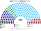
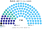
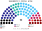
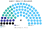
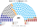

# 席次圖

> **這檔是什麼**：仿維基席次**圖庫**（長期示意；有則附大選重算／現行圖）。席次**數字表**與民調見 [`估計結果.md`](估計結果.md)；大選算法細節見本夾 `*大選重算*`／`*近期大選*` 檔。朝野互動見「預期政治生態」。

數字來自 [`生態模型.py`](生態模型.py)；產生器：席次圖產生器。座位依**地緣軸**由左（西方整合）到右（主權派）排列。

## 2025-10 得票套新制

### 眾議院 200

### 單一席次 110

### 複數席次 90

| 政黨 | 單一 110 | 複數 90 | **全院** |
|---|--:|--:|--:|
| ANO | 73 | 30 | **103** |
| STAN | 23 | 12 | **35** |
| SPOLU | 7 | 21 | **28** |
| Piráti | 7 | 9 | **16** |
| AUTO | 0 | 8 | **8** |
| SPD | 0 | 8 | **8** |
| Stačilo! | 0 | 2 | **2** |

過半 **101**、3/5 **120**、2/3 **134**。複數 3/5 **54**。

### 參議院 81（假設同一次民意全部改選）

| 政黨 | **全院** |
|---|--:|
| ANO | **54** |
| STAN | **15** |
| SPOLU | **7** |
| Piráti | **5** |

現實是每 2 年改選 1/3；2026 年 ANO 在改選 27 席中 0 席（[`12`](12-預期政治生態.md) §5.3）。

## 2021-10 得票套新制

| 政黨 | 單一 110 | 複數 90 | **眾議院** |
|---|--:|--:|--:|
| ANO | 76 | 27 | **103** |
| PirSTAN | 34 | 14 | **48** |
| SPOLU | 0 | 27 | **27** |
| SPD | 0 | 8 | **8** |
| ČSSD | 0 | 7 | **7** |
| Přísaha | 0 | 6 | **6** |
| KSČM | 0 | 1 | **1** |

## 顏色

| 政黨 | 色 |
|---|---|
| Piráti | 黑 |
| SPOLU | 藍 |
| PirSTAN | 灰 |
| STAN | 青綠 |
| ČSSD | 橙 |
| ANO | 淺藍 |
| Přísaha | 棕 |
| AUTO | 洋紅 |
| SPD | 深紅 |
| KSČM、Stačilo! | 紅 |
