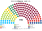
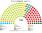

# 近期大選套新制

> 席次一覽與圖見 [`估計結果.md`](估計結果.md) §1、[`席次圖.md`](席次圖.md)。本檔講**怎麼**套。

## 1 方法

| 項目 | 來源與做法 |
|---|---|
| 第一偏好 | 統計局 volby.statistics.sk 的 `tab03f`（**逐投票區 okrsok × 政黨**）：2023 年 6,013 個、2020 年 5,998 個投票區＋海外（[`_build_nrsr.py`](_build_nrsr.py)、[`_build_nrsr2020.py`](_build_nrsr2020.py) → [`資料/nrsr-2023.csv`](資料/nrsr-2023.csv)、[`資料/nrsr-2020.csv`](資料/nrsr-2020.csv)）。政黨依官方編號對應；2020 年的州與座標沿用 2023 年同一市鎮碼 |
| 驗證 | 2020 年全國有效票 2,881,511、OĽaNO 25.03%、Smer 18.29%，和官方一致。2023 年全國有效票 2,967,896；Smer 22.95%、PS 17.96%、Hlas 14.70%、OĽaNO 8.90%、KDH 6.82%、SaS 6.32%、SNS 5.63%、Republika 4.75%、Aliancia 4.39%，和官方一致 |
| 座標 | Wikidata LAU 代碼（P782）末 6 碼＝市鎮碼（含布拉提斯拉瓦、科希策的市轄區）；2,927 個市鎮全部對上 |
| 單一 90 | 5 個國內區內依座標 Hilbert 序、按有效票連續切；top-3 孔多賽 |
| 複數 60 | 各區聖拉古、無門檻；海外 1 席 |
| 首長 | 全院 150 記名排名，須 ≥76 |

## 2 2023-09-30

實際（150）：Smer 42、PS 32、Hlas 27、OĽaNO 16、KDH 12、SaS 11、SNS 10；**Smer＋Hlas＋SNS 79 組閣**。Republika（4.75%）、Aliancia（4.39%）等約 17% 的票沒有換到席次。

| 政黨 | 得票% | 實際 150 | 單一 90 | 複數 60 | **新制 150** |
|---|--:|--:|--:|--:|--:|
| **Hlas** | 14.7 | 27 | **61** | 10 | **71** |
| Smer | 22.9 | 42 | 1 | 14 | **15** |
| SaS | 6.3 | 11 | 10 | 4 | **14** |
| Aliancia | 4.4 | 0 | 10 | 3 | **13** |
| PS | 18.0 | 32 | 0 | 12 | **12** |
| OĽaNO | 8.9 | 16 | 5 | 6 | **11** |
| KDH | 6.8 | 12 | 3 | 4 | **7** |
| SNS | 5.6 | 10 | 0 | 4 | **4** |
| Republika | 4.8 | 0 | 0 | 3 | **3** |

| 區（單一） | 結果 |
|---|---|
| 布拉提斯拉瓦（13） | SaS 10、Hlas 3 |
| 特爾納瓦－尼特拉（21） | Hlas 13、**Aliancia 7**、OĽaNO 1 |
| 特倫欽－日利納（23） | Hlas 21、Smer 1、KDH 1 |
| 班斯卡比斯特里察－科希策（21） | Hlas 16、Aliancia 3、OĽaNO 2 |
| 普雷紹夫（12） | Hlas 8、OĽaNO 2、KDH 2 |

- **Hlas 被大幅放大**：大多數新區的決選三人是 Smer、PS、Hlas；Smer 選民把 Hlas 排在 PS 前，PS 選民把 Hlas 排在 Smer 前。90 位單一當選人中 79 位不是第一偏好第一名；當選者第一偏好中位數只有 **16.3%**。
- **布拉提斯拉瓦給 SaS**：PS 第一，但 Smer、Hlas 選民把 SaS 排在 PS 前（模型位置）。
- **Aliancia 回到國會**：南部匈牙利族集中處拿 10 個單一席次，名單再 3 席（病 9）。
- **首長 Hlas**（對 Smer、PS 都大勝）；組閣 **Hlas＋KDH＝78**。
- **2023–24 年的執政三黨（Smer＋Hlas＋SNS）在本夾全院 90、複數 28**：改不了組織法（[`05`](05-法規位階與修憲.md)）。

## 3 2020-02-29

實際（150）：OĽaNO 53、Smer 38、Sme Rodina 17、ĽSNS 17、SaS 13、Za ľudí 12；**OĽaNO＋Sme Rodina＋SaS＋Za ľudí 95 組閣**。約 28% 的票投給門檻以下的黨（PS–Spolu 6.97% 差 0.03 點、KDH、MKS、SNS、Dobrá voľba、Vlasť、Most–Híd 等）。

| 政黨 | 得票% | 實際 150 | 單一 90 | 複數 60 | **新制 150** |
|---|--:|--:|--:|--:|--:|
| **OĽaNO** | 25.0 | 53 | 48 | 17 | **65** |
| Smer | 18.3 | 38 | 15 | 11 | **26** |
| Sme Rodina | 8.2 | 17 | 12 | 5 | **17** |
| Aliancia（MKS） | 3.9 | 0 | 10 | 3 | **13** |
| KDH | 4.7 | 0 | 5 | 3 | **8** |
| PS–Spolu | 7.0 | 0 | 0 | 5 | **5** |
| Za ľudí | 5.8 | 12 | 0 | 5 | **5** |
| ĽSNS | 8.0 | 17 | 0 | 4 | **4** |
| SaS | 6.2 | 13 | 0 | 4 | **4** |
| Most–Híd、Vlasť、SNS | 2.1、2.9、3.2 | 0 | 0 | 各 1 | **各 1** |

- **OĽaNO 是居中的孔多賽贏家**：布拉提斯拉瓦 13 區全拿，各區都第一。
- **ĽSNS（8.0%）單一 0 席**、名單只有 4 席；現行制度給它 17 席。
- **首長 OĽaNO**；組閣 **OĽaNO＋KDH＋Aliancia＝86**。

## 4 2024 總統

第一輪（統計局）：Korčok 42.5%、Pellegrini 37.0%、Harabin 11.7%。實際決選 **Pellegrini 53.1%**。

| | 現實 | **新制（模型）** |
|---|---|---|
| 進第二輪 | Korčok、Pellegrini | Korčok、Pellegrini、**Harabin** |
| 兩兩 | Pellegrini 53.1% | Pellegrini 對 Korčok **56.8%**；Korčok 對 Harabin 50.3%；Pellegrini 對 Harabin 87.7% |
| 勝者 | Pellegrini | **Pellegrini**（三種選民類型都相同） |

## 5 敏感度（`--sweep`）

| 檢查 | 2023 單一 90 | 首長 | 2020 單一 90 | 首長 |
|---|---|---|---|---|
| 基準 | Hlas 61、SaS 10、Aliancia 10、OĽaNO 5、KDH 3、Smer 1 | Hlas | OĽaNO 48、Smer 15、Sme Rodina 12、Aliancia 10、KDH 5 | OĽaNO |
| 全部重地緣 | Hlas 61、Aliancia 11、SaS 10、OĽaNO 4、KDH 3、Smer 1 | Hlas | OĽaNO 49、Smer 15、Sme Rodina 12、Aliancia 9、KDH 5 | OĽaNO |
| 全部重體制 | Hlas 63、SaS 10、Aliancia 7、OĽaNO 6、KDH 3、Smer 1 | Hlas | OĽaNO 53、Smer 15、Sme Rodina 12、Aliancia 5、KDH 5 | OĽaNO |
| 切線位移半區 | Hlas 62、SaS 10、Aliancia 8、OĽaNO 4、Smer 3、KDH 3 | — | OĽaNO 52、Sme Rodina 13、Smer 11、Aliancia 7、KDH 6、SaS 1 | — |
| 2023：Smer −6／PS ＋6 點 | Hlas 57、SaS 10、Aliancia 10、OĽaNO 7、KDH 6 | Hlas | — | — |
| 2023：Smer ＋6／PS −6 點 | Hlas 56、Smer 13、SaS 9、Aliancia 8 … | Hlas | — | — |

**結論對假設不敏感**：Hlas 在所有情境都是單一席次與首長的贏家。

## 6 走向（推測）

| 時點 | 現實 | **新制** |
|---|---|---|
| 2020-03 | OĽaNO＋Sme Rodina＋SaS＋Za ľudí，Matovič | OĽaNO 首長、OĽaNO＋KDH＋Aliancia |
| 2023-05 | 總統任命 Ódor 看守政府，信任投票失敗仍執政 | 沒有看守；Heger 做到繼任者就任 |
| 2023-10 | Smer＋Hlas＋SNS，Fico 第四任 | Hlas 首長、Hlas＋KDH |
| 2024-02 | 縮短程序修刑法、廢特別檢察署 | 刑法與檢察機關不得走縮短程序；廢特別檢察署要兩種多數 |
| 2024 | RTVS 改組為 STVR | 公共媒體財源與理事會是組織法事項 |
| 2025-09 | 執政聯盟拉到 3/5 修憲 | 修憲要兩種多數＋公投 |

## 7 出處

| 數字 | 出處 |
|---|---|
| 2023、2020 逐投票區 | 統計局 volby.statistics.sk/nrsr/nrsr2023 `files/NRSR2023_SK_csv.zip`、/nrsr2020 `files/NRSR_2020_SK_csv.zip`（`tab03f`、`tab0a` 政黨編號） |
| 市鎮座標 | Wikidata P782 → P625 |
| 2024 總統 | 維基 2024 Slovak presidential election（引 volbysr.sk） |
| 實際席次 | 維基 2023、2020 Slovak parliamentary election；統計局 2020 `tab04` |
