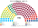
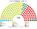
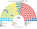
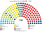
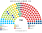
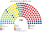
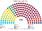

# 估計結果

> 席次**表**——§1 近期大選、§2 民調、§3 長期。圖庫見 [`席次圖.md`](席次圖.md)；算法見 [`14`](14-近期大選重算.md)、[`生態模型.py`](生態模型.py)、[`民調重算.py`](民調重算.py)。

選制：全院 **150＝單一 90（top-3 孔多賽）＋複數 60（5 國內區＋海外、聖拉古、無門檻）**；首長、供給 ≥76；組織法全院 ≥90 且複數 ≥36。詳 [`01`](01-國會與選制.md)。

## 1 近期大選

統計局**逐投票區**名單票（2023 年 6,013 個、2020 年 5,998 個＋海外）。

| | 實際（150） | **本夾全院 150** | 首長 | 組閣 |
|---|---|---|---|---|
| 2023-09 | Smer 42、PS 32、Hlas 27、OĽaNO 16、KDH 12、SaS 11、SNS 10；Smer＋Hlas＋SNS | **Hlas 71**、Smer 15、SaS 14、Aliancia 13、PS 12、OĽaNO 11、KDH 7、SNS 4、Republika 3 | **Hlas** | Hlas＋KDH＝78 |
| 2020-02 | OĽaNO 53、Smer 38、Sme Rodina 17、ĽSNS 17、SaS 13、Za ľudí 12；OĽaNO＋Sme Rodina＋SaS＋Za ľudí | **OĽaNO 65**、Smer 26、Sme Rodina 17、Aliancia 13、KDH 8、PS 5、Za ľudí 5、ĽSNS 4、SaS 4 … | **OĽaNO** | OĽaNO＋KDH＋Aliancia＝86 |

| 政黨 | 單一 90 | 複數 60 | **全院** |
|---|--:|--:|--:|
| Hlas | 61 | 10 | **71** |
| Smer | 1 | 14 | **15** |
| SaS | 10 | 4 | **14** |
| Aliancia | 10 | 3 | **13** |
| PS | 0 | 12 | **12** |
| OĽaNO | 5 | 6 | **11** |
| KDH | 3 | 4 | **7** |
| SNS | 0 | 4 | **4** |
| Republika | 0 | 3 | **3** |

**組閣聯盟／多數派政府**：首長 **Hlas**；**Hlas＋KDH＝78**。組織法：Hlas＋KDH 複數 14，改不了。

### 2024 總統（top-3 孔多賽）

**Pellegrini**（對 Korčok 56.8%，實際決選 53.1%）。見 [`14`](14-近期大選重算.md) §3。

## 2 民調

**方法**：[`民調重算.py`](民調重算.py)；來源 [`資料/polls.csv`](資料/polls.csv)（維基 Opinion polling for the next Slovak parliamentary election，投票意向）。2023 年 OĽaNO 名單裡的 Slovensko（Matovič）、Za ľudí、基督教聯盟用 OĽaNO 的地理按比例拆開；再以 2023 逐投票區地理縮放。

| 民調 | 投票意向（前五） | **本夾全院 150** | 單一 90 | 首長 | 組閣（機械） |
|---|---|---|---|---|---|
| Ipsos（10-15..19） | PS 18.6、Smer 18.4、Republika 10.8、Slovensko 10.0、SaS 8.1 | Smer 53、SaS 20、Slovensko 18、KDH 15、Aliancia 13、PS 12、Republika 8、Hlas 6、Demokrati 4、SNS 1 | Smer 40、SaS 16、Slovensko 11、KDH 11、Aliancia 10、Hlas 2 | **KDH** | 6 黨＝76 |
| Focus（10-12..19） | PS 17.4、Smer 17.0、Republika 11.3、Slovensko 9.7、Hlas 8.5 | Smer 50、Slovensko 19、SaS 17、Aliancia 13、Hlas 13、KDH 12、PS 11 … | Smer 39、SaS 13、Slovensko 12、Aliancia 10、Hlas 8、KDH 8 | **KDH** | 7 黨＝81 |
| NMS（10-01..05） | PS 19.6、Smer 17.9、Republika 14.3、Slovensko 9.0、SaS 8.0 | Smer 61、SaS 18、Slovensko 17、PS 15、Aliancia 11、Republika 10、KDH 9 … | Smer 49、SaS 14、Slovensko 11、Aliancia 9、KDH 5、PS 2 | **Hlas** | Hlas＋Sme Rodina＋KDH＋Smer＋Slovensko＝92 |
| AKO（09-10..21） | PS 18.9、Smer 17.1、Republika 9.7、Hlas 8.6、Slovensko 8.1 | Smer 46、SaS 22、Hlas 17、KDH 13、Aliancia 13、PS 12、Slovensko 12 … | Smer 35、SaS 17、Hlas 11、Aliancia 10、KDH 9、Slovensko 8 | **KDH** | 7 黨＝82 |

**讀法**：Hlas 掉到 6–9% 後，單一選區分散：Smer 35–49（第一偏好最大、對手分裂）、SaS 在布拉提斯拉瓦、Aliancia 在南部。首長是議員之間的孔多賽贏家：多半是**居中的小黨 KDH**。「組閣」是由首長往外依偏好距離加黨到 ≥76 的機械結果，不是預測。

## 3 長期運行（推估第 3 屆）

兩翼（PS、Republika、SNS）各讓出 1/8 第一偏好給 Hlas 與 KDH（`python 生態模型.py --projection`）。

| 政黨 | 單一 90 | 複數 60 | **全院** |
|---|--:|--:|--:|
| Hlas | 66 | 11 | **77** |
| Smer | 0 | 14 | **14** |
| KDH | 6 | 7 | **13** |
| SaS | 8 | 4 | **12** |
| Aliancia | 8 | 3 | **11** |
| PS | 0 | 10 | **10** |
| OĽaNO | 2 | 5 | **7** |
| Republika | 0 | 3 | **3** |
| SNS | 0 | 3 | **3** |

首長 **Hlas**，單獨 77；複數 11，改不了組織法。
