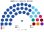

# 近期大選套新制

> **這檔是什麼**：近期大選得票**怎麼**套進本夾選制（方法、假設、對照）。席次一覽與圖見 [`估計結果.md`](估計結果.md) §1、[`席次圖.md`](席次圖.md)。

用**當時實際的得票**，把 2025、2020 年國會大選和 2011、2017、2023 年總統選舉套進本夾的制度。數字由 [`生態模型.py`](生態模型.py) 算出；假設見 [`12`](12-預期政治生態.md) §2。

## 1 一覽

| | 實際 | **本夾全院 100** | **首長** | **門檻** |
|---|---|---|---|---|
| 2025-05 | PAP 87／97（65.57%）、WP 10（另 2 非選區） | PAP **79**、WP 14、PSP 2、RDU 2、其餘各 1 | **PAP** | 複數 27≥24，單獨過組織法／修憲 |
| 2020-07 | PAP 83／93（61.24%）、WP 10 | PAP **77**、WP 12、PSP 4、NSP 2、其餘各 1 | **PAP** | 複數 24，剛好過 3/5 |

席次圖在**各屆小節**（圖上表下），不堆在一覽。總統重算見 §4（2011 孔多賽贏家為陳清木；無國會席次圖）。

## 2 國會 2025-05

### 2.1 實際

| 政黨 | 得票 | 席次 |
|---|--:|--:|
| PAP | 65.57% | 87 |
| WP | 14.99% | 10（另 2 非選區） |
| PSP | 4.88% | 0 |
| RDU | 3.96% | 0 |
| SDP | 3.72% | 0 |
| PAR | 2.51% | 0 |
| 其他 | 4.36% | 0 |

97 席中 92 席有競選；Marine Parade–Braddell Heights（5 席）不戰而勝。

### 2.2 新制

| 政黨 | 單一 60 | 複數 40 | **全院 100** |
|---|--:|--:|--:|
| **PAP** | 52 | 27 | **79** |
| WP | 8 | 6 | 14 |
| PSP | 0 | 2 | 2 |
| RDU | 0 | 2 | 2 |
| SDP、PAR、SPP | 0 | 各 1 | 各 1 |

| 複數區 | PAP | 第二 | 席次 |
|---|--:|---|---|
| 東南 | 55.1% | WP 38.0% | PAP 5、WP 3 |
| 東北 | 58.5% | WP 35.6% | PAP 5、WP 3 |
| 中區 | 74.7% | PAR 12.8% | PAP 6、PAR 1、SPP 1 |
| 西南 | 67.7% | PSP 22.1% | PAP 5、PSP 2、RDU 1 |
| 西北 | 72.5% | SDP 15.3% | PAP 6、RDU 1、SDP 1 |

- **首長**：PAP（黃循財），全院 79 票。
- **門檻**：PAP 全院 79（3/5 60、2/3 67 都過），複數 27（3/5 24 過）。**PAP 單獨過組織法，也單獨過修憲**（全院 2/3、複數 3/5）；只有核心條款要複決。
- **少數族群**：名單規則保證至少 13 位非華裔（[`01`](01-國會與選制.md) §2.3）。

## 3 國會 2020-07

### 3.1 實際

PAP 61.24%、83／93；WP 11.22%、10 席（Aljunied 集選區 5、Sengkang 集選區 4、後港 1）；PSP 10.18%、0 席（2 非選區）。

### 3.2 新制

| 政黨 | 單一 60 | 複數 40 | **全院 100** |
|---|--:|--:|--:|
| **PAP** | 53 | 24 | **77** |
| WP | 7 | 5 | 12 |
| PSP | 0 | 4 | 4 |
| NSP | 0 | 2 | 2 |
| SDP、RDU、SDA、PV、RP | 0 | 各 1 | 各 1 |

- **West Coast 集選區**（PAP 51.7%、PSP 48.3%）：拆成 3 區後，基準模型 3 區都是 PAP；擾動換種子時 PSP 可拿 1 區（[`12`](12-預期政治生態.md) §5.1）。
- **PSP 的 10% 得票**：現行 0 席加 2 非選區；新制 4 席，全部來自複數席次。
- **門檻**：PAP 複數 24，**剛好**過 3/5。

## 4 總統

### 4.1 2011：結果會反過來

| 候選人 | 第一輪 | 新制第二輪對決 |
|---|--:|---|
| 陳慶炎 | 35.20% | 對陳如斯 70.0% |
| **陳清木** | 34.85% | **對陳慶炎 64.8%**、對陳如斯 70.0% |
| 陳如斯 | 25.04% | — |
| 陳欽亮 | 4.91% | （第一輪淘汰） |

現實：一輪相對多數，陳慶炎以 7,382 票之差當選。**新制：陳清木是孔多賽贏家。** 陳如斯、陳欽亮的選民都把陳清木（前 PAP 議員、獨立形象）排在陳慶炎（前副總理）前面。三種選民類型的假設下結果都一樣。

★ 這是本夾最大的反事實：陳清木在 2017 年曾表態再選，當年的保留選舉讓他沒有資格參選。

### 4.2 2017：保留選舉

只有哈莉瑪拿到資格證書，不戰而勝。新制下沒有保留選舉，私部門要件改成組織規模；**無法重算**，因為實際上沒有其他候選人。可以確定的只有：本夾下這一屆一定要投票（[`04`](04-總統.md) §2：只有一位候選人時對手是「重新提名」）。

### 4.3 2023

| 候選人 | 第一輪 | 新制 |
|---|--:|---|
| **尚達曼** | 70.41% | 第一輪過半，直接當選 |
| 吳國松 | 15.72% | — |
| 陳欽亮 | 13.87% | — |

結果不變。

## 5 時程：2025 年在新制下

| 事項 | 現實 | 新制 |
|---|---|---|
| 新界線 | 2025-01-22 召集 EBRC，**3-11** 公布 | 依 2020 普查，**2024-05 前**定案 |
| 解散與選舉日 | 總理建議，**4-15** 解散 | 固定，無解散 |
| 提名 | 4-23 | A 日前 14 天以上 |
| 競選期 | 4-23 到 5-01，9 天 | ≥14 天 |
| 投票 | **5-03** 一天 | A 日（單一席次第一輪）＋兩週後 B 日（第二輪、複數名單） |
| 不戰而勝 | MPBH 5 席無人投票 | 單一選區各自投票；所有人都投複數名單 |
| 非選區議員 | 5-19 公布 2 人 | 無 |

## 6 走向

| 項目 | 現行 | 新制 |
|---|---|---|
| PAP 改選制 | 修憲 2/3，一次通過 | 全院 2/3 且複數 3/5，一次通過；改「單一＋複數」結構本身要複決 |
| 反對黨的選前協調 | 避免多角戰 | 不需要 |
| 總統選舉 | 6 次中 3 次不戰而勝 | 每次都要投票 |
| 內閣 | 部長須是議員 | 可延攬非議員 |
| PAP 單獨過半的得票 | — | 約 50%（[`12`](12-預期政治生態.md) §4） |

## 7 模型的限制

- 現行一個選區通常只有一個反對黨出戰；新制下多黨同時參選的第一偏好分布**沒有資料**，模型只用實際出戰的黨。
- 集選區內部的地理差異沒有公開資料，用隨機擾動代替。
- 複數區的劃法是模型自己調的（`LIST_MOVE`），實際由選舉委員會決定。
- 2011 年總統選舉的偏好位置沒有民調可以校準；結果之所以穩，是因為陳如斯、陳欽亮的選民（約 30%）幾乎不可能把前副總理排在陳清木前面。

## 8 資料來源

| 數字 | 出處 |
|---|---|
| 2025 年逐選區得票、全國得票、CDC 分區 | Wikipedia：Results of the 2025 Singaporean general election（引選舉局公報） |
| 2025 年時程、EBRC | Wikipedia：2025 Singaporean general election |
| 2020 年逐選區得票 | Wikipedia：2020 Singaporean general election |
| CDC 所轄選區 | Wikipedia：各 CDC 條目 |
| 2025 年選民數、集選區的少數族群類別 | Wikipedia：Constituencies of Singapore |
| 總統選舉 2011、2017、2023 | Wikipedia：各屆 Singaporean presidential election 條目 |
| 集選區的歷史（1988） | Wikipedia：Group representation constituency |
