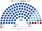
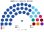
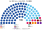

# 席次圖

> **這檔是什麼**：仿維基席次**圖庫**（長期示意；有則附大選重算／現行圖）。席次**數字表**與民調見 [`估計結果.md`](估計結果.md)；大選算法細節見本夾 `*大選重算*`／`*近期大選*` 檔。朝野互動見「預期政治生態」。

數字來自 [`生態模型.py`](生態模型.py)；產生器：席次圖產生器。座位依**體制軸**由左（建制）到右（改革、問責）排列。圖上、表下。

## 2025-05 得票套新制

### 全院 100

### 單一席次 60

### 複數席次 40

| 政黨 | 單一 60 | 複數 40 | **全院** |
|---|--:|--:|--:|
| PAP | 52 | 27 | **79** |
| WP | 8 | 6 | **14** |
| PSP | 0 | 2 | **2** |
| RDU | 0 | 2 | **2** |
| SDP | 0 | 1 | **1** |
| PAR | 0 | 1 | **1** |
| SPP | 0 | 1 | **1** |

過半 51、3/5 60、2/3 67。複數 3/5 **24**：PAP 單獨過。WP 單一：Aljunied 3、Sengkang 3、後港 1、Tampines 1。

### 對照：現行制度 2025 實際 97

| 政黨 | 席次 |
|---|--:|
| PAP | **87** |
| WP | **10** |

另有 WP 2 名非選區議員，不在圖中。

## 2020-07 得票套新制

| 政黨 | 單一 60 | 複數 40 | **全院** |
|---|--:|--:|--:|
| PAP | 53 | 24 | **77** |
| WP | 7 | 5 | **12** |
| PSP | 0 | 4 | **4** |
| NSP | 0 | 2 | **2** |
| SDP | 0 | 1 | **1** |
| RDU | 0 | 1 | **1** |
| SDA | 0 | 1 | **1** |
| PV | 0 | 1 | **1** |
| RP | 0 | 1 | **1** |

現實 PAP 83／93、WP 10。PAP 複數 24，剛好過 3/5。

## 刀鋒：PAP 掉到 55%

| 政黨 | 單一 60 | 複數 40 | **全院** |
|---|--:|--:|--:|
| PAP | 39 | 22 | **61** |
| WP | 19 | 8 | **27** |
| 其他（PSP、PAR、SDP、RDU、SPP、SDA） | 2 | 10 | **12** |

PAP 仍過半、過全院 3/5，複數 22——**改組織法要拉反對黨**（[`12`](12-預期政治生態.md) §4）。全院細分見圖例：PSP 4、PAR 2、SDP 2、RDU 2、SPP 1、SDA 1。

## 顏色

| 政黨 | 色 |
|---|---|
| PAP | 深藍 |
| WP | 淺藍 |
| SPP | 青綠 |
| 無黨籍、小黨 | 灰 |
| PSP | 洋紅 |
| RDU | 深紅 |
| SDA | 棕 |
| NSP | 黃 |
| SDP | 橙 |
| PV | 橄欖 |
| RP | 灰藍 |
| PAR | 紫 |
