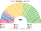

# 預期政治生態

> **席次估計**（近期大選重算、民調套本夾、長期運行假設下的席次表）見 [`估計結果.md`](估計結果.md)。本檔專注誘因、朝野互動與候選人行為；席次數字以估計結果與席次圖為準。

`0-基本/總體.md`：長期預期生態，要有論據，可大膽假設。`0-基本/要求.md` **硬性**：不得把提示詞當預期生態。席次由 [`生態模型.py`](生態模型.py) 算出。

## 1 誘因

| 層 | 誘因 | 預期行為 |
|---|---|---|
| top-3 孔多賽 | 第三名支持者的第二偏好決定勝負 | 自民與立憲的對決中，**國民民主、維新這類中間黨進得了前三名就是孔多賽贏家** |
| 自公合作 | 公明黨不必再讓出選區換比例票 | 公明黨的選區策略失去意義；它的組織票在名單層 |
| 無解散 | 首相不能挑時機 | 選舉日固定，政局不再繞著「何時解散」轉 |
| 彈性名單、廢重複立候補 | 名單順位不靠惜敗率 | 選區與名單的候選人分開競爭 |

## 2 假設

**第一偏好**：比例代表的政黨票（市區町村別），避開小選舉區層的在野協調、公明黨不推人。

**偏好空間**：四軸。

| 政黨 | 經濟 | 安保與憲法 | 建制 | 組織宗教 |
|---|:--:|:--:|:--:|:--:|
| 自民 | 0.5 | 0.7 | 0.9 | 0 |
| 公明 | 0.0 | 0.0 | 0.8 | **1** |
| 立憲 | −0.5 | −0.6 | 0.4 | 0 |
| 國民民主 | 0.1 | 0.2 | 0.1 | 0 |
| 維新 | 0.6 | 0.5 | −0.2 | 0 |
| 共產 | −0.9 | −0.9 | −0.3 | 0 |
| 令和 | −0.9 | −0.5 | −0.9 | 0 |
| 參政 | 0.2 | 0.8 | −0.9 | 0 |
| 保守 | 0.6 | 1.0 | −0.6 | 0 |

**組織宗教軸**：公明黨的選民是組織化的宗教票，其他選民很少把它當第二偏好。沒有這一軸時，公明黨居中、在三人對決裡變成孔多賽贏家（2024 年單一 101 席）——**這和日本的現實不合**，所以加上這一軸（權重 1.2）。

**推估第 3 屆＝2024 的地理與得票**。

## 3 席次（2024 得票）

| 政黨 | 單一 280 | 複數 185 | **全院 465** | 現行 2024 |
|---|--:|--:|--:|--:|
| 國民民主 | 124 | 22 | **146** | 28 |
| 自民 | 95 | 50 | **145** | 191 |
| 維新 | 42 | 20 | **62** | 38 |
| 立憲 | 19 | 39 | **58** | 148 |
| 公明 | 0 | 21 | **21** | 24 |
| 令和 | 0 | 16 | **16** | 9 |
| 共產 | 0 | 14 | **14** | 8 |
| 參政 | 0 | 2 | **2** | 3 |
| 保守 | 0 | 1 | **1** | 3 |

門檻：過半 233、3/5 279、2/3 310；複數 3/5 111。

- **國民民主單一 124**：決選三人「國民／立憲／自民」的 125 區裡它幾乎全勝——立憲選民把它排在自民前，自民選民把它排在立憲前。東京 26／28、愛知 15／15、神奈川 14、千葉 9、埼玉 8、新潟 6。
- **維新拿下大阪 17／17、兵庫 11／11、奈良、滋賀**。
- **自民黨在地方縣**（九州、中國、北關東）拿單一席次：那裡國民民主進不了前三名，自民對立憲、公明都贏。
- **立憲單一 19**：北海道 7、沖繩 3、岩手 3、長野 3、福島 2。
- **首長：國民民主**（對自民 320:145）。
- **組閣陣營**：國民＋自民 291（最小過半）；由近到遠擴展是國民＋維新＋自民 353。

## 4 朝野互動

| 面向 | 預期 |
|---|---|
| 政府 | 國民民主的首長＋自民黨的夥伴：**現實中「103 萬日圓牆」那種政策交易，在新制下是聯合政府內部的談判** |
| 規則 | 國民＋自民複數 72（要 111）：修憲、改選制要拉立憲或維新 |
| 立憲 | 第一大反對黨的代表移到名單層（39／58） |
| 地方 | 都市是國民民主、關西是維新、地方縣是自民 |

## 5 檢視：哪裡不合

### 5.1 不合一：一個 11% 的黨當首長

國民民主 2024 年比例票 11.3%，新制下全院 146 席、當首長。這是和保加利亞（進步保加利亞）、荷蘭（CDA）、巴西（中間大團）同型的結果：**top-3 孔多賽把中位黨放大**。

**判斷**：放大保留；改規則要複數 3/5（國民 22／185）。

### 5.2 不合二：沒有組織宗教軸時公明黨會當贏家

見 §2。這是模型的假設問題，不是規則問題；寫出來是因為**結果對這個假設極敏感**（§6）。

## 6 敏感度

| 情境 | 2024 單一 | 2024 首長 | 2021 首長 |
|---|---|---|---|
| 基準 | 國民 124、自民 95、維新 42、立憲 19 | 國民 | 自民 |
| 無組織宗教軸 | 國民 124、**公明 101**、維新 40 | 國民 | **國民** |
| 選民全部重經濟 | 自民 129、國民 124 | 國民 | 自民 |
| 選民全部重安保 | 國民 124、自民 58、立憲 53 | 國民 | 國民 |
| 選民全部重建制 | 國民 125、**立憲 125** | 國民 | 國民 |
| 自民 −6 點 | 國民 124、立憲 60、自民 59 | 國民 | — |
| 自民 +6 點 | 國民 125、自民 112 | 國民 | — |
| 兩輪多數決（前 2 名對決） | **自民 200**、立憲 36、維新 30、國民 14 | 自民 | 自民 |

★ 2024 年的首長在每個情境都是國民民主；2021 年在自民與國民之間（國民民主當時只有 4.5%）。兩輪多數決那一行說明 top-3 的作用：**二選一決選下自民黨拿 200 個單一席次**；三人決選讓國民民主進得去。
