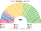
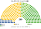
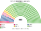
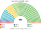
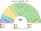

# 估計結果

> **這檔是什麼**：民意套本夾選制的席次**表**（如組閣聯盟／多數派政府）——§1 近期大選、§2 民調（若有）、§3 長期。圖庫見 [`席次圖.md`](席次圖.md)；大選算法細節見本夾重算檔。朝野互動見「預期政治生態」。

選制摘要：全院 **465＝單一 280（top-3 孔多賽）＋複數 185（聖拉古、無門檻）**。詳 [`01`](01-國會與選制.md)。

## 1 近期大選

用當時實際得票套本夾。細節見 [`14-近期大選重算.md`](14-近期大選重算.md)。

| | 實際 | **本夾全院 465** | 首長 |
|---|---|---|---|
| 2024-10 | 自民 191、立憲 148、維新 38、國民 28 … | 國民 **146**、自民 145、維新 62、立憲 58、公明 21 … | 國民民主 |
| 2021-10 | 自民 259、立憲 96 … | **自民 298**、維新 59、立憲 49、公明 21 … | 自民 |

### 2024-10 單一／複數

| 政黨 | 單一 280 | 複數 185 | **全院** |
|---|--:|--:|--:|
| 國民 | 124 | 22 | **146** |
| 自民 | 95 | 50 | **145** |
| 維新 | 42 | 20 | **62** |
| 立憲 | 19 | 39 | **58** |
| 公明 | 0 | 21 | **21** |
| 令和 | 0 | 16 | **16** |
| 共產 | 0 | 14 | **14** |
| 參政 | 0 | 2 | **2** |
| 保守 | 0 | 1 | **1** |

**組閣聯盟／多數派政府**：首長 **國民民主**；國民 146＜過半 233，須聯立（如國民＋維新＋立憲＝266）；複數 3/5＝111。

### 2021-10 單一／複數

| 政黨 | 單一 280 | 複數 185 | **全院** |
|---|--:|--:|--:|
| 自民 | 233 | 65 | **298** |
| 維新 | 34 | 25 | **59** |
| 立憲 | 8 | 41 | **49** |
| 公明 | 0 | 21 | **21** |
| 國民 | 5 | 13 | **18** |
| 共產 | 0 | 16 | **16** |
| 令和 | 0 | 4 | **4** |

**組閣聯盟／多數派政府**：首長 **自民**；自民 298 單獨過半；複數 3/5＝111（自民複數 65，改規則要拉公明等）。

## 2 民調

民調與得票摘自 parliament_condorcet 研究抽取／維基等彙整之 CSV（`parliament_condorcet/<country>/data/`），非本倉內建資料。下列支持率來自 `japan/data/input_vote_shares.csv`（合計遠低於 100% 時，分母僅含表列政黨再縮放）。方法：以 **2024-10 小選舉區彙整** 為地理基底，按支持度權重縮放後跑本夾——**單一 280** top-3 孔多賽、**複數 185** 聖拉古（不是全國比例拆單一）。「未來」以立憲地理為種。

### NHK 政黨支持率（2026-10-10..12）

支持率%（立憲系＝立憲3.0＋民改0.5＋中道0.4；減稅憂國未列＝0）

首長 **自民**。

| 政黨 | 支持度 | 單一 280 | 複數 185 | 全院 465 |
|---|--:|--:|--:|--:|
| 自民 | 35.3% | 280 | 125 | **405** |
| 立憲 | 3.9% | 0 | 16 | **16** |
| 維新 | 2.7% | 0 | 6 | **6** |
| 國民 | 2.7% | 0 | 13 | **13** |
| 參政 | 2.6% | 0 | 10 | **10** |
| 共產 | 2.6% | 0 | 9 | **9** |
| 公明 | 2.3% | 0 | 6 | **6** |
| 未來 | 1.2% | 0 | 0 | **0** |
| 保守 | 0.7% | 0 | 0 | **0** |
| 令和 | 0.3% | 0 | 0 | **0** |
| 社民 | 0.3% | 0 | 0 | **0** |

### JNN 政黨支持率（2026-10-03..04）

支持率%（立憲系＝立憲2.5＋民改0.4；減稅憂國未列＝0）

首長 **自民**。

| 政黨 | 支持度 | 單一 280 | 複數 185 | 全院 465 |
|---|--:|--:|--:|--:|
| 自民 | 34.7% | 278 | 114 | **392** |
| 參政 | 3.4% | 0 | 14 | **14** |
| 維新 | 3.2% | 2 | 9 | **11** |
| 立憲 | 2.9% | 0 | 16 | **16** |
| 國民 | 2.9% | 0 | 13 | **13** |
| 公明 | 2.8% | 0 | 14 | **14** |
| 共產 | 2.5% | 0 | 5 | **5** |
| 保守 | 0.8% | 0 | 0 | **0** |
| 未來 | 0.6% | 0 | 0 | **0** |
| 令和 | 0.3% | 0 | 0 | **0** |
| 社民 | 0.3% | 0 | 0 | **0** |

## 3 長期運行假設下

本夾生態模型以 **2024 得票** 為長期示意基準（見 [`12-預期政治生態.md`](12-預期政治生態.md) §3；[`生態模型.py`](生態模型.py)）。

| 政黨 | 單一 280 | 複數 185 | **全院 465** |
|---|--:|--:|--:|
| 國民民主 | 124 | 22 | **146** |
| 自民 | 95 | 50 | **145** |
| 維新 | 42 | 20 | **62** |
| 立憲 | 19 | 39 | **58** |
| 公明 | 0 | 21 | **21** |
| 令和 | 0 | 16 | **16** |
| 共產 | 0 | 14 | **14** |
| 參政 | 0 | 2 | **2** |
| 保守 | 0 | 1 | **1** |

朝野互動與候選人行為見 [`12-預期政治生態.md`](12-預期政治生態.md)。
