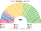
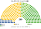
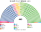
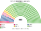

# 席次圖

> **這檔是什麼**：仿維基席次**圖庫**（長期示意；有則附大選重算／現行圖）。席次**數字表**與民調見 [`估計結果.md`](估計結果.md)；大選算法細節見本夾 `*大選重算*`／`*近期大選*` 檔。朝野互動見「預期政治生態」。

數字來自 [`生態模型.py`](生態模型.py)；產生器：席次圖產生器。座位依**安保與憲法軸**由左（鴿）到右（鷹）排列。

## 2024-10 得票套新制（＝推估第 3 屆）

### 全院 465

### 單一席次 280

### 複數席次 185

| 政黨 | 單一 280 | 複數 185 | **全院** |
|---|--:|--:|--:|
| 國民 | 124 | 22 | **146** |
| 自民 | 95 | 50 | **145** |
| 維新 | 42 | 20 | **62** |
| 立憲 | 19 | 39 | **58** |
| 公明 | 0 | 21 | **21** |
| 令和 | 0 | 16 | **16** |
| 共產 | 0 | 14 | **14** |
| 參政 | 0 | 2 | **2** |
| 保守 | 0 | 1 | **1** |

首長國民民主。

3/5 **111**。

## 現行制度 2024-10 實際結果

## 2021-10 得票套新制

| 政黨 | 單一 280 | 複數 185 | **全院** |
|---|--:|--:|--:|
| 自民 | 233 | 65 | **298** |
| 維新 | 34 | 25 | **59** |
| 立憲 | 8 | 41 | **49** |
| 公明 | 0 | 21 | **21** |
| 國民 | 5 | 13 | **18** |
| 共產 | 0 | 16 | **16** |
| 令和 | 0 | 4 | **4** |

3/5 **111**。
