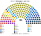
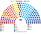
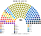

# 估計結果

> 席次**表**：§1 近期大選、§2 民調、§3 長期。國會兩夾相同，算法與逐區結果見 [`../共用/14`](../共用/14-近期大選重算.md)；圖見 [`../共用/席次圖.md`](../共用/席次圖.md)。

選制：國會 **180＝單一 108（top-3 孔多賽）＋複數 72（6 區、聖拉古、無門檻）**；法律 ≥91；組織法全院 ≥108 **且**複數 ≥44。總統：全國 top-3 孔多賽。

## 1 近期大選

### 2025-11（SERVEL 逐投票桌）

| 政黨 | 單一 108 | 複數 72 | **全院 180** |
|---|--:|--:|--:|
| **PDG 人民黨** | 59 | 10 | **69** |
| RN 國家革新 | 16 | 7 | **23** |
| REP 共和黨 | 1 | 12 | **13** |
| PPD、FA、PS、UDI | 19 | 21 | **40**（各 10） |
| PDC 基督教民主黨 | 6 | 1 | **7** |
| PNL 國家自由黨 | 0 | 6 | **6** |
| 其他 8 黨 | 7 | 15 | **22** |

**總統（top-3：Jara、Kast、Parisi）：Kast**，沒有循環。兩兩：Kast 對 Parisi 50.3（刀口）、Kast 對 Jara 60.2、Parisi 對 Jara 71.3。實際決選 Kast 58.2。

- 總統的黨 13／180；右派全部 57／180。
- Parisi 是第二名，只差 0.3 點：他是國會的孔多賽贏家（議會制夾的首長），在總統那一場差一點也是。

### 2021-11（總統）

國會沒有逐桌資料（[`../共用/14`](../共用/14-近期大選重算.md) §1）。

**總統（top-3：Kast、Boric、Parisi）：Parisi**。兩兩：Parisi 對 Kast 72.1、Parisi 對 Boric 65.1、Boric 對 Kast 52.9。**實際 Boric（決選 55.9）**：模型下 Parisi 是三人中的中位，現行兩輪制在第一輪就把他淘汰（第三名，12.8%）。

### 2017-11（SERVEL 逐投票桌）

| 政黨 | 單一 108 | 複數 72 | **全院 180** |
|---|--:|--:|--:|
| PDC 基督教民主黨 | 32 | 8 | **40** |
| RN 國家革新 | 19 | 14 | **33** |
| PS 社會黨 | 16 | 8 | **24** |
| PPD 爭取民主黨 | 8 | 5 | **13** |
| FA（RD 等） | 7 | 5 | **12** |
| UDI | 0 | 11 | **11** |
| PR 激進黨 | 9 | 2 | **11** |
| 其他 7 黨 | 17 | 19 | **36** |

**總統（top-3：Piñera、Guillier、Sánchez）：Piñera**。兩兩：Piñera 對 Guillier 50.4、Piñera 對 Sánchez 50.4、Guillier 對 Sánchez 79.5。實際 Piñera 54.6。

## 2 民調

2025 年選後沒有可用的政黨民調頁（維基未建），**本夾不做民調重算**。估計結果三來源中的這一項從缺。

## 3 長期運行（推估第 3 屆）

兩端（REP、PNL、PSC、PC、IZQ）各讓出 1/8 第一偏好給 RN、PS（各半）。

| 政黨 | 單一 108 | 複數 72 | **全院 180** |
|---|--:|--:|--:|
| PDG 人民黨 | 60 | 10 | **70** |
| RN 國家革新 | 24 | 8 | **32** |
| PS 社會黨 | 6 | 6 | **12** |
| REP 共和黨 | 0 | 10 | **10** |
| 其他 13 黨 | 18 | 38 | **56** |

PDG 仍是單一席次的大贏家；總統的黨無論誰都在國會少數，**預提是總統施政的主要保證**。
