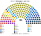
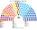
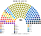

# 估計結果

> 席次**表**：§1 近期大選、§2 民調、§3 長期。國會與總統制夾相同，算法與逐區結果見 [`../共用/14`](../共用/14-近期大選重算.md)；圖見 [`../共用/席次圖.md`](../共用/席次圖.md)。

選制：國會 **180＝單一 108（top-3 孔多賽）＋複數 72（6 區、聖拉古、無門檻）**；首長、供給 ≥91；組織法全院 ≥108 **且**複數 ≥44。

## 1 近期大選

### 2025-11（SERVEL 逐投票桌）

| 政黨 | 單一 108 | 複數 72 | **全院 180** |
|---|--:|--:|--:|
| **PDG 人民黨** | 59 | 10 | **69** |
| RN 國家革新 | 16 | 7 | **23** |
| REP 共和黨 | 1 | 12 | **13** |
| PPD、FA、PS、UDI | 19 | 21 | **40**（各 10） |
| PDC 基督教民主黨 | 6 | 1 | **7** |
| PNL 國家自由黨 | 0 | 6 | **6** |
| 其他 8 黨 | 7 | 15 | **22** |

**首長：PDG**（議員之間的孔多賽贏家）。兩兩最近的：對 DEM 118：62、對 RN 125：55、對 EVO 126：54、對 PDC 128：52。

**組閣聯盟／多數派政府**（由近到遠）：PDG＋DEM＋PDC＋RN＝101。中間與中右。

元首（直選總統）：Kast（同總統制夾）。

### 2017-11（SERVEL 逐投票桌）

| 政黨 | 單一 108 | 複數 72 | **全院 180** |
|---|--:|--:|--:|
| PDC 基督教民主黨 | 32 | 8 | **40** |
| RN 國家革新 | 19 | 14 | **33** |
| PS 社會黨 | 16 | 8 | **24** |
| PPD 爭取民主黨 | 8 | 5 | **13** |
| FA（RD 等） | 7 | 5 | **12** |
| UDI | 0 | 11 | **11** |
| PR 激進黨 | 9 | 2 | **11** |
| 其他 7 黨 | 17 | 19 | **36** |

**首長：PR 激進黨**（11 席）。兩兩最近的：對 PDC 92：88、對 PPD、PS、FRVS、PRO 各 99：81。

**組閣聯盟**：PR＋FRVS＋PPD＋PS＋PRO＋PDC＝99。中左（當年的 Nueva Mayoría 加 PDC）。

元首：Piñera（同總統制夾）。

## 2 民調

2025 年選後沒有可用的政黨民調頁（維基未建），**本夾不做民調重算**。

## 3 長期運行（推估第 3 屆）

兩端（REP、PNL、PSC、PC、IZQ）各讓出 1/8 第一偏好給 RN、PS（各半）。

| 政黨 | 單一 108 | 複數 72 | **全院 180** |
|---|--:|--:|--:|
| PDG 人民黨 | 60 | 10 | **70** |
| RN 國家革新 | 24 | 8 | **32** |
| PS 社會黨 | 6 | 6 | **12** |
| REP 共和黨 | 0 | 10 | **10** |
| 其他 13 黨 | 18 | 38 | **56** |

**首長：PDG**；組閣聯盟 PDG＋DEM＋PDC＋RN＝112。
