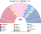
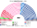
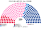
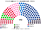
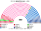

# 近期大選重算

> **這檔是什麼**：近期大選得票**怎麼**套進本夾選制（方法、假設、對照）。席次一覽與圖見 [`估計結果.md`](估計結果.md) §1、[`席次圖.md`](席次圖.md)。

用**當時實際的得票**，把 2024 年與 2022 年國民議會選舉套進本夾的制度。數字由 [`近期大選重算.py`](近期大選重算.py) 算出。

與 [`14`](14-預期政治生態.md) 不同：14 的第一偏好是假設，這裡是開票紀錄；**只有第二偏好仍用 14 §2.3 的假設**（程式直接讀 [`生態模型.py`](生態模型.py) 的 `ORDERS`）。最關鍵的一條是：左翼選民 80% 把中間排在國民聯盟前面、10% 反過來。

**結論：2024 年那個沒有多數的議會，套進本夾會變成中間陣營在單一席次拿 133／230、全院 159／400——不過行政首長門檻 201。** 中間＋共和黨系只有 199，**差 2 席**；組閣要再拉一個（例如社會黨系 25 → 224），或走 30 日期限由孔多賽第一名（仍是中間）逕行就任；供給自動生效後，建設性更新同樣要 ≥201。2024-12 到 2025-10 之間倒台的三任政府，在本夾不會以「純否定式倒閣」倒下——但執政多數要靠共和黨系再加一個夥伴。代價有兩個：中間陣營只有 21.7% 的第一偏好，230 位單一席次的當選人裡有 82 位在第一輪排第三；而且單一席次的放大只建立在一個假設上——左翼選民繼續把中間排在國民聯盟前面。

## 1 國民議會 2024-06

### 1.1 實際（現行 577，單一選區兩輪多數決）

| 陣營（內政部色彩分類） | 第一輪得票 | 席次 |
|---|--:|--:|
| 新人民陣線（UG）＋各類左派、社會黨 | 29.5% | 178＋14 |
| Ensemble＋地平線、各類中間 | 21.7% | 150＋12 |
| 國民聯盟＋Ciotti 派 | 33.6% | 125＋17 |
| 共和黨＋各類右派、UDI | 10.8% | 39＋30 |
| 地方派、其他 | — | 9＋3 |

得票率不含海外法國人 11 區，所以與全國公告數（國民聯盟 29.3%、聯合左翼 28.0%、Ensemble 20.0%）略有出入。

**過半 289，沒有任何陣營接近。** 後果是 Barnier 政府在 2024-12 被不信任案推翻，Bayrou 政府在 2025-09 的信任投票中落敗，第一任 Lecornu 政府在 2025-10 就職隔天即辭職。

### 1.2 本夾（400＝單一 230＋複數 170）

| 陣營／政黨 | 單一 230 | 複數 170 | **全院 400** |
|---|--:|--:|--:|
| **中間陣營**（Ensemble） | **133** | 26 | **159** |
| 國民聯盟系（含 Ciotti 派） | 53 | 59 | **112** |
| 左翼：新人民陣線共同候選人 | 18 | — | 18 |
| 　　社會黨系（PS–Place publique） | — | 25 | 25 |
| 　　不屈法國系 | — | 17 | 17 |
| 　　生態派 | — | 13 | 13 |
| 共和黨系 | 26 | 14 | **40** |
| 收復黨（Reconquête） | — | 14 | **14** |
| 鄉村聯盟 | — | 2 | **2** |
**單一 230 的做法。** 先把 230 席依 2024 年的選舉人數分到本夾的 14 個複數選區（最大餘數）。每區內，把 2024 年**逐投票所**得票（內政部 bureau de vote 檔，候選人姓名回推所屬選區；加總到「市鎮×選區」共 35,414 個單位，逐選區加總與 577 區官方結果完全一致）依省、省內市鎮座標（Wikidata INSEE 代碼 P374）的 Hilbert 曲線順序排好，按選舉人數切成等大的新區；跨界的單位按比例拆開。2022 年用逐市鎮檔（35,429 個單位）。海外法國人 11 區不計，因為本夾取消了這些選區（[`01`](01-國民議會與選制.md) §2.6）。

各候選人依內政部的色彩分類（nuance）歸入 7 群：

| 群 | 包含的分類 | 第二偏好 |
|---|---|---|
| 國民聯盟系 | RN、UXD | 14 §2.3 |
| 左翼陣營 | UG、FI、SOC、COM、VEC、DVG | 14 §2.3 |
| 中間陣營 | ENS、HOR、DVC | 14 §2.3 |
| 共和黨系 | LR、DVD、UDI | 14 §2.3 |
| 極右小黨 | REC、EXD、DSV | 本檔假設：國民聯盟 > 共和黨 > 中間 > 左翼 |
| 極左 | EXG | 本檔假設：左翼第一，中間與國民聯盟各半 |
| 其他 | REG、DIV、ECO、RDG | 14 §2.3 |

決選者是四大陣營中第一輪的前 3 名；第二輪用 top-3 孔多賽決定，出現循環時用 Ranked Pairs（逐投票所版本沒有循環）。
| 複數選區 | 單一席 | 國民聯盟 | 左翼 | 中間 | 共和黨 |
|---|--:|--:|--:|--:|--:|
| 法蘭西島－北 | 12 | 1 | 4 | 7 | 0 |
| 法蘭西島－中 | 11 | 0 | 2 | 9 | 0 |
| 法蘭西島－南 | 12 | 0 | 1 | 11 | 0 |
| 奧弗涅－羅納－阿爾卑斯－北 | 13 | 1 | 1 | 8 | 3 |
| 奧弗涅－羅納－阿爾卑斯－南 | 14 | 1 | 0 | 7 | 6 |
| 新阿基坦 | 22 | 1 | 1 | 18 | 2 |
| 奧克西塔尼 | 21 | 8 | 2 | 11 | 0 |
| 上法蘭西 | 21 | **16** | 1 | 3 | 1 |
| 大東部 | 19 | 4 | 0 | 11 | 4 |
| 普羅旺斯－阿爾卑斯－蔚藍海岸＋科西嘉 | 19 | **10** | 1 | 6 | 2 |
| 盧瓦爾河地區＋布列塔尼西 | 20 | 1 | 0 | 19 | 0 |
| 諾曼第＋布列塔尼東 | 18 | 3 | 1 | 13 | 1 |
| 中央－盧瓦爾河谷＋勃艮第－弗朗什孔泰 | 18 | 7 | 0 | 10 | 1 |
| 海外省與海外領地 | 10 | 0 | 4 | 0 | 6 |
| **計** | **230** | **53** | **18** | **133** | **26** |

**誰領先、誰當選。** 國民聯盟在 133 個新區的第一輪領先，但只贏下 53 區；另有 63 區輸給中間陣營，17 區輸給共和黨系。原因是左翼選民把中間或共和黨排在國民聯盟前面。左翼領先的 71 區，也只贏下 18 區。

| | 同場的區數 | 前者勝 | 前者得票中位數 |
|---|--:|--:|--:|
| 中間 對 國民聯盟 | 187 | 145 | 58.1% |
| 中間 對 左翼 | 189 | 174 | 65.6% |
| 國民聯盟 對 左翼 | 220 | 101 | 48.6% |

全國層級的兩兩對決也一樣：中間對國民聯盟 57.4%、對左翼 65.1%、對共和黨 63.7%。**中間陣營是全國的孔多賽贏家。**

**勝者的第一偏好很薄。** 230 位當選人中，97 位第一輪排第一、51 位排第二、**82 位排第三**；當選人第一偏好的中位數是 28.9%，最低只有 10%。中間陣營當選的區，它自己的第一偏好中位數是 26.0%。這是 14 §9.3 那條張力用實際得票算出來的樣子：本夾選出的是「對每一個對手都贏的人」，不是「最多人第一個選的人」。

**鐵票區只有 20 個**，也就是當選陣營的第一偏好本身就過半的區。

**同一張新選區圖若改用現行的兩輪多數決**（前 2 名對決，第二偏好不變）：國民聯盟 81、左翼 70、中間 62、共和黨 17，**沒有任何陣營過 116**，跟現實一樣是懸峙議會。席次數與選區圖都沒變，差別只在第二輪是 2 人還是 3 人。**穩定性來自 top-3 孔多賽，不是來自 400 或選區劃法**（[`README`](README.md)「三個最容易讀錯的地方」之一）。

**複數 170 的做法。** 名單票用 2024-06-09 的歐洲議會選舉，這是法國唯一的全國政黨名單選舉，比國會選舉早三週。用本夾的 14 區（M 同 [`01`](01-國民議會與選制.md) §2.5）、聖拉古、無門檻。全國第 15 名以後的名單合計約 1.7%，拆成 25 張等大的小名單計算，結果一席都沒有。共產黨（2.4%）在任何一區都拿不到席次。
| 複數選區 | M | 國民聯盟 | 中間 | 社會黨 | 不屈 | 共和黨 | 收復黨 | 生態 | 鄉村聯盟 |
|---|--:|--:|--:|--:|--:|--:|--:|--:|--:|
| 法蘭西島－北 | 10 | 3 | 1 | 1 | 2 | 1 | 1 | 1 | 0 |
| 法蘭西島－中 | 10 | 1 | 2 | 2 | 2 | 1 | 1 | 1 | 0 |
| 法蘭西島－南 | 11 | 2 | 2 | 2 | 2 | 1 | 1 | 1 | 0 |
| 奧弗涅－羅納－阿爾卑斯－北 | 10 | 3 | 2 | 1 | 1 | 1 | 1 | 1 | 0 |
| 奧弗涅－羅納－阿爾卑斯－南 | 10 | 3 | 1 | 2 | 1 | 1 | 1 | 1 | 0 |
| 新阿基坦 | 14 | 5 | 2 | 2 | 1 | 1 | 1 | 1 | 1 |
| 奧克西塔尼 | 14 | 5 | 2 | 2 | 1 | 1 | 1 | 1 | 1 |
| 上法蘭西 | 14 | 7 | 2 | 1 | 1 | 1 | 1 | 1 | 0 |
| 大東部 | 14 | 6 | 2 | 2 | 1 | 1 | 1 | 1 | 0 |
| 普羅旺斯＋科西嘉 | 14 | 6 | 2 | 2 | 1 | 1 | 1 | 1 | 0 |
| 盧瓦爾河＋布列塔尼西 | 14 | 4 | 3 | 3 | 1 | 1 | 1 | 1 | 0 |
| 諾曼第＋布列塔尼東 | 13 | 5 | 2 | 2 | 1 | 1 | 1 | 1 | 0 |
| 中央＋勃艮第 | 14 | 6 | 2 | 2 | 1 | 1 | 1 | 1 | 0 |
| 海外 | 8 | 3 | 1 | 1 | 1 | 1 | 1 | 0 | 0 |
| **計** | **170** | **59** | **26** | **25** | **17** | **14** | **14** | **13** | **2** |

**對照組：改用國會第一輪當名單票。** 各色彩併入所屬聯盟，新人民陣線以聯盟名單參選（本夾允許政黨聯盟，01 §2.1）。結果是國民聯盟系 57、新人民陣線 55、中間 38、共和黨 20。單一席次不變，全院變成中間 171、國民聯盟系 100、左翼 72、共和黨 57。

### 1.3 門檻

| 事項 | 門檻 | 2024 套本夾 |
|---|---|---|
| 選出行政首長、供給、建設性更新 | 全院 ≥201 | 中間 159 **不夠**；加共和黨系 40＝199 **仍差 2 席**，要再加一個夥伴（如社會黨系 25），或加左翼 73＝232 過。反對方（國民聯盟系＋左翼＋收復黨＋鄉村）201，**剛好過半——理論上不加共和黨系就能換掉中間，但要國民聯盟與左翼同列一位繼任者** |
| 法律、歲入與稅制 | 全院 ≥201 | 同上——政府多數就是立法多數 |
| 組織法、修憲 | 全院 ≥240 **且**複數 ≥102 | 見下 |

**組織法與修憲：主算版本中，沒有國民聯盟或收復黨就改不了。** 複數 170 席扣掉國民聯盟 59 與收復黨 14，剩下 97 席，不到 102。換句話說，國民聯盟加收復黨的 73 席超過了 2/5（68），單靠極右就擋得住。

對照組（國會第一輪當名單票）的結果不同：中間、共和黨、新人民陣線三方在複數席次合計 113 席，可以撇開國民聯盟改規則。**所以「誰能擋改規則」取決於名單票怎麼投，這一點 2024 年的資料判不出來。**

★ **與 14 的設計預期比較。** 14 預期中間陣營全院 256，單獨就過 201 與全院 3/5。實際得票套出來只有 159，**組閣與普通法律都要靠共和黨系**。這反而接近 2024–25 年的現實：Barnier 與 Bayrou 政府倚靠的正是 Ensemble 加共和黨的「共同基礎」（socle commun）。差別在於，在本夾裡這個組合同時負責政府與立法——沒有「政府活著、法案另找票」的分叉；共和黨系退出會同時危及首長存續與法律。

### 1.4 2024-12 到 2025-10 的三次倒閣，在本夾會怎樣

| 現實 | 本夾 |
|---|---|
| 2024-07 選後懸峙，Barnier 到 9 月才由總統任命 | 全院 400 記名排名投票；中間 159 不過 201，與共和黨系 199 仍差 2 席，須再拉一個夥伴，或 30 日期滿由孔多賽第一名（中間）逕行就任 |
| 2024-12 社會安全財源法案動用 49.3，政府隨即被不信任案推翻 | 行政權供給在 15 個開會日內**自動生效**。要推翻政府須以建設性更新提出繼任者並取得 **≥201**；反對方不加共和黨系只有 190，換不掉；若共和黨系改站反對方則可換 |
| 2025-09 Bayrou 自提信任投票失敗 | 本夾沒有信任投票，也沒有純否定式的倒閣 |
| 2025-10 Lecornu 公布內閣隔天即辭職（共和黨揚言退出） | 首長的去留由全院 ≥201 決定；**共和黨系退出會讓執政多數掉到 159，建設性更新變得可行**——這與現實裡盟友退出即危及政府是同一形狀 |

**本夾解決的是「政府會不會沒有」與「能不能只拆不換」。** 政府多數與立法多數同為全院 ≥201（[`03`](03-行政權預算與供給.md) §2.7）；2024 年那一屆兩者都要靠共和黨系。

## 2 國民議會 2022-06

| | 第一偏好 | 單一 230 | 複數 170 | **全院 400** |
|---|--:|--:|--:|--:|
| **中間陣營** | 26.8% | **208** | 47 | **255** |
| 左翼（NUPES） | 28.8% | 10 | 53 | **63** |
| 共和黨系（含 UDI） | 13.7% | 12 | 25 | **37** |
| 國民聯盟系 | 18.9% | 0 | 32 | **32** |
| 極右小黨（以收復黨為主） | 5.4% | — | 13 | **13** |
2022 年沒有全國性的名單選舉，所以複數席次用國會第一輪、各色彩併入聯盟來算（同 §1.2 的對照組）。UDI 在 2022 年與共和黨組成 UDC 聯盟，因此算進共和黨系。

**實際結果**（內政部統計）：Ensemble 245、NUPES 131、國民聯盟 89、UDC 64、各類左派 22、各類右派 10、地方派 10、各類中間 4、其他 2，**相對多數，不是過半**。Borne 政府多次動用 49.3 條通過預算與退休改革。

**本夾的結果：中間陣營單一 208、全院 255，同時過了全院 3/5（240）。** 但它在複數席次只有 47 席，組織法與修憲仍然要拉到另外 55 席。若同一張選區圖改用兩輪多數決，中間陣營也有 177 席，這是因為 2022 年的國民聯盟（18.9%）還不是第一大陣營。

## 3 敏感度（`--sweep`）

本夾的多數取決於一個假設：兩翼選民都把中間排在對方前面。把這個比例往下調：

| 左翼選民把國民聯盟排在中間前 | 2024 單一 國民聯盟／左翼／中間／共和黨 | 2022 |
|:--:|:--:|:--:|
| 5% | 44／18／139／29 | 0／10／208／12 |
| **10%（本夾假設）** | **53／18／133／26** | **0／10／208／12** |
| 20% | 68／18／121／23 | 3／10／205／12 |
| 30% | 80／18／112／20 | 8／10／200／12 |
| 40% | 101／18／99／12 | 21／10／188／11 |
| 50% | 119／22／78／11 | 34／10／175／11 |

| 兩翼同時把對方排在中間前 | 2024 | 2022 |
|:--:|:--:|:--:|
| 5% | 44／15／141／30 | 0／10／206／14 |
| **10%** | **53／18／133／26** | **0／10／208／12** |
| 20% | 68／25／115／22 | 3／14／203／10 |
| 30% | 80／33／99／18 | 8／16／197／9 |
| 40% | 99／48／73／10 | 21／21／181／7 |
| 50% | 104／75／42／9 | 34／28／161／7 |

只動國民聯盟選民（把左翼排在中間前的比例 5%→50%）：2024 年的中間陣營從 135 席降到 88 席，左翼從 15 席升到 64 席。

- 主算下中間全院 159 已不過 201，組閣本來就要共和黨系（或左翼）。單一席次再掉，只會讓這個依賴更重。
- **全院記名排名時，中間陣營仍多半是議員之間的孔多賽贏家**：左翼議員把中間排在國民聯盟前，國民聯盟議員把中間排在左翼前。30 日期限內湊不出 ≥201 把某人排在「維持空缺」之上時，孔多賽第一名逕行就任——通常仍是中間。
- 例外是「左翼選民 50%」那一列（國民聯盟單一 119、中間 78、共和黨 11）：議員之間的孔多賽贏家變成**共和黨系**。這就是 [`15`](15-完善與自洽.md) §4 承認不防的「準人選是傀儡」情形。
- 2022 年中間全院 255，單獨過 201；在敏感度表的各列都站得住，因為當年國民聯盟太小，進不了大多數區的決選。

**合併方式。** 把每區所有切點平移半個新區（頭尾兩段合成一區）：2024 年結果是國民聯盟 45、左翼 19、中間 133、共和黨 33；2022 年中間從 208 降到 200。中間陣營全院過不過 201，不取決於選區怎麼切（2024 年本來就不過；2022 年本來就過）。

## 4 模型的限制

- **第一偏好來自兩輪制下的第一輪。** 2024 年 Ensemble 在部分選區沒有提名，讓給共和黨或地平線；新人民陣線則每區只推一人。在本夾的制度下，各黨的提名與選民的第一偏好都會改變（14 §2）。
- **第二偏好全是假設**，而且是 14 為第 3 屆寫的假設。2024 年第二輪「共和陣線」的實際轉移率沒有逐區資料，這裡沒有用它校準。
- **地方派進不了決選。** 模型只讓四大陣營進前 3，所以科西嘉與海外的地方派（2024 年實際當選 9 席）全被併入「其他」。**海外 10 席的結果不可信**：當選的「共和黨系」多半是地方上的各類右派。
- **名單票的替代品不完美。** 歐洲議會選舉的投票率（51.5%）比國會第一輪（66.7%）低，比國會選舉早三週，議題也不同（例如 Glucksmann 名單的表現）。對照組的國會第一輪則把各類左右派當成聯盟名單，同樣是近似。
- **海外法國人 11 區不計。** 本夾規定他們依在法國的最後住所登記，但資料無法把他們分到本土各區；2024 年他們約 157 萬名選舉人，占全部選舉人約 3.2%。
- 原始檔中有 4 區的候選人得票加總與有效票差 1–2 票，模型照原檔使用。

## 5 資料來源

| 資料 | 來源 |
|---|---|
| 2024-06-30 國民議會第一輪，逐選區逐候選人 | 內政部，[Élections législatives des 30 juin et 7 juillet 2024 – Résultats définitifs du 1er tour](https://www.data.gouv.fr/fr/datasets/6682d0c255dcda5df20b1d90/)（`resultats-definitifs-par-circonscriptions-legislatives.csv`） |
| 2024-07-07 第二輪當選人 | 內政部，[Résultats définitifs du 2nd tour](https://www.data.gouv.fr/fr/datasets/668b4092826ddcf70e9e62cd/)；與第一輪的當選人合計 577：UG 178、ENS 150、RN 125、LR 39、DVD 27、UXD 17、DVG 12、REG 9、HOR 6、DVC 6、UDI 3、SOC 2、EXD 1、DIV 1、ECO 1 |
| 2024-06-09 歐洲議會，逐省逐名單 | 內政部，[Résultats des élections européennes du 9 juin 2024](https://www.data.gouv.fr/fr/datasets/666b1337471f4fe2f19f2573/)（`resultats-definitifs-par-departement.csv`）；全國：國民聯盟 31.37%、Besoin d'Europe 14.60%、PS–Place publique 13.83%、不屈法國 9.89% |
| 2022-06-12 國民議會第一輪 | 內政部，[Élections législatives des 12 et 19 juin 2022 – Résultats définitifs du premier tour](https://www.data.gouv.fr/fr/datasets/62a8c3f92b3b572a67d307f4/)（`resultats-par-niveau-cirlg-t1-france-entiere.txt`） |
| 2022 實際席次 | [2022 French legislative election](https://en.wikipedia.org/wiki/2022_French_legislative_election) |
| 2024–25 政府更迭 | [Next French legislative election](https://en.wikipedia.org/wiki/Next_French_legislative_election)（Barnier 2024-12、Bayrou 2025-09、第一任 Lecornu 2025-10）；截至 2026-10 沒有再解散國會 |
