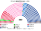
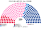
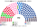
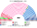
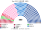
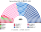
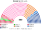

# 估計結果

> **這檔是什麼**：民意套本夾選制的席次**表**（如組閣聯盟／多數派政府）——§1 近期大選、§2 民調（若有）、§3 長期。圖庫見 [`席次圖.md`](席次圖.md)；大選算法細節見本夾重算檔。朝野互動見「預期政治生態」。

選制摘要：全院 **400＝單一 230（top-3 孔多賽）＋複數 170（彈性名單、14 區聖拉古、無門檻）**。詳 [`01`](01-國民議會與選制.md)。

## 1 近期大選

用當時實際得票套本夾（2024 逐投票所、2022 逐市鎮）。細節與方法見 [`16-近期大選重算.md`](16-近期大選重算.md)（[`近期大選重算.py`](近期大選重算.py)）。

| | 現實（577） | **本夾全院 400** |
|---|---|---|
| 2024-06 國會 | 新人民陣線 178、Ensemble 150、國民聯盟 125＋Ciotti 派 17、共和黨 39、其他 68；無多數 | **中間 159**、國民聯盟系 112、左翼 73、共和黨系 40、收復黨 14、鄉村聯盟 2 |
| 2022-06 國會 | Ensemble 245（相對多數）、NUPES 131、國民聯盟 89、UDC 64 | **中間 255**、左翼 63、共和黨系 37、國民聯盟系 32、極右小黨 13 |

### 2024-06 單一／複數

| 陣營／政黨 | 單一 230 | 複數 170 | **全院** |
|---|--:|--:|--:|
| 中間陣營（Ensemble） | 133 | 26 | **159** |
| 國民聯盟系（含 Ciotti 派） | 53 | 59 | **112** |
| 左翼：新人民陣線共同候選人 | 18 | — | 18 |
| 　　社會黨系 | — | 25 | 25 |
| 　　不屈法國系 | — | 17 | 17 |
| 　　生態派 | — | 13 | 13 |
| 共和黨系 | 26 | 14 | **40** |
| 收復黨 | — | 14 | **14** |
| 鄉村聯盟 | — | 2 | **2** |

**組閣聯盟／多數派政府**：首長／供給門檻全院 **201**——中間 159 不過；中間＋共和黨系＝**199**，差 2 席，要再拉一個夥伴。組織法／修憲：全院 ≥240 且複數 ≥102（現複數扣極右後 97，未達）。

中間全院 159，不過首長／供給／建設性更新門檻 **201**；加共和黨系 40＝199，仍差 2 席。組織法與修憲要全院 ≥240 **且**複數 ≥102：複數扣掉國民聯盟 59＋收復黨 14 後剩 97，未達。

### 2022-06

| 陣營 | **全院** |
|---|--:|
| 中間 | **255** |
| 左翼 | **63** |
| 共和黨系 | **37** |
| 國民聯盟系 | **32** |
| 極右小黨 | **13** |

**組閣聯盟／多數派政府**：中間全院 **255** 單獨過首長／供給門檻 201；改規則仍看複數門檻。

## 2 民調

**方法**：[`民調重算.py`](民調重算.py)；來源 [`資料/polls.csv`](資料/polls.csv)（維基「Next French legislative election」投票意向表；**2025-10 之後沒有新的國會投票意向民調**）。取「新人民陣線聯合推人」情境，併成本夾 7 群：國＝RN＋UDR、左＝NFP＋DVG、中＝ENS＋DVC、共＝LR＋DVD、右＝收復＋DLF、極＝極左、他＝其他。

- **單一 230**：2024 **逐投票所**單位每群的票 × 民調份額／2024 實際份額，同一張新選區圖、top-3 孔多賽（同 §1）。
- **複數 170**：2024 歐洲議會各省名單票，依名單所屬陣營等比縮放到民調份額，14 區聖拉古（同 §1 主算）。
- 舊版用生態模型的合成區域偏移，單一席次曾給共和黨系 192（Ifop）或中間 198（OpinionWay）；改用實際地理後兩翼的票倉集中效應出來了。

| | 七群（國／左／中／共／右／極／他） | 單一 230 國／左／中／共 | **全院 400** | 首長 |
|---|---|---|---|---|
| Ifop（2025-10-07..08，n＝1386） | 35／28／14／15／5／1／2 | 90／18／67／55 | 國民聯盟系 **152**、中間 94、共和黨系 81、左翼 69、收復黨 4 | **共和黨系** |
| OpinionWay（2025-10-06..07，n＝1012） | 34／24／16／13／5／2／6 | 81／12／87／50 | 國民聯盟系 **147**、中間 115、共和黨系 74、左翼 57、其他 7 | **共和黨系** |

### Ifop 單一／複數

| 政黨 | 單一 230 | 複數 170 | **全院** |
|---|--:|--:|--:|
| 國民聯盟系 | 90 | 62 | **152** |
| 中間陣營（復興系） | 67 | 27 | **94** |
| 共和黨系 | 55 | 26 | **81** |
| 左翼：新人民陣線共同候選人 | 18 | — | 18 |
| 　　社會黨系 | — | 20 | 20 |
| 　　不屈法國系 | — | 18 | 18 |
| 　　生態派 | — | 13 | 13 |
| 收復黨 | — | 4 | **4** |

### OpinionWay 單一／複數

| 政黨 | 單一 230 | 複數 170 | **全院** |
|---|--:|--:|--:|
| 國民聯盟系 | 81 | 66 | **147** |
| 中間陣營（復興系） | 87 | 28 | **115** |
| 共和黨系 | 50 | 24 | **74** |
| 左翼：新人民陣線共同候選人 | 12 | — | 12 |
| 　　社會黨系 | — | 19 | 19 |
| 　　不屈法國系 | — | 17 | 17 |
| 　　生態派 | — | 9 | 9 |
| 收復黨 | — | 5 | **5** |
| 鄉村聯盟、工人鬥爭 | — | 各 1 | **2** |

**讀法**：

- **國民聯盟系成為全院最大**（147–152），但不過 201；單一席次 81–90。
- **首長是共和黨系**：全院記名排名時，國民聯盟議員把共和黨系排在中間前，中間與左翼議員把共和黨系排在國民聯盟前，共和黨系兩兩對決全勝。這是 [`15`](15-完善與自洽.md) §4 承認不防的「小黨當準人選」情形。
- **組閣**：沒有兩黨能過 201 而不含國民聯盟系；共和黨系＋中間＝175（Ifop）／189（OpinionWay），要再拉左翼的一部分，或與國民聯盟系合組（233／221）。30 日內湊不出 ≥201 時，孔多賽第一名（共和黨系）逕行就任。

## 3 長期運行假設下

生態模型示意 **第 3 屆**（假設見 [`14-預期政治生態.md`](14-預期政治生態.md)；數字由 [`生態模型.py`](生態模型.py) 算出）。

| 政黨 | 單一 230 | 複數 170 | 全院 400 |
|---|--:|--:|--:|
| 復興系（中間） | 164 | 25 | **189** |
| 民主運動 | 54 | 13 | **67** |
| 國民聯盟系 | 10 | 60 | **70** |
| 不屈法國系 | 1 | 24 | **25** |
| 社會黨系 | 1 | 19 | **20** |
| 生態派 | 0 | 14 | **14** |
| 共和黨系 | 0 | 15 | **15** |
| **計** | **230** | **170** | **400** |

中間陣營（復興＋民運）：單一 218、複數 38、全院 **256**（單獨過 201 與全院 3/5；複數 38 過不了組織法／修憲的 102）。

| | 第 3 屆 | 第 6 屆 |
|---|--:|--:|
| 單一 國民聯盟／左翼／中間 | 10／2／218 | 29／2／199 |
| 複數 國民聯盟／中間 | 60／38 | 62／36 |

朝野互動與候選人行為見 [`14-預期政治生態.md`](14-預期政治生態.md)。
