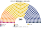
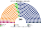

# 近期大選套新制

> 席次一覽與圖見 [`估計結果.md`](估計結果.md) §1、[`席次圖.md`](席次圖.md)。本檔講**怎麼**套。

## 1 方法

| 項目 | 來源與做法 |
|---|---|
| 第一偏好 | PKW **逐投票所（obwód）名單票**：2023 年 31,495 個、2019 年 27,415 個（[`資料/sejm-2023.csv`](資料/sejm-2023.csv)、[`資料/sejm-2019.csv`](資料/sejm-2019.csv)；[`_build_sejm.py`](_build_sejm.py)）。全國加總與 PKW 一致：2023 PiS 35.38%、KO 30.70%、TD 14.40%、Lewica 8.61%、Konf 7.16%；2019 PiS 43.59%、KO 27.40%、SLD 12.56%、PSL 8.55%、Konf 6.81% |
| 區 | 12 國內區＋海外（[`01`](01-國會與選制.md) §2）；首都區用縣名判定 |
| 座標 | Wikidata TERYT 代碼（P1653）的 P625，取 7 碼的前 6 碼平均；對不上的鄉鎮用所屬縣的平均 |
| 單一 204 | 區內依座標的 Hilbert 曲線排序，按有效票連續切成等大的新區；第一輪前 3 名進第二輪；top-3 孔多賽 |
| 複數 136 | 各區聖拉古、無門檻；「其他」拆成 5 張小名單 |
| 首長 | 全院 340 記名排名（議員依黨的均衡型排序），須 ≥171；組閣由近到遠 |
| 偏好 | 二維假設（[`12`](12-預期政治生態.md) §2） |
| **不是** | 全國比例拆單一；不模擬政黨在新制下的重組（那是第 3 屆推估） |

## 2 2023-10-15 眾議院

實際（460）：PiS 194、KO 157、TD 65、Lewica 26、Konf 18；**KO＋TD＋Lewica 248 組閣**，但總統先提名 Morawiecki，Tusk 2023-12-13 才宣誓。

| 政黨 | 得票% | 實際 460 | 單一 204 | 複數 136 | **新制 340** |
|---|--:|--:|--:|--:|--:|
| **TD**（第三條路） | 14.4 | 65 | **119** | 19 | **138** |
| PiS | 35.4 | 194 | 59 | 50 | **109** |
| KO | 30.7 | 157 | 26 | 42 | **68** |
| Lewica | 8.6 | 26 | 0 | 13 | **13** |
| Konf | 7.2 | 18 | 0 | 12 | **12** |

| 區（單一） | 結果 | 區 | 結果 |
|---|---|---|---|
| 首都（19） | TD 12、KO 7 | 下西里西亞－奧波萊（20） | TD 18、KO 2 |
| 馬佐夫舍（12） | PiS 11、TD 1 | 羅茲（13） | PiS 6、TD 4、KO 3 |
| 西里西亞（24） | TD 19、KO 3、PiS 2 | 波美拉尼亞（13） | TD 9、KO 4 |
| 大波蘭（19） | TD 15、KO 3、PiS 1 | 盧布林－波德拉謝（17） | PiS 13、TD 4 |
| 小波蘭（19） | PiS 11、TD 8 | 喀爾巴阡－聖十字（17） | PiS 15、TD 2 |
| 庫亞維－瓦爾米亞（17） | TD 15、KO 2 | 西波美拉尼亞－盧布斯卡（14） | TD 12、KO 2 |

- **第三條路被放大**：大多數新區的決選三人是 PiS、KO、TD。PiS 選民把 TD 排在 KO 前，KO 選民把 TD 排在 PiS 前，TD 兩邊都贏。這和日本夾 2026 年國民民主黨的情形相同。
- **代價**：204 位當選人中 121 位不是第一偏好第一名；當選者第一偏好的中位數只有 **17.5%**。
- **PiS 的票倉守得住**：東部（盧布林、喀爾巴阡）、馬佐夫舍鄉村、小波蘭，PiS 第一偏好就很高，TD 進不了前 2。
- **首長 TD**（對 PiS 219：121、對 KO 272：68）；組閣 **TD＋KO＝206**。
- **對照現實**：同樣是「非 PiS 執政」，但沒有兩週政府，也不需要 Lewica。

## 3 2019-10-13 眾議院

實際（460）：PiS 235、KO 134、SLD 49、PSL 30、Konf 11、MN 1；**PiS 單獨過半**。

| 政黨 | 得票% | 實際 460 | 單一 204 | 複數 136 | **新制 340** |
|---|--:|--:|--:|--:|--:|
| **PiS** | 43.6 | 235 | **118** | 56 | **174** |
| KO | 27.4 | 134 | 81 | 39 | **120** |
| Lewica（SLD） | 12.6 | 49 | 0 | 18 | **18** |
| PSL | 8.5 | 30 | 4 | 12 | **16** |
| Konf | 6.8 | 11 | 0 | 11 | **11** |
| MN | 0.2 | 1 | 1 | 0 | **1** |

- **PiS 仍單獨過半（174≥171）**，但只多 3 席；現行制度是 235／460（51%）、多 4 席。兩套制度在 2019 年結論相同。
- 2019 年沒有強的中間黨（PSL 8.5%），PiS 與 KO 兩強直接對決，孔多賽的放大效果小。
- **組織法**：PiS 全院 174 遠不到 204，複數 56 也不到 82。現行制度下 PiS 同樣沒有 3/5，但在本夾連法院、選舉規則都改不了，因為它們是組織法。

## 4 2025 總統

第一輪（PKW）：Trzaskowski 31.36%、Nawrocki 29.54%、Mentzen 14.81%、Braun 6.34%、Hołownia 4.99%、Zandberg 4.86%、Biejat 4.23%。實際決選 **Nawrocki 50.89%**。

| | 現實 | **新制** |
|---|---|---|
| 進第二輪 | Trzaskowski、Nawrocki | Trzaskowski、Nawrocki、**Mentzen** |
| 兩兩（模型） | Nawrocki 50.89% | Nawrocki 對 Trzaskowski **51.4%**；Trzaskowski 對 Mentzen 55.2%；Nawrocki 對 Mentzen 71.6% |
| 勝者 | Nawrocki | **Nawrocki**（孔多賽贏家，無循環） |
| 敏感度 | — | 全部重地緣：Nawrocki；**全部重經濟：Trzaskowski**（Mentzen 選民的市場立場更接近 KO） |

模型的兩兩對決和實際決選差 0.5 點，可以當偏好假設的校準。結果相同，但**總統在本夾沒有否決的 3/5 與提名權**：2025 年起的共治僵局（病 1）不會出現。

## 5 走向（推測）

| 時點 | 現實 | **新制** |
|---|---|---|
| 2023-10 至 12 | Duda 先提名 Morawiecki，兩週政府，12-13 Tusk 宣誓 | 集會後 30 日內全院選出；TD 的人選（模型）或 KO＋TD 的共同人選 |
| 2024 | 憲法法庭判決不公布；檢察長爭議 | 判決自動生效；檢察總長由檢察官委員會提名、全院選出，政府不能換 |
| 2025-08 起 | Nawrocki 大量否決 | 擱置否決，全院 ≥171 即推翻；執政聯盟本來就有 206 |
| 2026-07 | PiS 分裂，R+ 出走 | 單一席次議員換黨不必補選；PiS 的名單席次照舊 |

## 6 限制

- 偏好位置是假設；第三條路是否真的是 PiS 與 KO 選民共同的第二選擇，決定了 §2 的大半結果。
- 新區是連續切票，不是官方劃界。
- 2023 年 TD 已在 2025 年分裂，第 3 屆推估與民調用拆分後的政黨（[`估計結果.md`](估計結果.md) §2）。
- **不論轉型可行性**。

## 7 出處

| 數字 | 出處 |
|---|---|
| 2023、2019 逐投票所 | PKW，wybory.gov.pl/sejmsenat2023 `data/csv/wyniki_gl_na_listy_po_obwodach_sejm_csv.zip`；sejmsenat2019.pkw.gov.pl 同名檔 |
| 鄉鎮座標 | Wikidata P1653 → P625 |
| 2025 總統 | 維基 2025 Polish presidential election（引 PKW） |
| 實際席次 | 維基 2023、2019 Polish parliamentary election |
