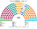
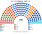
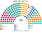

# 估計結果

> 席次**表**：§1 近期大選、§2 民調、§3 長期。國會兩夾相同，算法與逐區結果見 [`../共用/14`](../共用/14-近期大選重算.md)；圖見 [`../共用/席次圖.md`](../共用/席次圖.md)。

選制：國會 **160＝單一 96（top-3 孔多賽）＋複數 64（5 區＋海外、聖拉古、無門檻）**；法律 ≥81；組織法全院 ≥96 **且**複數 ≥39。總統：全國 top-3 孔多賽。

## 1 近期大選

### 2026-04（2021 逐投票桌地理＋2026 各省總統票推估）

| 政黨 | 單一 96 | 複數 64 | **全院 160** |
|---|--:|--:|--:|
| AN 此刻民族 | 30 | 8 | **38** |
| FP 人民力量 | 21 | 12 | **33** |
| PBG 好政府黨 | 17 | 7 | **24** |
| OBRAS | 16 | 6 | **22** |
| RP 人民革新 | 3 | 9 | **12** |
| PPT 全民國家 | 6 | 4 | **10** |
| JP 團結秘魯 | 2 | 7 | **9** |
| 其他、APP、PLG、Pod | 1 | 11 | **12** |

**總統（top-3：Fujimori、Sánchez、López Aliaga）：Keiko Fujimori**，沒有循環。兩兩：Fujimori 對 Sánchez 50.0：50.0（些微勝出）、Fujimori 對 López Aliaga 62.1、Sánchez 對 López Aliaga 55.5。實際決選 Fujimori 50.13。

- 總統的黨 33／160（21%）：法律要再拉至少兩黨；組織法要五黨。
- **人選與現實相同，但差距是刀口**：敏感度下總統在 Fujimori、Sánchez 之間換（[`../共用/14`](../共用/14-近期大選重算.md) §4）。

### 2021-04（ONPE 逐投票桌）

| 政黨 | 單一 96 | 複數 64 | **全院 160** |
|---|--:|--:|--:|
| AP 人民行動 | 22 | 6 | **28** |
| AvP 國家前進 | 23 | 5 | **28** |
| APP 進步聯盟 | 22 | 5 | **27** |
| FP 人民力量 | 9 | 8 | **17** |
| PL 自由秘魯 | 5 | 9 | **14** |
| 其他 8 黨 | 15 | 31 | **46** |

**總統（top-3：Castillo、Fujimori、López Aliaga）：Keiko Fujimori**。兩兩：Fujimori 對 Castillo 52.5、Fujimori 對 López Aliaga 54.6、Castillo 對 López Aliaga 51.1。**實際決選 Castillo 50.13 勝出**：模型偏差 2.6 點，足以讓刀口的勝負翻轉。

- 總統的黨 17／160（11%）。

## 2 民調

2026 年選後沒有可用的政黨或總統民調（維基未建頁），**本夾不做民調重算**。估計結果三來源中的這一項從缺，理由如上。

## 3 長期運行（推估第 3 屆）

假設兩端（RP、JP、AN、FREPAP）各讓出 1/8 第一偏好給居中政黨（PBG、APP 各半），反映 top-3 孔多賽向中間的誘因（`python ../共用/生態模型.py --projection`）。

| 政黨 | 單一 96 | 複數 64 | **全院 160** |
|---|--:|--:|--:|
| PBG 好政府黨 | 34 | 10 | **44** |
| AN 此刻民族 | 21 | 6 | **27** |
| OBRAS | 18 | 6 | **24** |
| FP 人民力量 | 7 | 12 | **19** |
| APP 進步聯盟 | 9 | 3 | **12** |
| 其他 6 黨 | 7 | 27 | **34** |

最大黨 44／160；總統的國會基礎無論誰當選都在三成以下，**預提預算是總統能施政的主要保證**（[`03`](03-行政權預算.md)）。
