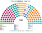
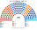
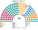

# 估計結果

> 席次**表**：§1 近期大選、§2 民調、§3 長期。國會與總統制夾相同，算法與逐區結果見 [`../共用/14`](../共用/14-近期大選重算.md)；圖見 [`../共用/席次圖.md`](../共用/席次圖.md)。

選制：國會 **160＝單一 96（top-3 孔多賽）＋複數 64（5 區＋海外、聖拉古、無門檻）**；首長、供給 ≥81；組織法全院 ≥96 **且**複數 ≥39。

## 1 近期大選

### 2026-04（2021 逐投票桌地理＋2026 各省總統票推估）

| 政黨 | 單一 96 | 複數 64 | **全院 160** |
|---|--:|--:|--:|
| AN 此刻民族 | 30 | 8 | **38** |
| FP 人民力量 | 21 | 12 | **33** |
| PBG 好政府黨 | 17 | 7 | **24** |
| OBRAS | 16 | 6 | **22** |
| RP 人民革新 | 3 | 9 | **12** |
| PPT 全民國家 | 6 | 4 | **10** |
| JP 團結秘魯 | 2 | 7 | **9** |
| 其他、APP、PLG、Pod | 1 | 11 | **12** |

**首長：OBRAS**（議員之間的孔多賽贏家）。兩兩：對 AN 80：73、對 JP 82：71、對 PBG 89：64、對 FP 108：45、對 RP 108：45。

**組閣聯盟／多數派政府**（由近到遠）：OBRAS＋Pod＋PPT＋APP＋AN＋JP＝82。最大黨 AN（38）不是首長：它在經濟軸上偏左，OBRAS 居中。

元首（直選總統）：Keiko Fujimori（同總統制夾）。

### 2021-04（ONPE 逐投票桌）

| 政黨 | 單一 96 | 複數 64 | **全院 160** |
|---|--:|--:|--:|
| AP 人民行動 | 22 | 6 | **28** |
| AvP 國家前進 | 23 | 5 | **28** |
| APP 進步聯盟 | 22 | 5 | **27** |
| FP 人民力量 | 9 | 8 | **17** |
| PL 自由秘魯 | 5 | 9 | **14** |
| 其他 8 黨 | 15 | 31 | **46** |

**首長：APP**；兩兩：對 AP 95：65、對 SP 94：66、對 FP 135：25、對 PL 140：20。

**組閣聯盟**：APP＋SP＋Pod＋AP＋VN＋AvP＝104。中間偏右六黨。

元首：Keiko Fujimori（模型；實際 Castillo 50.13，見總統制夾）。

## 2 民調

2026 年選後沒有可用的政黨民調（維基未建頁），**本夾不做民調重算**。

## 3 長期運行（推估第 3 屆）

兩端（RP、JP、AN、FREPAP）各讓出 1/8 第一偏好給居中政黨（PBG、APP 各半）。

| 政黨 | 單一 96 | 複數 64 | **全院 160** |
|---|--:|--:|--:|
| PBG 好政府黨 | 34 | 10 | **44** |
| AN 此刻民族 | 21 | 6 | **27** |
| OBRAS | 18 | 6 | **24** |
| FP 人民力量 | 7 | 12 | **19** |
| APP 進步聯盟 | 9 | 3 | **12** |
| 其他 6 黨 | 7 | 27 | **34** |

**首長：AN**；組閣聯盟 AN＋JP＋PBG＋OBRAS＝102（中間偏左）。
