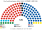

# 估計結果

> **這檔是什麼**：民意套本夾選制的席次**表**（如組閣聯盟／多數派政府）——§1 近期大選、§2 民調（若有）、§3 長期。圖庫見 [`席次圖.md`](席次圖.md)；大選算法細節見本夾重算檔。朝野互動見「預期政治生態」。

選制摘要：全院 **120＝單一 72（top-3 孔多賽）＋複數 48（4 區彈性名單、聖拉古、無門檻、平行）**。詳 [`01`](01-國會與選制.md)。

## 1 近期大選（與現實 MMP 對照）

細節見 [`14-近期大選重算.md`](14-近期大選重算.md)。第一偏好＝投票所政黨票（校準官方選區總票）。

| 屆 | 現實 MMP | **本夾全院 120** | 現實執政 | 本夾首長 |
|---|---|---|---|---|
| 2023-10 | 122 席；國家 48… | 國家 **65**、工黨 40、綠 6… | 國家＋行動＋優先 | **國家黨**（單獨） |
| 2020-10 | 工黨 65… | 工黨 **92**、國家 19… | 工黨單獨 | **工黨**（單獨） |
| 2017-09 | 國家 56… | 國家 **64**、工黨 48… | **工黨＋優先＋綠** | **國家黨**（單獨）← 與現實不同 |
| 2014-09 | 121 席；國家 60… | 國家 **83**、工黨 26… | 國家＋行動＋聯合未來 | **國家黨**（單獨） |

### 2023-10 單一／複數

| 政黨 | 現實 | 單一 | 複數 | **本夾** |
|---|--:|--:|--:|--:|
| 國家黨 | 48 | 46 | 19 | **65** |
| 工黨 | 34 | 26 | 14 | **40** |
| 綠黨 | 15 | 0 | 6 | **6** |
| 紐西蘭優先 | 8 | 0 | 4 | **4** |
| 行動黨 | 11 | 0 | 4 | **4** |
| 毛利黨 | 6 | 0 | 1 | **1** |

**組閣聯盟／多數派政府**：首長 **國家黨**；單獨 **65**（過半 61）；改規則要複數 ≥29。

### 2020-10

| 政黨 | 現實 | 單一 | 複數 | **本夾** |
|---|--:|--:|--:|--:|
| 工黨 | 65 | 66 | 26 | **92** |
| 國家黨 | 33 | 6 | 13 | **19** |
| 綠黨 | 10 | 0 | 4 | **4** |
| 行動黨 | 10 | 0 | 4 | **4** |
| 紐西蘭優先 | 0 | 0 | 1 | **1** |

**組閣聯盟／多數派政府**：首長 **工黨**；單獨 **92**。

### 2017-09

| 政黨 | 現實 | 單一 | 複數 | **本夾** |
|---|--:|--:|--:|--:|
| 國家黨 | 56 | 42 | 22 | **64** |
| 工黨 | 46 | 30 | 18 | **48** |
| 紐西蘭優先 | 9 | 0 | 4 | **4** |
| 綠黨 | 8 | 0 | 4 | **4** |

**組閣聯盟／多數派政府**：首長 **國家黨**；單獨 **64**。現實執政的工＋優＋綠本夾過不了半。

### 2014-09

| 政黨 | 現實 | 單一 | 複數 | **本夾** |
|---|--:|--:|--:|--:|
| 國家黨 | 60 | 59 | 24 | **83** |
| 工黨 | 32 | 13 | 13 | **26** |
| 紐西蘭優先 | 11 | 0 | 5 | **5** |
| 綠黨 | 14 | 0 | 4 | **4** |
| 保守黨 | 0 | 0 | 2 | **2** |

**組閣聯盟／多數派政府**：首長 **國家黨**；單獨 **83**；總席固定 120（現實 121 超額）。

## 2 民調

**方法**：[`民調重算.py`](民調重算.py)。來源 [`資料/polls.csv`](資料/polls.csv)（2026-11-07 大選前的政黨票民調，摘自 Wikipedia 民調彙整頁，2026-11-03 抓取）。以 **2023-10 投票所地理**縮放（每黨在每個投票所的票 × 民調份額／2023 份額；民調沒列的保守黨等併入「其他」），跑本夾的單一 72 top-3 孔多賽與複數 48 聖拉古。

| 民調 | 政黨票 % | **本夾全院 120** | 單一 72 | 首長 | 組閣 |
|---|---|---|---|---|---|
| RNZ–Reid Research（2026-10-20..26） | 國家 24.8、工黨 30.6、綠 14.5、機會 7.2、行動 10.1、優先 9.9 | 工黨 53、國家黨 46、綠黨 7、紐西蘭優先 5、行動黨 5、機會黨 4 | 工黨 38、國家 34 | **工黨**（對機會黨 60:60，平手規則） | 工黨＋機會＋綠 64 |
| 1 News–Verian（2026-10-21..25） | 國家 28.9、工黨 27.3、綠 14.8、行動 12.4、優先 10、機會 6.3 | 國家黨 55、工黨 43、綠黨 7、行動黨 6、紐西蘭優先 5、機會黨 4 | 國家 42、工黨 30 | **國家黨**（對工黨 66:54） | 國家＋優先＋行動 66 |
| The Post/Freshwater（2026-10-09..19） | 國家 27.6、工黨 28.7、綠 14.3、優先 11.8、行動 9、機會 5.4 | 國家黨 51、工黨 49、綠黨 6、紐西蘭優先 5、機會黨 4、行動黨 4、毛利黨 1 | 國家 37、工黨 35 | **國家黨**（對工黨 60:60，平手規則） | 國家＋優先＋行動＋機會 64 |
| Taxpayers' Union–Curia（2026-10-01..05） | 國家 28.5、工黨 28.2、綠 13.3、優先 12、行動 9.2、機會 4.8 | 國家黨 56、工黨 44、綠黨 6、紐西蘭優先 5、行動黨 5、機會黨 4 | 國家 42、工黨 30 | **國家黨**（對工黨 66:54） | 國家＋優先 61 |

**讀法**：

- **單一 72 席只有國家黨與工黨**：兩黨各 24–31%，每一區的三人決選裡都有兩大黨之一當孔多賽贏家；綠、行動、優先、機會全靠名單層（各 4–7 席）。
- **首長取決於兩大黨誰多幾席**：三份民調是國家黨，RNZ–Reid（工黨領先 5.8 點）是工黨。Freshwater 與 Reid 兩版首長對決都是 **60:60**，靠平手規則決定——本夾在兩大黨拉鋸時，翼側小黨的排序幾乎不起作用，因為它們合計只有 20 席左右。
- 現行 MMP 下這些民調都是「國家＋行動＋優先」對「工黨＋綠＋機會＋毛利」的懸峙；本夾因單一席次放大兩大黨，大黨只需一兩個夥伴。

## 3 長期運行假設下

以 2023 套新制為第 3 屆示意。投票所孔多賽下大黨單一溢價更大（綠／行動／毛利幾乎只靠名單）；**2017 仍顯示執政結果可與 MMP 相反**。朝野互動見 [`12`](12-預期政治生態.md)。
