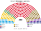
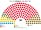
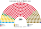
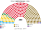

# 估計結果

> **這檔是什麼**：民意套本夾選制的席次**表**（如組閣聯盟／多數派政府）——§1 近期大選、§2 民調（若有）、§3 長期。圖庫見 [`席次圖.md`](席次圖.md)；大選算法細節見本夾重算檔。朝野互動見「預期政治生態」。

選制摘要：全院 **300＝單一 180（top-3 孔多賽）＋複數 120（彈性名單、國內 10 區＋海外 1 區、無法定門檻）**。詳 [`01`](01-國民議會與選制.md)。

## 1 近期大選

用當時實際得票套本夾。細節與方法見 [`14-近期大選重算.md`](14-近期大選重算.md)（[`生態模型.py`](生態模型.py)）。

| | 現實 | **本夾全院 300** |
|---|---|---|
| 2024-12 國會 | 眾議院 331：PSD 86、AUR 63、PNL 49、USR 40、SOS 28、POT 24、UDMR 22、少數族群保障 19；參議院 134 | **PSD 148**、AUR 51、PNL 37、USR 24、UDMR 16、SOS 12、POT 12 |

### 2024-12 單一／複數

| 政黨 | 單一 180 | 複數 120 | **全院** |
|---|--:|--:|--:|
| PSD | 118 | 30 | **148** |
| AUR | 29 | 22 | **51** |
| PNL | 18 | 19 | **37** |
| USR | 7 | 17 | **24** |
| UDMR | 8 | 8 | **16** |
| SOS | 0 | 12 | **12** |
| POT | 0 | 12 | **12** |

**組閣聯盟／多數派政府**：首長 **PSD**；執政多數 PSD＋PNL＝**165**（過半 151；＋UDMR＝201）；複數 57＜72，改規則要拉 USR。

PSD 全院 148，差 3 過半（≥151）。PSD＋PNL＋UDMR＝201，複數 57＜72——改組織法／修憲要拉 USR。總統 top-3 見 [`14`](14-近期大選重算.md) §2。

## 2 民調

公開全國投票意向（CURS；另列生態檔 2026-10 彙整平均）。

方法：民調得票率當全國第一偏好，套本夾生態模型——**單一 180** top-3 孔多賽、**複數 120** 聖拉古（不是全國比例拆單一）。SENS／ACT 併入「其他」。刀鋒 INSCOP 見 [`席次圖-刀鋒-INSCOP.svg`](席次圖-刀鋒-INSCOP.svg)。

### CURS（2026-10-22..27，n＝1068）

首長 **PSD**。

| 政黨 | 得票推估% | 單一 180 | 複數 120 | 本夾全院 |
|---|--:|--:|--:|--:|
| PSD | 26% | 142 | 37 | **179** |
| AUR | 34% | 19 | 46 | **65** |
| PNL | 16% | 12 | 20 | **32** |
| UDMR | 5% | 7 | 5 | **12** |
| USR | 8% | 0 | 11 | **11** |
| SOS | 2% | 0 | 1 | **1** |
| 其他 | 9% | 0 | 0 | **0** |

### 2026-10 彙整平均（生態檔採用；PolitPro 等）

首長 **PSD**。

| 政黨 | 得票推估% | 單一 180 | 複數 120 | 本夾全院 |
|---|--:|--:|--:|--:|
| PSD | 22.9% | 102 | 31 | **133** |
| AUR | 35.8% | 60 | 48 | **108** |
| PNL | 16.9% | 11 | 21 | **32** |
| UDMR | 5.1% | 7 | 6 | **13** |
| USR | 8.2% | 0 | 12 | **12** |
| POT | 2.3% | 0 | 1 | **1** |
| SOS | 2.9% | 0 | 1 | **1** |
| 其他 | 5.9% | 0 | 0 | **0** |

## 3 長期運行假設下

生態模型示意 **下一屆（2028）**，得票取 2026-10 民調平均（假設見 [`12-預期政治生態.md`](12-預期政治生態.md)；數字由 [`生態模型.py`](生態模型.py) 算出）。

| 政黨 | 單一 180 | 複數 120 | 全院 300 |
|---|--:|--:|--:|
| PSD | 102 | 31 | **133** |
| AUR | 60 | 48 | **108** |
| PNL | 11 | 21 | **32** |
| UDMR | 7 | 6 | **13** |
| USR | 0 | 12 | **12** |
| SOS | 0 | 1 | **1** |
| POT | 0 | 1 | **1** |
| **計** | **180** | **120** | **300** |

首長：PSD（對 AUR 最弱一場約 190:110）。PSD＋PNL＝165 過半。無一黨單獨過複數 3/5（72）。刀鋒（INSCOP）見 [`席次圖-刀鋒-INSCOP.svg`](席次圖-刀鋒-INSCOP.svg)。
朝野互動與候選人行為見 [`12-預期政治生態.md`](12-預期政治生態.md)。
