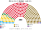
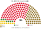
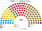
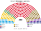
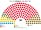

# 席次圖

> **這檔是什麼**：仿維基席次**圖庫**（長期示意；有則附大選重算／現行圖）。席次**數字表**與民調見 [`估計結果.md`](估計結果.md)；大選算法細節見本夾 `*大選重算*`／`*近期大選*` 檔。朝野互動見「預期政治生態」。

數字來自 [`生態模型.py`](生態模型.py)；產生器：席次圖產生器。座位依**地緣軸**由左（親歐盟）到右（主權派）排列。

## 下一屆（2026-10 民調平均推估）

### 全院 300

### 單一席次 180

### 複數席次 120

| 政黨 | 單一 180 ★ | 複數 120 | **全院** |
|---|--:|--:|--:|
| AUR | 61 | 41 | **102** |
| PSD | 47 | 31 | **78** |
| PNL | 29 | 19 | **48** |
| USR | 14 | 10 | **24** |
| UDMR | 9 | 6 | **15** |
| SENS | 5 | 4 | **9** |
| SOS | 4 | 2 | **6** |
| ACT | 4 | 2 | **6** |
| 其他 | 7 | 5 | **12** |

過半 **151**、3/5 **180**、2/3 **200**。首長：PSD 人選。AUR 在約 85 區第一偏好第一，其中 80 區輸給 PSD（[`12`](12-預期政治生態.md) §5.2）。複數 3/5 **72**——無一黨單獨過。★單一為比例示意，非正式逐區 Condorcet。

## 2024-12 得票套新制

細節見 [`14`](14-近期大選重算.md)。

### 全院 300

### 單一席次 180

| 政黨 | 單一 180 | 複數 120 | **全院** |
|---|--:|--:|--:|
| PSD | 118 | 30 | **148** |
| AUR | 29 | 22 | **51** |
| PNL | 18 | 19 | **37** |
| USR | 7 | 17 | **24** |
| UDMR | 8 | 8 | **16** |
| SOS | 0 | 12 | **12** |
| POT | 0 | 12 | **12** |

PSD 全院 148，差 3 過半；PSD＋PNL＋UDMR＝201，複數 57＜72——改組織法／修憲還要拉 USR。

## 顏色

| 政黨 | 色 |
|---|---|
| USR | 藍 |
| PNL | 黃 |
| UDMR | 綠 |
| PSD | 紅 |
| AUR | 暗金 |
| POT | 紫 |
| SOS | 深藍 |
