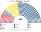

# 預期政治生態

> **席次估計**（近期大選重算、民調套本夾、長期運行假設下的席次表）見 [`估計結果.md`](估計結果.md)。本檔專注誘因、朝野互動與候選人行為；席次數字以估計結果與席次圖為準。

`0-基本/總體.md`：長期預期生態，要有論據，可大膽假設。
`0-基本/要求.md` **硬性**：不得把提示詞要求直接當預期生態。

路徑：**誘因 → 得票 → 選制 → 席次 → 朝野互動 → 檢視**。席次由 [`生態模型.py`](生態模型.py) 算出。

## 1 誘因

| 層 | 誘因 | 預期行為 |
|---|---|---|
| 單一席次（top-3 孔多賽） | 第三名支持者的第二偏好決定勝負 | 義大利最常見的三人組合是 FdI／M5S／PD：**M5S 是左右兩邊都能接受的第二偏好，FdI 是右派過半時的贏家** |
| 無多數獎勵 | 不必選前湊聯盟 | 「中右聯盟」「廣泛陣營」這類選前大聯盟失去理由；政黨各自競選 |
| 彈性名單 | 個人票要達額數 25% | 交換選票的報酬下降 |
| 建設性更新、無解散 | 拆政府不會帶來選舉 | 技術官僚政府、提前改選這兩個出口消失 |

## 2 假設

### 2.1 偏好空間：三軸

| 政黨 | 經濟 | 主權 | 建制 |
|---|:--:|:--:|:--:|
| AVS | −0.8 | −0.5 | 0.0 |
| PD | −0.4 | −0.6 | 0.7 |
| +Europa | 0.2 | −1.0 | 0.5 |
| 第三極（Azione–IV） | 0.3 | −0.7 | 0.5 |
| **M5S** | −0.4 | 0.2 | **−0.6** |
| FI | 0.6 | −0.1 | 0.6 |
| FdI | 0.4 | 0.7 | 0.0 |
| Lega | 0.5 | 0.8 | −0.2 |
| 主權派（Italexit 等） | −0.1 | 1.0 | −0.9 |

選民四型：重經濟、重主權、重建制、均衡，各 25%。2018 年五星 (−0.2, 0.4, −0.8)、Lega 建制 −0.4、FdI −0.2。

★ **建制軸是本模型最敏感的假設**：它決定 PD 選民在 FdI 與 M5S 之間選誰、FdI 選民在 PD 與 M5S 之間選誰。只用二維時 M5S 剛好在中間，2022 年單一 125 席、當首長；加上建制軸後 FdI 單一 151、M5S 60。§6 列出五星在建制軸的三個位置。

### 2.2 地理

內政部逐市鎮×現行單一選區的名單得票，約 7,800 個單位；大區內依現行選區序切新選區（現行單一選區在地理上連續）。

### 2.3 屆次

**推估第 3 屆＝2022 的地理與得票**（不另外假設政黨重組）。

## 3 席次（2022 得票）

| 政黨 | 單一 240 | 複數 160 | **全院 400** | 現行 2022 |
|---|--:|--:|--:|--:|
| FdI | 151 | 44 | **195** | 119 |
| M5S | 60 | 27 | **87** | 52 |
| PD | 21 | 31 | **52** | 69 |
| Lega | 0 | 16 | **16** | 66 |
| 第三極 | 4 | 12 | **16** | 21 |
| FI | 1 | 13 | **14** | 45 |
| 主權派 | 0 | 8 | **8** | 0 |
| AVS | 0 | 6 | **6** | 12 |
| SVP | 3 | 1 | **4** | 3 |
| +Europa | 0 | 2 | **2** | 2 |

門檻：過半 201、3/5 240、2/3 267；複數 3/5 96。

| 地區 | 單一席次 |
|---|---|
| 北部（倫巴底 41、威尼托 21、皮埃蒙特 17 等） | **FdI 幾乎全拿**（倫巴底 37、威尼托 21、皮埃蒙特 15） |
| 紅區（艾米利亞–羅馬涅 19、托斯卡尼 16） | PD 12＋6，FdI 7＋9 |
| 拉齊奧（22） | FdI 18、M5S 2 |
| 南部與島嶼（坎帕尼亞 19、西西里 17、普利亞 15、薩丁尼亞 6 等） | **M5S 為主**（坎帕尼亞 19、西西里 15、普利亞 9） |

- **首長：FdI**（對 M5S 245:155，最弱一場對 AVS 233:167）。
- **組閣陣營**：FdI 195＋Lega 16＝211；或 FdI＋FI 209。
- **Lega、FI 單一 0–1 席**：在北部它們和 FdI 同陣營，三人決選裡 FdI 吸走右派第二偏好。
- **當選者第一偏好中位數 30%**。

## 4 朝野互動與候選人行為

| 面向 | 預期 |
|---|---|
| 組閣 | 30 日內；FdI 只差 6 席，拉 Lega 或 FI 一黨即過半 |
| 立法 | 中右多數；PD 與 M5S 是主要反對 |
| 規則 | FdI＋Lega 複數 60（要 96）：**改選舉法、修憲要拉 PD 或 M5S** |
| 南北 | 北方 FdI、南方 M5S 的地理分裂在單一席次上變得更鮮明 |
| 候選人 | 單一席次的 FdI 候選人要拿第三極、FI 選民的第二偏好；南方的 M5S 候選人要拿 PD 選民的第二偏好 |

## 5 檢視：哪裡不合

本夾的期望：**政府穩定、選舉法不被執政多數改、沒有技術官僚政府、改規則要跨陣營。**四項都對得上。不合的是：

### 5.1 不合一：第一大黨被放大

| | 得票 | 新制全院 |
|---|--:|--:|
| FdI 2022 | 26.2% | **48.8%**（195） |
| M5S 2018 | 32.4% | **55.8%**（223） |

top-3 孔多賽在義大利**放大第一大黨**，因為第一大黨剛好也是孔多賽贏家（2022 年的 FdI 在右派過半的北方；2018 年的 M5S 在南方與中部）。這和保加利亞夾的結果同型：**它防的不是一黨執政，是一黨改規則**。

**檢視後的判斷**：廢除多數獎勵的理由是「42% 換 55% 的席次」；新制下 26% 換到 49%，**放大得更多**。差別在於：

| | 多數獎勵（2026 新法） | 本夾 |
|---|---|---|
| 放大誰 | 選前湊成的聯盟（不論是否真的同意彼此） | 每一區的孔多賽贏家 |
| 能不能改規則 | 獎勵後過半即可改選舉法 | **複數 3/5**：FdI 44／160，改不了 |
| 選後散夥 | 常見 | 不會倒閣 |

所以本夾保留這個放大，**加強「改規則要兩種多數」**：選制從普通法律升到組織法並入憲（[`05`](05-憲法與修憲.md)），這是看到這張表後確認的設計。

### 5.2 不合二：Lega、FI 在單一席次消失

兩黨合計 2022 年得票 17%，新制 30 席（全在名單層）。它們的選民在三人決選裡把 FdI 排第一或第二，**右派的第二偏好集中到 FdI**。

## 6 敏感度

| 情境 | 2022 單一 240 | 2022 首長 | 2018 首長 |
|---|---|---|---|
| 基準（五星建制 −0.6） | FdI 151、M5S 60、PD 21 | FdI | M5S |
| 五星建制 −1.0（更反建制） | FdI 190、PD 28、M5S 14 | FdI | M5S |
| 五星建制 −0.2（接近中間） | FdI 110、**M5S 106** | **M5S** | M5S |
| 選民全部重主權 | **M5S 128**、FdI 80 | **M5S** | M5S |
| 選民全部重建制 | FdI 211 | FdI | **Lega** |
| FdI −6 點 | FdI 119、M5S 68、PD 42 | FdI | — |
| FdI +6 點 | FdI 204、M5S 22 | FdI | — |
| 兩輪多數決（前 2 名對決） | FdI 146、M5S 56、PD 32 | FdI | M5S |

★ 首長在大多數情境是第一大黨（2022 FdI、2018 M5S）；但 **2022 年 M5S 對 FdI 的兩兩對決落在假設的範圍內**——若右派選民對五星的反感比基準少，M5S 會成為孔多賽贏家。這一項不能宣稱已知。
