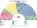
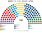
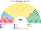

# 席次圖

> **這檔是什麼**：仿維基席次**圖庫**（長期示意；有則附大選重算／現行圖）。席次**數字表**與民調見 [`估計結果.md`](估計結果.md)；大選算法細節見本夾 `*大選重算*`／`*近期大選*` 檔。朝野互動見「預期政治生態」。

數字來自 [`生態模型.py`](生態模型.py)；產生器：席次圖產生器。座位依**主權軸**由左（親歐）到右（主權派）排列。

## 2022-09 得票套新制（＝推估第 3 屆）

### 全院 400

### 單一席次 240

### 複數席次 160

| 政黨 | 單一 240 | 複數 160 | **全院** |
|---|--:|--:|--:|
| FdI | 151 | 44 | **195** |
| M5S | 60 | 27 | **87** |
| PD | 21 | 31 | **52** |
| Lega | 0 | 16 | **16** |
| 第三極 | 4 | 12 | **16** |
| FI | 1 | 13 | **14** |
| 主權派 | 0 | 8 | **8** |
| AVS | 0 | 6 | **6** |
| SVP | 3 | 1 | **4** |
| +Europa | 0 | 2 | **2** |

過半 **201**、3/5 **240**、2/3 **267**。首長 FdI；組閣 FdI＋Lega＝211。複數 3/5 **96**——FdI＋Lega 僅 60，改選舉法／修憲要拉 PD 或 M5S。

## 2018-03 得票套新制

| 政黨 | **全院** |
|---|--:|
| M5S | **223** |
| Lega | **89** |
| PD | **42** |
| FI | **30** |
| FdI | **6** |
| AVS | **4** |
| +Europa | **3** |
| SVP | **3** |

## 顏色

AVS 綠、PD 紅、+Europa 洋紅、第三極 藍紫、M5S 金黃、SVP 黑、FI 天藍、FdI 深藍、Lega 綠、主權派 棕。
