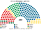
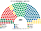

# 近期大選套新制

> 席次一覽與圖見 [`估計結果.md`](估計結果.md)、[`席次圖.md`](席次圖.md)。本檔講**怎麼**套。數字由 [`生態模型.py`](生態模型.py) 算出。

## 1 方法

| 項目 | 來源與做法 |
|---|---|
| 第一偏好 | 正義部 tulospalvelu `ekv-YYYY_puo_maa.csv.zip` 候選人列加總至市鎮×黨 → [`資料/fi-2023.csv`](資料/fi-2023.csv)、[`資料/fi-2019.csv`](資料/fi-2019.csv)（[`_fetch_vaalit.py`](_fetch_vaalit.py)） |
| 驗證 | 2023 年 309 市鎮、有效票 3,095,604；2019 年 311 市鎮、有效票 3,081,916（與官方有效票一致） |
| 區劃 | 現行 vaalipiiri → 八區＋奧蘭（計劃 §3.1）；新地西／東依市鎮清單（見 `生態模型.py` `UUSIMAA_WEST`） |
| 單一 120 | 區內對有效票超過單席目標 0.55 倍之大市鎮（埃斯波、萬塔、圖爾庫、坦佩雷、奧盧、于韋斯屈萊、庫奧皮奧、拉赫蒂等）先等分拆細，再依市鎮代碼序按累積有效票四捨五入切出 $n$ 區；top-3 孔多賽；Ranked Pairs |
| 複數 80 | 八區聖拉古、無法定門檻（奧蘭無複數） |
| 奧蘭 | 源檔政黨列在「其他」→ 單一 1 席記「奧蘭」 |
| 首長 | 全院 200 記名排名，須 ≥101；候選黨 ≥5 席 |

**不是**：現行 d'Hondt 開放名單；補償鎖比例；奧蘭 FPTP 以外的特例算法。

## 2 2023-04-02

實際（200）：聯合 48、芬人 46、社民 43、中間 23、綠 13、左翼 11、瑞典人民 9、基民 5、現在運動 1、奧蘭 1；**Orpo（聯合＋芬人＋瑞典人民＋基民）**。

| 政黨 | 實際 200 | 單一 120 | 複數 80 | **新制 200** |
|---|--:|--:|--:|--:|
| **聯合黨** | 48 | 65 | 18 | **83** |
| 社民黨 | 43 | 21 | 18 | **39** |
| 中間黨 | 23 | 29 | 9 | **38** |
| 芬人黨 | 46 | 0 | 17 | **17** |
| 瑞典人民黨 | 9 | 4 | 3 | **7** |
| 綠黨 | 13 | 0 | 7 | **7** |
| 左翼聯盟 | 11 | 0 | 5 | **5** |
| 基民黨 | 5 | 0 | 3 | **3** |
| 奧蘭 | 1 | 1 | 0 | **1** |
| 現在運動 | 1 | 0 | 0 | **0** |

- **各區單一席次**：赫爾辛基（14）社民黨 14；新地西（11）聯合黨 8、社民黨 2、瑞典人民黨 1；新地東（11）聯合黨 10、瑞典人民黨 1；西南（15）聯合黨 10、社民黨 4、中間黨 1；海梅皮爾卡（20）聯合黨 20；東南薩沃（18）中間黨 9、聯合黨 9；瓦薩中芬（16）中間黨 9、聯合黨 4、瑞典人民黨 2、社民黨 1；北部（14）中間黨 10、聯合黨 4；奧蘭（1）奧蘭 1。
- **單一統計**：孔多賽循環 0 區；非第一偏好最多者當選 81 區；第一偏好過半 2 區；當選者第一偏好中位數 22.4%。
- **首長中間黨**（對聯合黨 114∶86、對社民黨 141∶59）；組閣 **中間＋聯合＝121**；複數合計 27（就算再加社民黨也只有 45＜48），改不了組織法（[`05`](05-法規位階與修憲.md)）。

## 3 2019-04-14

實際（200）：社民 40、芬人 39、聯合 38、中間 31、綠 20、左翼 16、瑞典人民 9、基民 5、現在運動 1、奧蘭 1；**Rinne／Marin 五黨**（社民＋中間＋綠＋左翼＋瑞典人民）。

| 政黨 | 實際 200 | 單一 120 | 複數 80 | **新制 200** |
|---|--:|--:|--:|--:|
| **聯合黨** | 38 | 43 | 14 | **57** |
| 中間黨 | 31 | 42 | 11 | **53** |
| 社民黨 | 40 | 30 | 15 | **45** |
| 芬人黨 | 39 | 0 | 15 | **15** |
| 綠黨 | 20 | 0 | 12 | **12** |
| 瑞典人民黨 | 9 | 4 | 4 | **8** |
| 左翼聯盟 | 16 | 0 | 6 | **6** |
| 基民黨 | 5 | 0 | 3 | **3** |
| 奧蘭 | 1 | 1 | 0 | **1** |

- **各區單一席次**：赫爾辛基（14）社民黨 14；新地西（11）聯合黨 6、社民黨 5；新地東（11）聯合黨 10、瑞典人民黨 1；西南（15）聯合黨 7、中間黨 4、社民黨 4；海梅皮爾卡（20）聯合黨 14、社民黨 6；東南薩沃（18）中間黨 14、聯合黨 4；瓦薩中芬（16）中間黨 10、瑞典人民黨 3、聯合黨 2、社民黨 1；北部（14）中間黨 14；奧蘭（1）奧蘭 1。
- **單一統計**：循環 0 區；非第一偏好最多者當選 68 區；第一偏好過半 2 區；當選者第一偏好中位數 20.9%。
- **首長中間黨**（對社民黨 128∶72、對聯合黨 140∶60）；組閣 **中間＋聯合＝110**（或中間＋社民＋瑞典人民＝106）。

## 4 2024 總統（全國層）

第一輪前三：Stubb 27.2%、Haavisto 25.8%、Halla-aho 19.0%。以黨位置代理候選人距離排序做 top-3 孔多賽 → **Stubb**（Halla-aho 次偏好偏 Stubb）。top-4 納入 Rehn 15.3%：首長仍 Stubb。

**限制**：非逐市鎮；待 Tilastokeskus／正義部市鎮層總統票後可重跑。

## 5 民調

見 [`估計結果.md`](估計結果.md) §2、[`民調重算.py`](民調重算.py)、[`資料/polls.csv`](資料/polls.csv)。2023 市鎮地理縮放；奧蘭單位不縮放。

## 6 敏感度（`python 生態模型.py --sweep`）

| 假設 | 2023 單一 120 | 2023 首長 | 2019 單一 120 | 2019 首長 |
|---|---|---|---|---|
| 基準 | 聯合黨 65、中間黨 29、社民黨 21、瑞典人民黨 4、奧蘭 1 | 中間黨 | 聯合黨 43、中間黨 42、社民黨 30、瑞典人民黨 4、奧蘭 1 | 中間黨 |
| 全部重經濟 | 芬人黨 57、中間黨 29、社民黨 18、瑞典人民黨 8、聯合黨 7、奧蘭 1 | 中間黨 | 中間黨 42、芬人黨 35、社民黨 25、瑞典人民黨 9、聯合黨 8、奧蘭 1 | 中間黨 |
| 全部重文化 | 聯合黨 66、中間黨 29、社民黨 23、奧蘭 1、瑞典人民黨 1 | 中間黨 | 聯合黨 43、中間黨 42、社民黨 31、瑞典人民黨 3、奧蘭 1 | 中間黨 |
| 全部均衡 | 聯合黨 66、中間黨 29、社民黨 19、瑞典人民黨 5、奧蘭 1 | 中間黨 | 聯合黨 43、中間黨 42、社民黨 28、瑞典人民黨 6、奧蘭 1 | 中間黨 |
| 切線位移半區 | 聯合黨 63、中間黨 30、社民黨 22、瑞典人民黨 4、奧蘭 1 | 中間黨 | 中間黨 42、聯合黨 41、社民黨 31、瑞典人民黨 5、奧蘭 1 | 中間黨 |

只有當全體選民「全部重經濟、忽視文化軸」時，經濟位置居中的芬人黨才會拿到大量單一席；在文化軸有權重的基準、重文化、均衡與切線位移下，單一席次結構與首長（中間黨）皆高度穩定。
