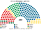
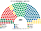
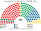
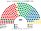

# 估計結果

> 席次**表**——§1 近期大選、§2 民調、§3 長期。圖庫見 [`席次圖.md`](席次圖.md)；算法見 [`14`](14-近期大選重算.md)、[`生態模型.py`](生態模型.py)、[`民調重算.py`](民調重算.py)。

選制：全院 **200＝單一 120（本土 119＋奧蘭 1，top-3 孔多賽）＋複數 80（八區聖拉古、無門檻）**；首長、供給 ≥101；組織法全院 ≥120 且複數 ≥48。詳 [`01`](01-國會與選制.md)。

## 1 近期大選

正義部 tulospalvelu 市鎮×黨得票（[`資料/`](資料/README.md)）。

| | 實際（200） | **本夾全院 200** | 首長 | 組閣 |
|---|---|---|---|---|
| 2023-04 | 聯合 48、芬人 46、社民 43、中間 23…；Orpo 中右 | **聯合 83、社民 39、中間 38、芬人 17、瑞典人民 7、綠 7、左翼 5、基民 3、奧蘭 1** | **中間黨** | 中間＋聯合＝121 |
| 2019-04 | 社民 40、芬人 39、聯合 38、中間 31…；Rinne／Marin 五黨 | **聯合 57、中間 53、社民 45、芬人 15、綠 12、瑞典人民 8、左翼 6、基民 3、奧蘭 1** | **中間黨** | 中間＋聯合＝110 |

| 政黨 | 單一 120 | 複數 80 | **全院** |
|---|--:|--:|--:|
| 聯合黨 | 65 | 18 | **83** |
| 社民黨 | 21 | 18 | **39** |
| 中間黨 | 29 | 9 | **38** |
| 芬人黨 | 0 | 17 | **17** |
| 瑞典人民黨 | 4 | 3 | **7** |
| 綠黨 | 0 | 7 | **7** |
| 左翼聯盟 | 0 | 5 | **5** |
| 基民黨 | 0 | 3 | **3** |
| 奧蘭 | 1 | 0 | **1** |

**組閣聯盟／多數派政府**：首長 **中間黨**；**中間＋聯合＝121**。組織法：組閣複數 27（就算再加社民黨也僅 45＜48），改不了。

| 政黨 | 單一 120 | 複數 80 | **全院** |
|---|--:|--:|--:|
| 聯合黨 | 43 | 14 | **57** |
| 中間黨 | 42 | 11 | **53** |
| 社民黨 | 30 | 15 | **45** |
| 芬人黨 | 0 | 15 | **15** |
| 綠黨 | 0 | 12 | **12** |
| 瑞典人民黨 | 4 | 4 | **8** |
| 左翼聯盟 | 0 | 6 | **6** |
| 基民黨 | 0 | 3 | **3** |
| 奧蘭 | 1 | 0 | **1** |

**組閣聯盟／多數派政府**：首長 **中間黨**；**中間＋聯合＝110**。組織法：組閣複數 25，改不了。

## 2 民調

**方法**：[`民調重算.py`](民調重算.py)；來源 [`資料/polls.csv`](資料/polls.csv)（維基 Opinion polling for the 2027 Finnish parliamentary election；Yle／Taloustutkimus、HS／Verian 各取最新一筆；以 2023 市鎮地理縮放，奧蘭單位原樣保留）。

| 民調 | 投票意向（前五） | **本夾全院 200** | 單一 120 | 首長 | 組閣（機械） |
|---|---|---|---|---|---|
| Taloustutkimus／Yle（2026-10-12..11-03） | 社民 22.9、芬人 16.7、聯合 15.4、左翼 12.6、中間 12.2 | **社民 77**、中間 42、聯合 38、芬人 15、左翼 12、綠 8、瑞典人民 5、基民 2、奧蘭 1 | 社民 58、中間 33、聯合 25、瑞典人民 3、奧蘭 1 | **社民黨** | 社民＋奧蘭＋瑞典人民＋中間＝125 |
| Verian／HS（2026-09-15..10-19） | 社民 23.3、聯合 16.2、芬人 15.3、中間 13.8、左翼 11.6 | **社民 65**、中間 53、聯合 42、芬人 13、左翼 11、綠 8、瑞典人民 5、基民 2、奧蘭 1 | 社民 46、中間 43、聯合 27、瑞典人民 3、奧蘭 1 | **中間黨** | 中間＋聯合＋基民＋奧蘭＋社民＝163（最小過半：中間＋社民＝118） |

**讀法**：「組閣」是由首長往外依偏好距離加黨到 ≥101 的機械結果，不是預測。當社民黨拉開領先且左翼／綠黨席次成長（Taloustutkimus：社民 77＋左翼 12＋綠 8＋RKP 5＋奧蘭 1＝103 ≥ 101），首長即由中間黨轉歸 **社民黨**；Verian 中左合計 100 席差 1 席過半，首長仍為中間黨。

## 3 第 3 屆（誘因略調）

| 政黨 | 單一 120 | 複數 80 | **全院** |
|---|--:|--:|--:|
| 聯合黨 | 67 | 19 | **86** |
| 社民黨 | 20 | 19 | **39** |
| 中間黨 | 28 | 9 | **37** |
| 芬人黨 | 0 | 15 | **15** |
| 瑞典人民黨 | 4 | 4 | **8** |
| 綠黨 | 0 | 6 | **6** |
| 左翼聯盟 | 0 | 5 | **5** |
| 基民黨 | 0 | 3 | **3** |
| 奧蘭 | 1 | 0 | **1** |

首長 **中間黨**；組閣 **中間＋聯合＝123**。複數合計（28）仍遠低於 48。
